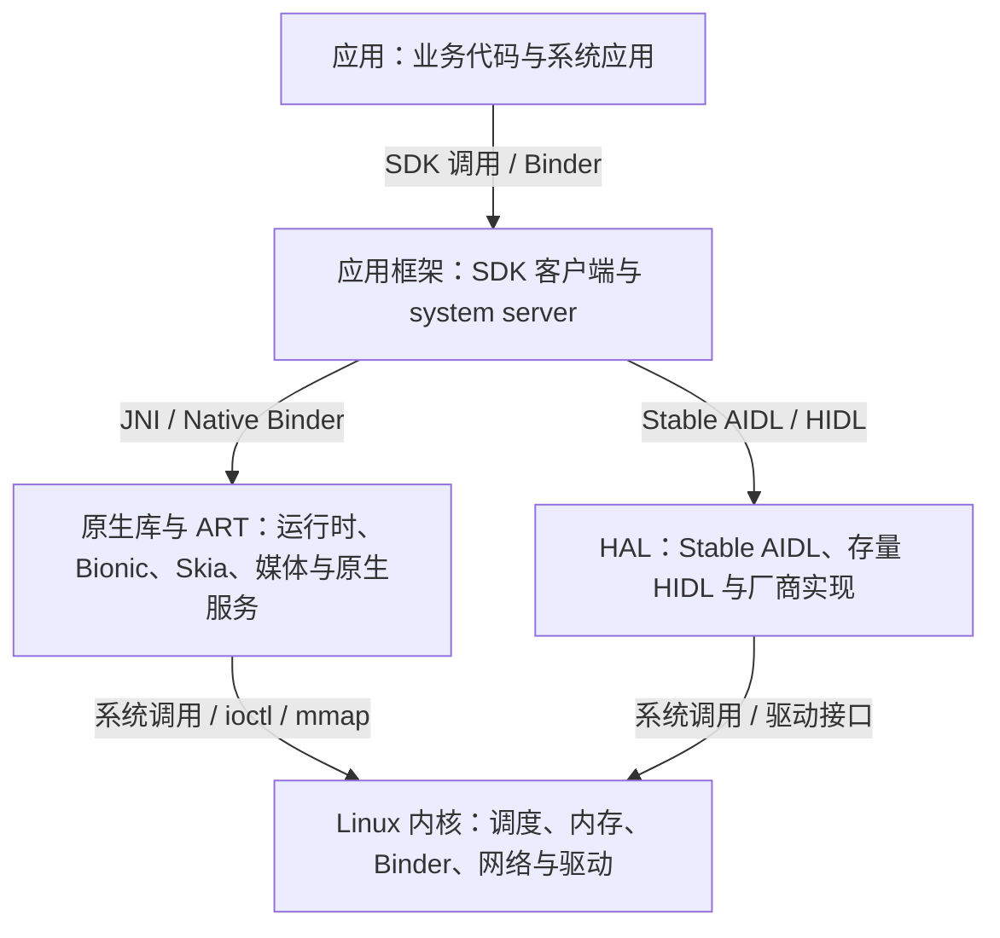

# Android 系统架构

> 本文解释 Android 的职责分层、进程边界、跨层接口和平台组件。启动全链路见 [Android 系统启动](02-系统启动.md)，系统服务进程见 [system_server](04-SystemServer.md)，硬件抽象层见 [HAL](05-HAL.md)。事实以对应平台版本的 Android Open Source Project（AOSP）实现和官方架构文档为准。Q 序列即结构，供 Atlas 同源直读。

**Q1: [done] Android 的五层架构分别承担什么职责，每一层都有哪些典型组件？**

Android 的五层是按组件职责组织的架构视图，不是五个进程，也不意味着请求必须逐层经过。典型分层从上到下如下：



1. **应用层：**应用组件和业务代码，如 Activity、View/Compose、应用线程与应用自带的 Native 库。
2. **应用框架层：**供应用使用的 API（Application Programming Interface，应用程序接口），以及 ActivityTaskManager、WindowManager、PackageManager 等系统服务。API 客户端类通常运行在调用应用进程，服务端通常运行在 `system_server`。
3. **Android Runtime 与原生库：**Android Runtime（ART）执行和管理应用字节码；原生库提供通用平台能力，如 Bionic、Skia、SQLite 和 libbinder。SurfaceFlinger、AudioFlinger 等原生服务通常以独立进程运行。
4. **HAL（Hardware Abstraction Layer，硬件抽象层）：**定义硬件能力的接口并承接厂商实现，使上层能够通过约定接口访问设备能力。HAL 的进程和语言形态取决于接口与实现。
5. **Linux 内核：**提供进程调度、虚拟内存、文件系统、网络、Binder 驱动和设备驱动等内核机制。


**Q2: [done] Android 中 Native 代码、库和服务如何区分？**

Android NDK 文档在应用开发语境中把 C/C++ 代码称为 native code；JNI 文档把 Java/Kotlin 称为 managed code，并说明 JNI 用于两者互调。这里的 Native 指应用中的原生实现，通常编译为设备 ABI 匹配的 `.so` 并加载到进程运行。

Java/Kotlin 代码由 ART 管理；即使 ART 将其编译成机器码，它仍是 managed code。Java/Kotlin 可通过 JNI 调用 Native 实现，但调用不会改变两边代码的归属。

1. **应用 Native 库：**应用进程加载 APK 中的 `.so`，JNI 提供 Java/Kotlin 与 Native 代码的调用接口。
2. **平台 Native 库：**如 Bionic、Skia、SQLite，作为共享库映射到使用它们的进程。
3. **Native 服务：**如 SurfaceFlinger，是独立可执行程序和进程；HAL 常由此类服务实现。Linux 内核代码运行在内核态，不是用户进程中的 Native 库。

依据：Android Developers《Android NDK: Concepts》《JNI tips》《Android ABIs》；AOSP《Architecture overview》。


**Q3: [learning] 一次 Android 请求会按五层顺序传递吗，不同请求实际经过哪些边界？**

不会。五层不是固定调用管线；请求只穿过实际参与的进程和接口。分析时要分别画出控制命令与数据的路径，并区分进程内调用、JNI、IPC（Inter-Process Communication，进程间通信）、共享内存和系统调用。

1. **应用内文件操作：**应用调用 Java/Kotlin API 后，可能经 libcore、Bionic 和系统调用到达内核；它不必先经过 `system_server` 或 HAL。
2. **系统管理操作：**查询系统服务、启动组件或管理窗口时，应用侧 API 通常经 Binder 调用 `system_server` 中的服务。是否再访问 HAL 取决于具体操作。
3. **图形显示：**应用生成图形缓冲区并交给系统合成链路；SurfaceFlinger 收集可见图层，按设备能力使用 GPU（Graphics Processing Unit，图形处理器）客户端合成或委托 HWC（Hardware Composer，硬件合成器）。缓冲区传递和图层控制并不等同于逐层同步函数调用。
4. **相机与音频：**Binder 等 IPC 常承载配置和控制；图像、音频等大块数据可使用共享缓冲区、DMA（Direct Memory Access，直接内存访问）缓冲区、FMQ（Fast Message Queue，快速消息队列）等通路。控制面和数据面需要分别追踪。

JNI 只适合同一进程内的 Java/native 互调，不能跨越进程边界。跨进程则需要 Binder 等 IPC；共享内存减少大块数据复制，但仍须处理缓冲区所有权、同步和生命周期。

依据：AOSP《Graphics architecture》《AIDL for HALs》。


**Q4: [learning] 跨层性能或故障问题应如何定位，怎样避免把调用方误判为根因？**

先建立带时间戳的因果链，再沿实际进程边界追踪；调用方出现长耗时只证明它在等待或执行，不能单独证明哪一层出了问题。定位结论至少要对应到具体进程、线程、接口或等待对象。

1. **固定场景：**记录设备、系统构建、复现步骤、请求或帧的关联标识和目标结果，避免把不同请求拼成一条链。
2. **找出进程边界：**确认调用方和被调用方，以及中间是否有 Binder、JNI、共享缓冲区、驱动或系统服务。
3. **对齐时间线：**使用 Perfetto 等证据关联调用、线程状态、调度、锁、I/O、同步栅栏和下游处理。只有采集到相应事件时，才能据此建立因果关系。
4. **检查阻塞点：**识别线程是在 CPU（Central Processing Unit，中央处理器）上运行、等待 CPU，还是睡眠等待事件；再用唤醒源、栈、Binder 对端、锁或 I/O 证据细化原因。线程状态本身通常不能给出完整根因。
5. **回到实现验证：**把时间片与对应版本源码、接口契约和设备实现对照，确认该片段代表的实际工作。

常见跨层场景可按以下证据链开始：

1. **主线程同步 Binder 耗时：**关联调用方、服务端 Binder 线程和服务端下游等待。若目标线程正在等锁或 I/O，不能仅凭调用方时间片断言 Binder 驱动慢。
2. **SurfaceFlinger 合成变长：**区分客户端合成、硬件合成、GPU 工作和同步栅栏，再查看图层与缓冲区变化。SurfaceFlinger 的耗时变长不自动证明应用绘制慢。
3. **Camera 请求返回慢：**用同一请求标识串起应用、CameraService、HAL、缓冲区和驱动。应用 API 返回慢不等于传感器本身慢。

Perfetto 中常见线程状态只说明线程当时的调度状态：Running 表示正在 CPU 上执行；Runnable 表示可运行但尚未获得 CPU；Sleeping 表示等待事件；Uninterruptible Sleep 表示处于不可中断等待。它们需要与线程栈、唤醒事件和内核证据一起解释，不能直接映射成业务根因。


**Q5: [learning] Android 架构层与 Linux 进程是什么关系，一个应用进程里通常有哪些组件？**

架构层描述职责，进程描述隔离和资源所有权，因此两者是多对多关系。普通应用进程通常同时包含应用代码、Framework 客户端类、ART 和应用所需的原生库。

1. **应用代码：**应用的 DEX（Dalvik Executable）字节码、业务线程，以及 APK（Android application package，Android 应用程序包）携带并加载的 `.so`。
2. **Framework 客户端类：**Activity、View 和系统服务客户端等类由系统运行时环境提供，并在应用进程中执行。构建时的 `android.jar` 是编译期 API stub，不是设备运行时实现。
3. **ART：**为应用提供运行时环境、垃圾回收和线程管理，并可使用解释、JIT（Just-In-Time，即时编译）或 AOT（Ahead-Of-Time，提前编译）等方式执行字节码。
4. **原生依赖：**Bionic、图形或数据库等系统库，以及应用自身的 Native 库，按进程需要映射到该地址空间。

反过来，`system_server` 可同时运行大量 Java 服务和 JNI 代码；SurfaceFlinger 通常是独立 Native 进程；HAL 可运行在独立服务进程，也可能采用同进程实现。判断崩溃、权限和性能归属时，要分别问组件属于什么职责层、运行在哪个进程、调用经过什么边界。


**Q6: [learning] Android 进程与线程有什么区别，同一应用为什么会使用多个进程？**

进程拥有独立的虚拟地址空间和进程级资源；线程是进程内的执行流，共享进程地址空间和大部分进程资源，但有各自的栈、寄存器状态和调度状态。应用组件默认运行在应用主进程，也可通过 `android:process` 等配置运行在其他进程。

1. **隔离：**进程边界可隔离崩溃、权限和部分资源回收影响，但不意味着进程一定独立于应用生命周期或拥有更高优先级。
2. **状态：**静态字段、单例和普通对象缓存只存在于各自进程，不能跨进程共享；通信需要 IPC 或其他跨进程数据机制。
3. **成本：**每个进程都要维护地址空间、运行时和线程等状态，通常增加内存与启动成本。多进程本身不会把主线程工作自动变成后台任务。
4. **命名：**以冒号开头的 `android:process` 值表示应用私有进程名，系统会把它与应用包名组合。进程名不能用于推断线程数、调度优先级或隔离强度。

只有在隔离边界、组件部署或系统约束确有需要时才采用多进程，并为跨进程状态、生命周期和错误恢复设计明确协议。


**Q7: [learning] 16 KB 页大小、Mainline 模块化和 VNDK 弃用分别改变了什么？**

它们影响的是不同兼容边界：16 KB 页大小要求 Native 二进制和打包布局适配；Mainline 使部分系统组件可独立于整机 OTA（Over-the-Air，无线）更新；VNDK 弃用改变了 system/vendor 原生库的分发方式。三者不能互相替代。

1. **16 KB 页大小：**Android 15 起，AOSP 支持使用 16 KB 页的设备。应用只要直接或通过 SDK（Software Development Kit，软件开发工具包）间接依赖 NDK（Native Development Kit，原生开发套件）库，就应检查并按要求重建、测试 Native 库及 APK 对齐。Google Play 要求面向 Android 15（API 35）及以上的应用支持 64 位设备上的 16 KB 页；自 2027 年 2 月 1 日起，不支持 16 KB 页的应用更新不能发布。该分发要求不表示所有 Android 设备都使用 16 KB 页。
2. **Mainline：**部分系统组件以可更新模块分发，可独立于整机系统镜像更新。同一平台版本的设备可能因此运行不同模块版本；诊断模块行为时应记录设备构建信息和相关模块版本。
3. **VNDK（Vendor Native Development Kit，厂商原生开发套件）弃用：**从 Android 15 起弃用该套件。为 Android 15 构建的 vendor/product 分区不再使用 VNDK 版本属性；原 VNDK 库改为按 vendor-available 库安装到 vendor 或 product 镜像。既有较旧 vendor 镜像仍可能依赖旧 VNDK。弃用 VNDK 不等于取消 linker namespace 或所有 system/vendor 隔离规则。

版本依据：Android Developers《Support 16 KB page sizes》；AOSP《VNDK overview》《Mainline》。


**Q8: [learning] 为什么不能只看 Android 版本号判断设备上的运行时行为？**

Android 版本号只描述平台基线，应用兼容行为、可更新模块、vendor/HAL 实现和内核都可能独立变化。复现和归因时，应记录与问题相关的实际版本，而不是只写“Android 17”。

1. **平台构建：**记录 build fingerprint、SDK/API level 和构建类型，以确定 Framework 基线。
2. **应用兼容设置：**记录应用 `targetSdkVersion` 和适用的兼容性变更状态，因为部分新行为按目标版本启用。
3. **Mainline 模块：**对依赖模块的行为，记录相关模块版本；平台版本号不能替代模块版本。
4. **vendor 与 HAL：**检查设备实际 VINTF manifest、HAL 接口版本和厂商实现；相同 Framework 版本不保证底层实现一致。
5. **内核：**记录内核 release、GKI（Generic Kernel Image，通用内核映像）/KMI（Kernel Module Interface，内核模块接口）信息及厂商扩展，确认实际调度和驱动实现。

只采集与故障假设相关的维度。完整记录用于复现和缩小差异来源，不能单凭版本字段证明某一项就是根因。


**Q9: [learning] Treble 怎样降低 Framework 与 vendor 的升级耦合，GSI 能证明什么？**

Treble 通过 system/vendor 分区边界和版本化接口约束双方依赖。VINTF（Vendor Interface，厂商接口）汇总设备提供的接口与 Framework 所需接口，兼容性矩阵和 manifest 用于检查双方声明是否匹配。

1. **接口声明：**device manifest 描述设备侧提供的 HAL；framework compatibility matrix 描述 Framework 所需能力。声明匹配是 OTA 兼容判断的一部分。
2. **接口形式：**新 HAL 优先使用 Stable AIDL（Android Interface Definition Language，Android 接口定义语言）；存量 HIDL（HAL Interface Definition Language，HAL 接口定义语言）仍可能存在。接口稳定性和可用后端受所在分区规则约束。
3. **GSI 验证：**GSI（Generic System Image，通用系统映像）提供通用 AOSP system 镜像，可在 Treble 设备上检验通用 Framework 与设备 vendor 接口的协作。它能发现一部分集成问题，但单独刷入 GSI 不证明产品满足全部 CTS（Compatibility Test Suite，兼容性测试套件）/VTS（Vendor Test Suite，厂商测试套件）、认证、厂商扩展或性能要求。

完整兼容性结论还需结合 VINTF 检查、CTS/VTS 和产品自身测试。

依据：AOSP《Vendor interface object》《Generic system images》《AIDL for HALs》。


**Q10: [learning] Android 的进程回收与压缩由哪些角色负责？**

进程重要性评估、进程终止、冻结和 ZRAM 维护是不同职责。诊断时要先确认现象是进程退出、冻结，还是内存页交换/压缩造成的回切成本。

1. **ActivityManager 与 OomAdjuster：**根据组件状态和依赖关系计算进程重要性，并把相应信息提供给系统的内存管理策略。重要性不是简单按进程 RSS（Resident Set Size，常驻集大小）排序。
2. **lmkd（Low Memory Killer Daemon，低内存杀进程守护进程）：**监测内存压力并在需要时选择可回收进程终止。它会综合压力和可用内存等信号，不等同于“杀掉占内存最多的应用”。
3. **Cached App Freezer：**按系统策略冻结符合条件的缓存进程，使其线程暂时不被调度；进程仍保留，冻结与终止是不同状态。
4. **mmd（Memory Management Daemon，内存管理守护进程）：**Android 17 及以上引入的内存管理守护进程，负责配置和持续维护 swap/ZRAM，可执行重压缩、写回等维护操作。它与 `system_server` 的调度决策、lmkd 的终止职责不同。

排查进程退出时看退出原因和 lmkd 证据；进程仍存在但不运行时确认 freezer 状态；回切变慢时再检查 ZRAM 与缺页/写回证据。某一种信号与另一种结果同时出现，不足以单独证明因果。

依据：AOSP《Memory management daemon》《Cached app freezer》《Low memory killer daemon》。


**Q11: [learning] 应用进程常见线程角色有哪些，点击到显示通常经过哪些执行环节？**

应用进程通常有主线程、硬件加速路径中的 RenderThread、接收远程 Binder 调用的线程池，以及应用创建的后台线程。它们不是每个进程都固定具备的一组线程；点击到屏幕显示也不是单线程串行完成。

常见路径从系统已把输入事件路由到应用窗口开始：InputDispatcher 经输入通道投递事件，应用主线程分发输入并执行回调；需要更新界面时，主线程进行 View 遍历并记录绘制内容；硬件加速场景下，RenderThread 准备并提交渲染工作；之后由 GPU、SurfaceFlinger 和显示合成链路完成可见帧。具体工作会受动画、帧合并、缓存和合成策略影响。

1. **主线程：**运行 Looper，处理生命周期、输入分发、View 测量/布局/绘制记录和应用回调。长时间占用会推迟输入或帧工作。
2. **RenderThread：**硬件加速路径使用的渲染线程之一，负责消费绘制记录并准备渲染命令。它与 GPU 执行不是同一件事，主线程也不必等待 GPU 完成整帧才继续所有工作。
3. **Binder 线程：**处理远程进程送来的 Binder 请求或回调。远程 AIDL 方法不保证在主线程执行；实现要按实际线程模型保护共享状态。
4. **后台线程：**线程池、协程调度器或 HandlerThread 承担耗时工作。协程改变任务组织方式，不会自动加速任务；运行在 `Dispatchers.Main` 的代码仍占用主线程。

定位掉帧时要确认耗时发生在主线程、RenderThread、GPU、SurfaceFlinger 还是显示等待上，不能把“点击回调变慢”和“最终上屏变慢”视为同一指标。


**Q12: [learning] ABI 是什么，与 API 有什么区别？**

API（Application Programming Interface，应用程序接口）约定调用方能使用什么功能；ABI（Application Binary Interface，应用二进制接口）约定编译后的二进制如何彼此调用。开发中说“我可以给你提供 API 接口”，通常指提供可调用的功能及其参数、返回值或请求响应约定。

1. **API 示例：**库可以提供 `UserRepository.findById(id)`；服务端也可以提供 `GET /users/{id}`，约定请求参数和 JSON 响应。调用方按约定使用，不必了解内部实现。
2. **ABI 示例：**Android NDK 库需提供与设备兼容的二进制，例如 APK 中 `lib/arm64-v8a/libfoo.so`。ABI 不只指指令集，也包括函数调用约定、符号和数据布局；这些不匹配时，Native 库可能无法加载或正确调用。

API 说明“调用什么、如何使用”，ABI 说明“二进制如何衔接”。API 可兼容而 ABI 不兼容，例如函数声明未变，但 Native 库改用不兼容的调用约定或数据布局。

依据：Android Developers《Android NDK: Concepts》《Android ABIs》。


**Q13: [learning] HAL 通常用什么语言实现，Framework 为什么通过 IPC 而不是 JNI 调用独立 HAL 服务？**

HAL 没有唯一实现语言。常见实现使用 C/C++；AIDL 也可生成 Java、C++、NDK 或 Rust 后端，但 vendor 分区必须遵守对应的稳定接口与运行时规则。JNI 只做进程内互调；当 Framework 与 HAL 位于不同进程时，必须使用 Binder 等 IPC。

1. **设备访问：**HAL 常需调用设备节点、驱动接口或厂商库，因此 Native 实现常见；这只是工程惯例，不是 HAL 的定义条件。
2. **跨分区契约：**system/vendor 之间的 AIDL HAL 使用 Stable AIDL。vendor Native 实现应使用 NDK 后端及稳定的 `libbinder_ndk` 接口，不能依赖不稳定的 C++ `libbinder` API。
3. **数据通路：**Binder 适合控制命令和结构化元数据；图像、音频等大数据可结合共享内存、DMA-BUF（Direct Memory Access Buffer，直接内存访问缓冲区）、FMQ 和同步栅栏。不能把“使用 Binder”理解为所有媒体数据都复制进 Parcel。
4. **历史形态：**旧式 passthrough HAL 可在调用方进程中加载；Treble 后 binderized HAL 是跨分区常见方式。具体设备仍要看接口版本、VINTF 声明和实现。

JNI 不提供进程隔离、服务发现或 IPC 权限边界，因此不能用它替代 Framework 与独立 HAL 服务之间的 Binder 通信。

依据：AOSP《AIDL for HALs》《AIDL backends》《HAL overview》。


**Q14: [learning] C++ Binder、Java Binder 和 hwbinder 是什么关系？**

Java Binder 与 C++ Binder 是 Android Binder IPC 的不同语言接口；它们可以通过 Binder 驱动通信，不代表两套互不相关的 IPC 机制。`hwbinder` 则是历史上供 HIDL HAL 使用的 Binder 设备/上下文，不能把“C++ Binder”等同于 `hwbinder`。

1. **Java Binder：**应用和 Framework Java 代码通常使用 `android.os.Binder`、`IBinder` 与 Java AIDL 生成类。
2. **C++ Binder：**Native 进程可使用 libbinder 的 C++ 接口；稳定跨分区 AIDL 通信应选择适用的 NDK 或 Rust 后端，遵守对应 API 稳定性要求。
3. **hwbinder：**存量 HIDL HAL 可能使用专用 Binder 通道；新的 HAL 接口应按当前 AOSP 规则优先采用 Stable AIDL，不能把旧设备行为外推到所有版本。
4. **数据边界：**例如 AudioTrack 与音频服务之间，Binder 可传控制请求和句柄，PCM（Pulse-Code Modulation，脉冲编码调制）流通常通过共享缓冲区等机制传输，而非把连续音频样本逐次塞入普通 Binder 调用。

分析 Binder 问题时说明进程、语言后端、Binder 设备/上下文和数据通路；只说“原生 Binder 慢”不足以定位故障。

依据：AOSP《AIDL for HALs》《AIDL backends》及对应版本的 Binder 实现。


**Q15: [learning] Android 平台主要使用哪些实现语言，AIDL 和 HIDL 又是什么？**

Android 平台使用 Java、Kotlin、C、C++ 和 Rust 等语言实现不同组件。AIDL 与 HIDL 是接口描述语言，用于声明跨进程接口契约并生成绑定代码，不是与这些实现语言并列的组件语言。

1. **Java 与 Kotlin：**广泛用于 Framework、`system_server` 和应用。Kotlin 与 Java 可在 Android 工具链中互操作；Kotlin 不会替换 ART，也不意味着 Framework 已整体迁移。
2. **C 与 C++：**常用于 Native 库、系统服务、HAL 和工具。Linux 内核以 C 为主，也在受控范围引入 Rust；模块构建约束需按具体 `Android.bp` 配置核对。
3. **Rust：**用于部分平台组件，借用检查可在编译期阻止一类内存错误；`unsafe` 和 FFI（Foreign Function Interface，外部函数接口）边界仍需审查。引入 Rust 不代表既有 C/C++ 代码会整体重写。
4. **AIDL：**描述 IPC 接口，支持 Java、C++、NDK 和 Rust 等后端。具体后端是否适用，取决于模块和分区规则。
5. **HIDL：**用于较早建立的 HAL 接口体系，存量设备仍可能使用；新 HAL 按 AOSP 指引优先使用 Stable AIDL。

不要从语言名称推断层级、隔离方式或安全性。应同时说明实现语言、进程位置和接口契约。

依据：AOSP《AIDL backends》《AIDL for HALs》《HAL overview》及 Android Kernel 文档。


**Q16: [learning] system_server 中有哪些 Native 代码，它们为什么与 Java 服务同进程？**

`system_server` 是一个进程，不是单一语言运行时：其中运行 ART/Java 服务，也可加载 JNI 库和 Native 组件。JNI 让同一进程内的 Java 与 C/C++ 代码互调；进程内共享意味着它们共享进程故障边界。

1. **JNI 胶水：**`frameworks/base/services/core/jni/` 中的实现为部分 Java 系统服务接入 Native 库和系统能力。
2. **Native 子系统：**例如 InputManagerService 通过 JNI 创建 Native 输入管理组件，InputReader 和 InputDispatcher 在独立 Native 线程中处理输入；SensorService 在相应 AOSP 配置下可由 SystemServer 的 Native 初始化路径启动。
3. **服务边界：**Native 组件在 `system_server` 内运行时，与该进程中的 Java 服务共享地址空间和崩溃域；独立 Native 守护进程则有自己的进程边界。

把某组件称为“Native”不表示它一定是独立进程，也不表示它由应用调用。排查时要核对该版本的 JNI 注册、加载入口和实际进程归属。

依据：对应版本 AOSP `frameworks/base/services/core/jni/`、InputFlinger 和 SensorService 实现。


**Q17: [learning] 怎样查看设备上 system_server 当前映射的 .so，为什么它不是固定依赖清单？**

`system_server` 的映射会随 Android 版本、产品配置、启动阶段和按需加载行为变化，因此不存在适用于所有设备的固定 `.so` 清单。`/proc/<pid>/maps` 只能显示采样时刻已映射的对象，适合作为设备现场证据。

在允许读取目标进程 maps 的开发设备上，可用以下命令列出映射路径中包含 `.so` 的条目：

```bash
adb shell 'pid=$(pidof system_server) && cat /proc/$pid/maps' \
  | sed -n 's/^[^ ]* [^ ]* [^ ]* [^ ]* [^ ]* //p' \
  | grep '\.so' \
  | sort -u
```

1. **远端采样：**`pidof system_server` 获取设备端 PID（Process Identifier，进程标识符），`cat` 读取该进程 maps。生产设备可能因权限和 SELinux（Security-Enhanced Linux，安全增强型 Linux）限制拒绝读取；仅在获准 root 的 userdebug/eng 等开发环境使用特权方式。
2. **提取路径：**maps 每行前五项是地址范围、权限、偏移、设备号和 inode；`sed` 去掉这些字段并保留其余路径，避免用固定列号截断带空格的路径。
3. **筛选去重：**`grep` 只保留路径文本包含 `.so` 的映射，`sort -u` 去重。该筛选是便于阅读的近似清单，不包含所有匿名映射或无 `.so` 路径的 Native 映射。
4. **解释来源：**把现场路径与该设备版本的 `SystemServer` 显式加载点、`libandroid_servers` 等构建依赖及动态链接关系对照。按需加载库可能尚未出现，库也可能随后卸载。

命令反映的是采样时刻的映射，不等于源码中的完整依赖闭包，也不能直接说明每个库当前正在执行。


**Q18: [learning] Linux 内核本身能构成完整的 Android 或桌面 Linux 系统吗？**

不能。Linux 内核提供进程、内存、调度、文件系统和驱动等底层机制；用户可交互的系统还需要 init、运行库、守护进程、服务、命令行工具或图形环境等用户空间组件。

1. **Android：**除内核外，还需要 init、Bionic、系统服务、ART、Framework 和应用等组件。
2. **桌面 Linux：**除内核外，还需要用户空间运行库、init/system manager、shell、命令行工具，以及按需提供的图形环境。
3. **命令边界：**`ls` 通常是用户空间可执行程序；`cd` 通常由 shell 内建。启动内核不会自动提供这些程序或 shell 环境。

因此“Linux”在日常语境中可能指内核，也可能指由内核与用户空间组件组成的完整系统；讨论架构时要说清所指范围。
