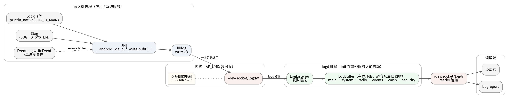

# Android 日志调用、丢弃与 logcat 过滤边界

> 学习资料（文章模式沉淀）。边界：本文回答日志服务的整体架构与设计依据、Android 日志从调用到 logd 的路径、级别过滤能节省的成本、写入丢弃与缓冲区裁剪的区别，以及 logcat 客户端过滤和 logd 读取过滤的边界。R8 构建期删日志与包体积治理归应用 CPU 与体积优化主题。实现细节按 Android 17 语境核对，参考 AOSP `system/logging/liblog`、`system/logging/logd`、`system/logging/logcat` 和 `frameworks/base` 日志实现。Q 序列即结构，供 Atlas 同源直读。

**Q1: [learning] 一条 Log.d() 从调用到 logd 经过哪些步骤？native 级别过滤能省掉哪些成本？**

`Log.d()` 进入 logd 前经过 Java/native 桥和 liblog。native 级别判断能阻止不需要的日志继续传输，但不能撤销调用参数已经完成的构造工作。

1. **Java 入口：**应用调用 `Log.d(tag, message)` 后，Java 日志实现进入 `println_native`。调用参数在进入方法前已经求值，因此拼接字符串、调用对象的 `toString()` 或 JSON 序列化都已经发生。
2. **JNI 转换：**JNI 取得 tag 和 message，并形成供 native 日志接口写入的 Modified UTF-8 数据。
3. **native 级别判断：**`__android_log_buf_write()` 再按 tag 和 priority 执行 loggability 判断。被过滤的日志不会进入后续 socket 写入和 logd 接收路径，但之前的参数构造和 JNI 调用仍可能已经发生。
4. **liblog 写入：**通过过滤的消息由 liblog 的 `LogdWrite()` 组成日志头和 payload，再用 `writev()` 写入 `/dev/socket/logdw`。
5. **logd 接收：**`/dev/socket/logdw` 是 AF_UNIX 数据报 socket。内核附带发送方 PID、UID 和 GID 凭据，客户端不能通过自己填写日志内容伪造这些凭据。logd 的 LogListener 收到数据后交给 LogBuffer 保存。
6. **调用前保护：**高频路径应在格式化前判断，例如先检查 `BuildConfig.DEBUG` 或 `Log.isLoggable(TAG, Log.DEBUG)`，再构造日志参数。若传入方法前已经构造完整 String，仅在外层包装一个函数并不会省掉字符串构造。
7. **单条消息上限：**`LOGGER_ENTRY_MAX_PAYLOAD` 为 4068 字节，native 写入超过上限时会截断。Java `Log.printlns()` 会按字节预算把长文本或异常堆栈拆成多条记录。因此长堆栈会增加 JNI 和 `writev()` 次数，应把包名、请求 ID 等稳定识别信息放在较前位置。
8. **旁路日志：**EventLog 二进制事件写入 events buffer。StatsD atom 从 Android R 起可经独立的 `/dev/socket/statsdw` 送往 statsd，不经过 logd 的普通文本日志链路。

**Q2: [learning] Android 17 的普通日志风暴会因 logd socket 满而阻塞主线程吗？写入丢弃和缓冲区裁剪有什么区别？**

Android 17 的普通日志 buffer 写入使用非阻塞 socket。logd 接收队列满时，普通日志写入会以 `EAGAIN` 返回并丢弃当前消息，不会等 logd 腾出空间。写入端丢弃与 logd 缓冲区满后裁剪旧记录是两个发生位置和时间都不同的机制。

1. **写入端丢弃：**普通 main、system、radio、events、crash 等 buffer 发生 socket 背压时，liblog 遇到 `EAGAIN` 后放弃当前日志并返回。队列恢复后，liblog 可通过 event tag 1006（`liblog`）报告此前累计丢弃数量。不要对 `EAGAIN` 做无间隔重试，重试会加重拥塞。
2. **安全日志例外：**`security` 是受权限控制的特殊 buffer，liblog 为其使用不同的阻塞 socket。不能把普通 buffer 的非阻塞行为推广到所有 buffer 和所有版本。
3. **服务端裁剪：**Android 17 默认使用 serialized buffer。日志按 chunk 序列化并在封存后使用 Zstd 1 级压缩。buffer 超过目标容量时，logd 会从最旧 chunk 开始回收空间，因而被覆盖的是历史记录，不一定是刚写入的新记录。
4. **旧版 chatty 差异：**压缩方案在 Android S 起取代 chatty 重复日志折叠。旧设备看到 chatty 统计不能证明 Android S 及之后的默认实现仍按该方式去重。
5. **日志风暴的实际代价：**即使 socket 写入不等待，应用仍持续支付参数格式化、JNI 和系统调用成本。大量日志也会遮住关键现场或使旧记录更快被裁剪。logd 接收、压缩、回收和向 reader 分发日志也会增加系统负载。
6. **控制写入：**用 `adb logcat -g` 查看 logd 各 ring buffer 当前容量，不会改变容量。随后降低产生日志的频率、合并重复事件并只保留诊断必需字段，而不是一味增大 buffer。

**Q3: [learning] MyApp:V *:S 和 --regex 在哪里过滤？如何减少 logd 发送给 logcat 的日志量？**

tag/priority filter spec 和 `--regex` 都由 logcat 客户端在收到日志后执行，所以主要减少终端输出和后续文本处理，不会自动缩小 logd 已经发来的数据。要缩小传输范围，应先使用 buffer、PID、时间或序号等 logd reader 条件。

1. **客户端 tag/priority 过滤：**filter spec 的形式是 `<tag>[:priority]`。`MyApp:V` 表示对 `MyApp` 标签显示 Verbose 及以上优先级的日志。`*:S` 表示其他标签静默，因此组合后只打印 `MyApp`。这些规则在 logcat 客户端判断。
2. **客户端正则过滤：**`--regex` 在 logcat 读到并解析消息后对 message 执行 ECMAScript 正则匹配。复杂表达式会增加 logcat 客户端 CPU 开销，不是 logd 服务端匹配正则。
3. **reader 范围过滤：**`-b main` 只订阅 main buffer。`--pid=<pid>` 让 logd reader 只读取指定进程 ID 的日志。`-t` 或 `-T` 可限制读取的尾部条数或起始时间，非阻塞和 wrap 模式则影响 reader 的等待方式。
4. **输出格式：**`-v threadtime` 要求 logcat 客户端以 threadtime 格式打印时间、priority、tag、PID 和 TID。它改变输出格式，不会减少 logd 提供的记录。
5. **组合使用：**先按 buffer 和进程缩小 reader 范围，再用 tag 过滤界面输出：

    ```bash
    adb logcat -b main --pid="$(adb shell pidof -s com.example.app)" \
      -v threadtime 'MyApp:V' '*:S'
    ```

    参数分别承担以下作用：

    1. `-b main` 选择 main buffer。
    2. `adb shell pidof -s com.example.app` 在设备上查询该包的一个 PID，外层 `--pid` 把这个 PID 用作 reader 范围条件。
    3. `-v threadtime` 只改变客户端显示字段。
    4. `'MyApp:V' '*:S'` 是客户端 filter spec，只打印 MyApp 标签的日志。

多开 logcat 会建立独立 reader，增加 logd 解压和数据发送工作。若 reader 的读取位置落到已被裁剪的日志范围之后，服务端会跳过不再可用的记录并记录警告。

**Q4: [learning] Android 日志服务整体如何实现？为什么用集中式 logd 进程与有界缓冲，而不是各进程直接写文件？**

Android 日志服务由写入端 API、logd 守护进程和读取端三部分组成：所有进程经 liblog 把日志发给同一个 socket，logd 收下后保存在按用途划分的有界内存缓冲中，logcat 等读取端再从 logd 订阅。集中式设计换来的是全系统统一时序、可信的进程凭据、固定的内存预算和崩溃后仍存的现场，这些恰恰是各进程写文件方案给不了的。

三部分的实现与原理：



图中从左到右依次是写入端进程内的三层 API 与 liblog、内核数据报 socket 与附带的 PID/UID/GID 凭据、logd 的 LogListener 与有界 LogBuffer、读取端的 logcat 与 bugreport。statsd 旁路 socket、kernel 日志与 pstore、security buffer 的阻塞 socket 差异未画，它们都不改变主链路的组成。

1. **写入端分层**：应用侧 android.util.Log 的各级别方法都收敛到 `println_native(LOG_ID_MAIN, priority, tag, msg)`，系统进程的 Slog 复用同一入口但固定写 LOG_ID_SYSTEM，EventLog 的 writeEvent 走 native 写二进制结构化事件。它们最终都进入 JNI 的 `__android_log_buf_write(bufID, priority, tag, msg)`，由 liblog 按 buffer 分发。Java 层定义的 buffer 就有 main、radio、events、system、crash 五种，Android 17 另有受权限控制的 security buffer。
2. **传输与凭据**：liblog 用 `writev()` 把日志写入 AF_UNIX 数据报 socket `/dev/socket/logdw`。内核在每个数据报上附带发送方的 PID、UID、GID 凭据，logd 记录的进程信息由内核背书，客户端在日志内容里自报的进程身份不可信也不被采用。
3. **logd 服务端**：init 在其他服务之前启动 logd，init.rc 的注释写明 "Start logd before any other services run to ensure we capture all of their logs"，因此系统服务启动阶段的首批日志不会丢失。logd 的 LogListener 从 socket 收数据报交给 LogBuffer，按 buffer 分别保存在有界内存中，超出容量从最旧记录开始回收。读取端经 `/dev/socket/logdr` 建立 reader 连接，logcat 从这里拿到跨进程按时间排序的完整流。

为什么这样设计，逐项对应各进程写文件方案的缺陷：

1. **为什么集中到独立进程**：日志一经写入 socket 就离开了应用进程，应用崩溃、被杀或 ANR 后现场仍完整保存在 logd 中，bugreport 与 tombstone 因此能拿到崩溃前的日志。各进程写文件时，用户态缓冲里未落盘的日志会随进程一起消失。
2. **为什么统一入口**：logcat 一个读取端订阅即得全系统按时间交错的日志流，跨进程因果与时序可以直接对照。分散文件需要事后合并 N 个文件，且各进程时间戳来源难以对齐。
3. **为什么有界环形缓冲**：日志的价值随时间衰减，保留最近一段即可满足排查。固定容量把日志的内存成本封顶，覆盖旧记录而不是拒绝新写入，保证最新现场总能留下。写文件方案则需要每进程自实现轮转，磁盘仍可能被写满。
4. **为什么用内存而不是磁盘**：写入路径是一次 socket 系统调用加内存操作，没有同步落盘的 I/O 延迟，高频日志不会拖慢主线程。落盘只按需发生，例如 logcat -f 或 bugreport 时才从缓冲导出。
5. **为什么按用途分 buffer**：电话栈高频日志（radio）、结构化事件（events）、崩溃现场（crash）、系统服务（system）与应用日志（main）分开保存，一类日志的洪流不会冲掉另一类的现场，读取端也可以只订阅关心的 buffer。
6. **为什么数据报 socket 且普通写入非阻塞**：数据报无需维护连接状态，写入端一次调用即完成。logd 忙或满时普通日志按 EAGAIN 丢弃而不是阻塞所有调用方，用丢日志保护应用的主线程与系统吞吐。

依据：Android 13 本地源码的 Log.println_native 与 LOG_ID 常量、Slog 的 LOG_ID_SYSTEM 写入、EventLog.writeEvent、JNI 的 __android_log_buf_write、init.rc 的 logd 启动时机与注释。logd 内部结构（LogListener、LogBuffer、LogReader、缓冲回收）沿用本册 Android 17 语境，对照 AOSP system/logging/logd 与 liblog 实现。
