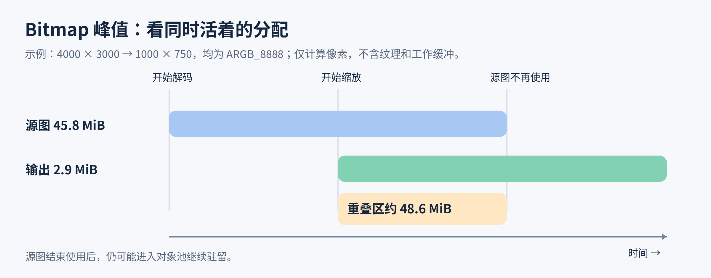

# 图片解码与内存

**Q1: [done] 压缩文件很小，为什么解码后仍可能占大量内存？**

压缩文件大小表示编码数据量，不能代表解码后的 Bitmap 内存。像素内存主要由解码输出尺寸和像素配置决定。

1. **像素内存：**ARGB_8888 每像素 4 字节。4000 × 3000 像素解码后约占 45.8 MiB，与压缩文件大小无关。
2. **输出尺寸与配置：**采样到 2000 × 1500 后，ARGB_8888 约占 11.4 MiB；改用 RGB_565（每像素 2 字节）约占 5.7 MiB。较大 Bitmap 被复用时，分配容量可能仍较大。
3. **峰值内存：**解码并发、临时缓冲和变换副本会叠加到像素内存上；普通解码缓冲通常远小于 Bitmap。

依据为 Android Developers《Loading Large Bitmaps Efficiently》、Android《Bitmap API reference》和 Android 11 BitmapFactory 实现。

**Q2: [done] 怎样减少 Bitmap 解码临时缓冲区的重复分配？**

Android 11 的 BitmapFactory.decodeStream 默认使用约 16 KiB 临时缓冲。频繁解码时，可通过 BitmapFactory.Options.inTempStorage 复用该数组，减少小额重复分配；这不会减少 Bitmap 像素内存。

1. **线程隔离：**每个解码工作线程使用自己的数组，不要让并行解码同时共享。
2. **优化优先级：**先按显示尺寸采样并限制解码并发；临时数组的节省通常很小。

依据为 Android Developers《BitmapFactory.Options》和 Android 11 BitmapFactory.decodeStream 实现。

**Q3: [done] Bitmap 复用为什么可能保留较大的分配容量？**

大 Bitmap 被复用来存放较小结果时，当前像素量会减少，但底层分配容量可能不变；对象留在缓存或池中时，这部分容量仍被占用。

1. **发生条件：**较大可变 Bitmap 经 inBitmap 或 BitmapPool 复用于较小图片时才可能发生，并非每次复用都会保留多余容量。
2. **发现方式：**检查当前尺寸与 getAllocationByteCount；容量明显偏大时，用 Profiler 沿引用链查出持有者，见 Q4。
3. **处理方式：**按目标尺寸解码，并限制池的容量；清理闲置对象时确保没有界面或其他对象仍在使用，见 Q5。

依据为 Android《Bitmap API reference》《BitmapFactory.Options》和 Android Developers《Managing Bitmap Memory》。

**Q4: [done] Android Studio Memory Profiler 怎样判断 Bitmap 由谁持有？**

堆转储能显示 Bitmap 的 Java 包装对象及其引用链；沿引用链可判断它由界面、缓存还是对象池持有。

1. **对比快照：**页面显示时和离开页面或清理缓存后分别抓取 Heap Dump，观察哪些 Bitmap 仍存活。
2. **追踪引用：**筛选 Bitmap 实例并查看 References。引用链到 ImageView/Drawable 通常表示界面持有；到缓存容器或 BitmapPool 则表示缓存或池持有。
3. **判断处置：**离页后仍被旧 View 引用，检查界面生命周期；由缓存或池持有，检查其容量和淘汰策略。同一 Bitmap 可有多个持有者。Android 7.0 及以上还能查看 Native Size，但引用链用于判断对象归属。

依据为 Android Studio《Capture a heap dump》和 Android《Bitmap API reference》。

**Q5: [done] 如何限制或清理过大的 Bitmap 闲置对象？**

为图片缓存和对象池设置字节上限；超限或界面退出时，淘汰可重建且不再使用的 Bitmap。

1. **容量控制：**超限时优先移除过大、少复用的闲置对象；池中优先保留容量接近常见请求的 Bitmap。
2. **生命周期清理：**界面隐藏或应用进入后台时，清除仅供界面使用、可快速重建的图片资源。系统内存回调受 Android 版本影响，只作为补充；缓存和对象池仍需有容量上限。
3. **安全释放：**图片库管理的 Bitmap 使用库提供的清理接口；自行管理的对象先从 View、缓存和对象池解绑，确认不再使用后再 recycle。

依据为 Android《ComponentCallbacks2》、Android《Bitmap API reference》和 Android Developers《Managing Bitmap Memory》。

**Q6: [done] Bitmap 像素数据为什么放在 Native Heap，而不是 Java Heap？**

Android 8.0（API 26）起，普通软件 Bitmap 的 Java 包装对象在 Java 堆，像素缓冲在 Native Heap。这样可避免大块像素数据占用 Java 堆，但只是改变内存归属，进程总内存仍会增加。

1. **职责分离：**Java 层的 Bitmap 保存尺寸、配置和原生对象引用；像素缓冲由原生图形代码处理。让大块像素留在 Native Heap，可减轻 Java 堆占用，并便于原生图形路径直接读写。
2. **回收衔接：**Bitmap 通过 NativeAllocationRegistry 向 ART 登记原生分配大小和释放函数。包装对象被回收后，运行时可释放像素缓冲；释放时机不保证与对象刚变得不可达同步。
3. **收益与代价：**Java 堆压力降低，但 Native Heap 和进程总内存仍增加，仍可能 OOM。HARDWARE Bitmap 使用图形缓冲区，不属于普通软件 Bitmap 的 Native Heap 像素分配。

依据为 Android Developers《Bitmaps and memory》及 Android 8 Bitmap 实现。将其概括为减轻 Java 堆压力、便于原生图形代码处理，是根据实现结构作出的归纳。

**Q7: [learning] BitmapFactory 怎样在分配像素前完成尺寸采样？**

ImageView 的绘制尺寸与源文件、解码输出是不同环节：缩小 View 不会重写源文件；只有解码器或加载库按目标尺寸采样，才会生成像素更少的 Bitmap，降低像素内存，但输入文件字节数不变。

先读取图片头，再根据目标尺寸解码，才能避免“先分配原图，再缩小”造成的内存峰值。两次读取必须对应同一份内容，正式解码应在工作线程执行。

1. **预读尺寸：**将 inJustDecodeBounds 设为 true，只填充 outWidth、outHeight 等信息，不返回 Bitmap。省略时默认 false，会尝试分配像素。非法输入可能返回无效尺寸，不能直接据此分配数组。
2. **确定倍率：**inSampleSize 为 2 时，两轴大致各减半，像素约剩四分之一。公开契约按 2 的幂解释，非 2 的幂向下取整，不能依赖某个解码实现对任意整数的特殊行为。默认不采样。
3. **重新读取：**正式解码前把 inJustDecodeBounds 改回 false，并重新打开流或可靠地回到输入起点。网络流不保证支持 reset，不宜在主线程重发网络请求来完成第二次读取。
4. **核对输出：**采样只是请求，格式取整和资源密度缩放仍会影响结果。decodeResource 可能带入密度，decodeFile 不会凭文件位置自动获得 drawable 目录的密度语义。
5. **失败边界：**限制输入像素数、输出尺寸和同时解码数。几百 KiB 的压缩文件也可能声明巨大分辨率，文件大小上限不能替代像素预算。

依据为 Android《BitmapFactory.Options》《BitmapFactory》及 Android Developers《Loading Large Bitmaps Efficiently》。

**Q8: [learning] Fit 与 Crop 怎样影响采样倍率？**

先按显示方式算出所需的保持比例尺寸，再选不会让关键方向欠采样的倍率。只比较控件宽度会让竖图、长图或裁切图出现模糊。

1. **完整显示：**源图为 Ws × Hs，目标为 Wt × Ht，Fit 的比例为 min(Wt/Ws, Ht/Hs)。4000 × 3000 放进 300 × 300，可显示为 300 × 225，不需要把两个方向都塞满。
2. **填满裁切：**Crop 的比例为 max(Wt/Ws, Ht/Hs)。同一张图需要至少 400 × 300，再裁掉两侧。若先解码为 300 × 225，就要放大高度，浪费了本可保留的细节。
3. **选择粗采样：**上述 Crop 目标允许的最大缩小倍率是 10，BitmapFactory 可保守选 8，得到约 500 × 375，再缩放裁切。选 16 会只有约 250 × 188，需要回头放大。
4. **计算峰值：**解码结果和变换结果可能同时存在，不能只算最后的 300 × 300。更高效的解码器可能融合部分处理，但业务预算不能先假定没有中间副本。
5. **处理放大：**目标超过源图时，扩大像素只改变采样网格，不能增加真实细节。需要更清晰的详情图时应切换源资源，而不是提高解码尺寸。

依据为 Android《ImageView.ScaleType》、Glide 4《Transformations》和 Android《BitmapFactory.Options》。数值为按几何比例推导的示例。

**Q9: [learning] Exif 方向怎样影响解码、裁切与缓存？**

Exif（Exchangeable Image File Format）的方向信息描述编码像素到显示画面的变换，既可能旋转也可能镜像。确定采样、裁切和输出身份时，应统一到相同方向坐标系。

1. **先确认解码器行为：**BitmapFactory 不会替应用统一处理 Exif 方向，ImageDecoder 的平台解码路径会考虑编码方向，Glide 等加载库也可能执行自己的方向变换。先确认谁处理，避免再旋转一次。
2. **交换轴：**编码尺寸为 4000 × 3000、视觉方向需转 90 度时，显示宽高为 3000 × 4000。以横图宽高计算竖向目标会选择错误采样率。
3. **处理镜像：**方向标签有八种变换，不能只判断 90、180、270 度。前置相机镜像、裁切焦点和人脸框也必须经过同一变换。
4. **统一导出：**若把旋转落实到像素，再写出方向为正常的文件，否则下次读取可能二次旋转。删除元数据前先验证显示方向。
5. **减少副本：**优先在较小输出上完成方向与裁切，或交给能够组合变换的库。同一文件方向或裁切改变后，缓存身份也应改变。

依据为 AndroidX《ExifInterface》、Android《ImageDecoder》及 Android 13 开源实现 `libs/hwui/hwui/ImageDecoder.cpp` 的方向处理及 BitmapFactory 解码契约。

**Q10: [learning] 怎样选择 Bitmap 像素配置，而不是盲目使用 RGB_565？**

先确定透明度、颜色精度与消费方要求，再选像素配置。inPreferredConfig 是偏好，不是输出保证，应验收真实 config 和容量。

1. **ARGB_8888：**每像素 4 字节，含透明度，通常适合普通界面图片。透明 PNG 文件里的索引色或压缩大小不会直接变成运行时每像素字节数。
2. **RGB_565：**每像素 2 字节且无 alpha。适合可接受颜色精度损失的不透明图片，渐变、暗部和文字边缘可能出现色带。若解码器因输入特性选回其他配置，就没有预期的减半收益。
3. **ALPHA_8：**每像素 1 字节，只表示透明遮罩。下游必须只消费遮罩，再另行提供颜色，不能把普通彩色图片改名为该配置来省内存。
4. **RGBA_F16：**Android 8.0 起提供，每像素 8 字节，以半精度浮点保存通道。适合确需高精度的处理或显示，但宽色域和高位深并非同一条件，仍需检查 colorSpace。
5. **RGBA_1010102：**Android 13 起提供，每像素 4 字节，颜色通道各 10 位、alpha 仅 2 位。适合相应高精度颜色路径，不能视为与 8 位 alpha 等价的通用透明图替代。
6. **避免旧建议：**ARGB_4444 已废弃，不能作为现代 Android 的稳定省内存方案。优先降低不必要的输出尺寸，再评估配置退让。

依据为 Android《Bitmap.Config》《BitmapFactory.Options》。

**Q11: [learning] 预乘 alpha 为什么会影响透明边缘与像素处理？**

预乘 alpha 是把颜色分量预先乘以透明度的像素表示，Android View 绘制期望相应的混合语义。直接处理内存时混用预乘与非预乘数据，可能产生暗边或亮边。

1. **数值含义：**半透明红色的非预乘表示可写作 R=1、A=0.5，预乘后 R=0.5、A=0.5。对预乘值再乘一次 alpha，会让颜色过暗。
2. **默认行为：**BitmapFactory 的 inPremultiplied 默认 true。ImageDecoder 默认也返回预乘结果，显式请求非预乘后要由支持该表示的消费方处理，不能直接当普通 Drawable 绘制。
3. **区分访问接口：**Bitmap.getPixels 返回的颜色契约与直接读取原始像素缓冲不同。不能看到底层数据预乘，就把高层 API 返回的颜色也无条件反预乘。
4. **变换顺序：**缩放过滤、合成和颜色转换要在一致的表示下进行。尤其 alpha 接近零时，反预乘会放大量化误差，不能靠随意除以 alpha 修复边缘。
5. **验收：**使用半透明彩边样图，在黑、白和主题背景上观察轮廓，同时核对解码、处理、绘制各端的表示约定。

依据为 Android《Bitmap.isPremultiplied》《Bitmap.getPixels》《BitmapFactory.Options》《ImageDecoder》。

**Q12: [learning] ImageDecoder 怎样一次确定尺寸、可变性与分配方式？**

Android 9 起的 ImageDecoder 应在头信息回调中设置输出契约，避免先完整解码再复制。默认输出尺寸接近编码图像的显示尺寸，默认分配器由平台选择，不保证始终返回硬件 Bitmap。

1. **尺寸：**setTargetSize 接受大于零的目标像素宽高，可进行采样或缩放。setTargetSampleSize 接受不小于 1 的倍率，由解码器选择适合的取整。两者只保留最后一次设置，不能把倍率与目标宽高当作连续两次缩小。
2. **只读显示：**默认 ALLOCATOR_DEFAULT 让平台决定合适存储，解码后检查实际 config。不要为了“硬件”字样强制切换到后续路径无法消费的结果。
3. **读取像素：**需要 getPixels 或软件 Canvas 时显式选择 ALLOCATOR_SOFTWARE，否则默认路径可能返回不可直接读取的硬件图。
4. **修改像素：**setMutableRequired(true) 要求可变结果，省略时默认不可变。它与硬件分配不兼容，也不能用于 decodeDrawable，软件分配本身不等于自动可变。
5. **低内存与共享：**MEMORY_POLICY_LOW_RAM 允许降低适合图片的颜色精度，默认策略保留更高质量，不保证切换后固定减半。ALLOCATOR_SHARED_MEMORY 适用于确需共享像素的路径，不会免除像素容量或跨进程生命周期管理。
6. **裁切与后处理：**setCrop 的矩形位于目标缩放后的坐标系，不保证只解码源文件局部。后处理可能增加运算或工作缓冲，峰值要覆盖实际处理阶段。

依据为 Android《ImageDecoder》公开接口契约。

**Q13: [learning] Hardware Bitmap 何时能降低成本，何时必须禁用？**

Android 8.0 起的 Config.HARDWARE 适合只在硬件加速画布显示的不可变图片。它描述像素存储方式，不表示 GPU（Graphics Processing Unit）直接解压 JPEG，也不保证整条链路没有复制。

1. **潜在收益：**软件 Bitmap 参与硬件绘制时可能同时保留软件像素和纹理，硬件结果可避免部分双份驻留与首绘上传。收益取决于实际图形路径，不能承诺整个进程内存减半。
2. **不支持的消费：**不能直接 getPixels、修改像素或作为源绘制到软件 Canvas。截图、导出、软件变换等需求应在解码前请求软件结果，事后 copy 会增加一次转换及峰值。
3. **复用限制：**硬件结果不可变，不能作为 inBitmap 的可重写候选。不能把 BitmapPool 的软件复用规则直接套到图形缓冲。
4. **资源边界：**旧 Android 版本及部分设备存在文件描述符、驱动或绘制兼容限制，成熟图片库会做设备与版本判断。自行强制打开前要覆盖实际设备和界面路径。
5. **测量：**同时观察解码交付时间、首次显示帧和图形内存。Java 堆下降只是存储位置变化的线索，不能当成总内存优化结论。

依据为 Android《Bitmap.Config》与 Glide 4《Hardware Bitmaps》。

**Q14: [learning] inBitmap 和 BitmapPool 怎样减少分配，又避免复用错误？**

复用让新图片覆盖空闲可变 Bitmap 的存储，主要减少频繁分配与释放，不减少目标像素数。可复用对象必须已无消费者，否则覆盖会直接破坏仍显示的图像。

1. **平台约束：**Android 4.4 起，普通软件解码可在分配容量足够时跨尺寸复用。旧版本要求匹配尺寸、特定格式且不采样等更严格条件。最终采样与密度缩放后的需求才是容量判断依据。
2. **输入条件：**候选必须可变且未回收。inBitmap 默认没有候选，不显式设置时不会通过此选项复用指定对象。传入后必须使用解码器返回的对象，不能假定候选一定成功成为结果。
3. **失败回退：**不兼容候选可能触发 IllegalArgumentException。确认是复用条件问题后移除候选、重开输入并重试一次，不要对损坏图片或内存不足进行无限重试。
4. **池与缓存：**结果缓存保留“这张图的内容”，池保留“可覆盖的容量”。命中池仍要解码，命中结果缓存才可能跳过解码。大对象被小图复用时，旧容量可能继续驻留。
5. **所有权：**使用 Glide 时通过 Target 生命周期归还，不自行 recycle 或长期保存已交回库的 Bitmap。自定义 Transformation 返回新对象后，也应遵守库对输入与输出的释放契约。

依据为 Android《BitmapFactory.Options》、Glide 4《Resource Reuse》《Transformations》。

**Q15: [learning] 超大图怎样通过区域解码和瓦片控制内存？**

当用户只查看原图局部，却要求放大后保留细节时，用低清概览加可见区域瓦片，比保留完整高分辨率 Bitmap 更合适。普通缩略图无需引入这套复杂度。

1. **坐标换算：**把屏幕可见矩形经缩放、平移、旋转和镜像的逆变换映射回源像素，再限制在图片边界内。BitmapRegionDecoder 接收源区域，不能直接传 View 坐标。
2. **分级采样：**远景用低分辨率瓦片，放大后只请求覆盖当前视口的高分辨率瓦片。先用已有低清图托底，避免瓦片尚未到达时露白。
3. **限制工作集：**缓存可见区和少量邻近瓦片，离屏瓦片按字节预算淘汰。手势快速变化时取消过期区域，结果携带版本标识，避免旧层级覆盖新画面。
4. **边缘一致：**邻接瓦片的采样坐标和过滤边界要一致，必要时保留少量重叠像素，避免缩放时出现接缝。瓦片尺寸同时受解码效率、缓存粒度和纹理限制影响。
5. **平台边界：**Android 13 的 BitmapRegionDecoder 文档与实现包含 JPEG、PNG、WebP、HEIF，不能据此保证任意设备和配置成功。当前参考页新增格式也不代表旧系统支持。同一实例内部同步会限制并行度，盲目加线程可能只增加等待。
6. **回退：**不支持区域解码时，可请求服务端瓦片、降低查看分辨率或使用经过验证的专用解码器，不能悄悄退回完整解码超大原图。

依据为 Android《BitmapRegionDecoder》及 Android 13 开源实现 `graphics/java/android/graphics/BitmapRegionDecoder.java`。

**Q16: [learning] 动图解码为什么要按播放工作集计算内存？**

动图通常保留编码数据、当前合成画布和若干处理缓冲，既不能只算首帧，也不能一概乘总帧数。峰值由具体解码器、帧间依赖和同时播放数量决定。

1. **解码入口：**Android 9 起 ImageDecoder.decodeDrawable 可对受支持 GIF（Graphics Interchange Format）和动态 WebP 返回 AnimatedImageDrawable，decodeBitmap 只给静态结果。入口选错会让“文件支持动画”却只显示一帧。
2. **帧间依赖：**局部更新帧要与已有画布合成，帧处置还可能要求恢复前一状态，所以小更新区域并不保证只保留小块像素。
3. **控制成本：**先约束目标画布和同播数量，再考虑帧率或素材简化。把动画解到详情尺寸再缩小显示，会让每次更新持续承担过大工作量。
4. **生命周期：**离开可见区或页面停止时暂停动画并清理目标。移出屏幕不等于所有自定义 Drawable 都会自动停止，重新可见时再按业务恢复。
5. **验收：**分别观察首帧、稳定播放、多图同播和退出后的内存与处理时间。只优化首帧而保留离屏解码，持续功耗可能仍很高。

依据为 Android《AnimatedImageDrawable》《ImageDecoder》及 GIF89a 帧处置定义。

**Q17: [learning] 同页多图怎样建立峰值内存预算？**

按同一时刻实际存活的分配求和，不能把“最后显示的图片大小”当成加载过程上限，也不能把同一对象的多个引用重复计费。

1. **常驻部分：**活动目标、结果缓存、空闲 BitmapPool、动画画布分别计入。相同来源的不同尺寸或变换通常是不同结果，一个对象被多个目标使用则只计一次。
2. **在途部分：**解码输入、输出、变换输出和工作缓冲会短暂重叠。若三张 4000 × 3000 的 ARGB_8888 原图同时解码，仅三个像素输出就约 137.3 MiB，还未计缩放副本和其他页面对象。
3. **图形部分：**软件像素可能对应额外纹理、过渡图层或离屏缓冲。进程内存报告和 Bitmap 分配统计有不同口径，不能把相互包含的指标再次相加。
4. **限流依据：**先减少不必要像素与过期请求，再按测得的单任务工作集设置并发预算。压低并发可降峰值，但也会增加首屏排队，应一起验收。
5. **示例边界：**4000 × 3000 的源图和 1000 × 750 的输出若同时存活，仅这两份 ARGB_8888 像素约为 48.6 MiB。分配量不含纹理和缓冲，不代表设备实测进程峰值。

依据为 Android《Bitmap API reference》、Glide 4《Resource Reuse》。图与数值是按同时存活对象推导的模型，不是设备测量结果。

**Q18: [learning] 图片内存怎样区分泄漏、缓存驻留和分配抖动？**

先看对象为何仍被持有，再看它是否持续增长。内存未立即下降不等于泄漏，反复回收又重新分配也不等于优化。

1. **泄漏：**离开页面后，旧 Activity、View 或自定义 Target 仍被不应存在的引用保留。使用堆转储沿引用链找到持有者，修复生命周期，而不是只减缓存上限。
2. **缓存驻留：**旧图由有界缓存或对象池持有，达到容量后趋于稳定。比较命中率、回访延迟和峰值决定容量，缓存占满预算本身不是泄漏。
3. **分配抖动：**快速滚动时反复出现大分配和回收，内存呈锯齿。检查尺寸是否频繁变化、请求是否反复重启、池是否失配，不能只看最终存活量。
4. **跨堆观察：**Android 8.0 起普通软件 Bitmap 像素主要在原生堆，Java 引用链仍用于判断所有者。图形缓冲需要结合相应内存统计，不能只筛 Java 大数组。
5. **实验：**固定图片集反复进入、退出、滚动，分别记录活动对象数、缓存与池字节、在途数和进程峰值。稳定平台值与每轮持续增长的含义不同。

依据为 Android Studio《Capture a heap dump》、Android Developers《Bitmaps and memory》与 Glide 4《Caching》。

**Q19: [learning] byteCount、allocationByteCount 与进程内存有什么区别？**

byteCount 表示当前像素布局需要的字节，allocationByteCount 表示 Bitmap 已分配的容量，两者都不能直接代表整个进程为显示该图片付出的内存。

1. **当前布局：**getByteCount 采用 rowBytes × height，行跨度可能包含对齐。width × height × 每像素字节数是常用估算，不应替代真实返回值。
2. **分配容量：**Android 4.4 起的 getAllocationByteCount 可反映复用或 reconfigure 后仍保留的旧容量。例如约 4 MiB 的存储被改作约 1 MiB 的图，当前布局变小，底层容量不一定缩小。
3. **统计去重：**同一 Bitmap 被多个目标引用只算一份分配，不同变换结果则分别算。对象池占用不能因为当前没有显示就排除。
4. **进程口径：**编码输入、解码工作区、图形纹理和其他对象不在这两个值中。它们衡量容量，不保证像素此刻全部驻留物理内存，不能与进程驻留指标机械相加。

依据为 Android《Bitmap.getByteCount》《Bitmap.getAllocationByteCount》《Bitmap.getRowBytes》。

**Q20: [learning] 现代 Android 怎样回收闲置图片而不依赖低内存通知？**

常态预算与页面生命周期应主动约束图片占用，系统通知只提供额外释放机会，不能作为唯一保护线。

1. **版本变化：**Android 14 起不再发送部分 TRIM_MEMORY_RUNNING、MODERATE、COMPLETE 等级，Android 15 将相关常量废弃。onLowMemory 从 Android 14 起也不再调用，旧教程“等系统低内存通知再清理”的方案不可靠。
2. **有效时机：**页面退出或应用界面隐藏时先释放仅供该界面的资源，按 TRIM_MEMORY_UI_HIDDEN 和 TRIM_MEMORY_BACKGROUND 的语义处理可重建缓存。不要因为一个子页面停止就清空全应用图片缓存。
3. **有界预算：**结果缓存、池、预取和解码并发各有上限，允许按设备档位调整，但需以实测工作集校准。不会再使用的巨大对象不必为了提高命中率无限驻留。
4. **安全清理：**库管理的资源使用库接口，仍被界面持有的图不应被业务直接 recycle。强制垃圾回收不会消除仍可达的缓存，也可能引入额外停顿。
5. **验证取舍：**比较退出后的占用与返回页面的可见时间。过度清理导致重解码和滚动抖动时，应调整释放范围，而不是反复在两个极端间切换。

依据为 Android《ComponentCallbacks2》《ComponentCallbacks》与 Glide 4《Resource Reuse》。

**Q21: [learning] 图片 OOM 怎样定位并验证修复？**

OOM（Out Of Memory）发生在一次分配时，但根因可能是此前积累的工作集。先还原“正在分配什么、同时还活着什么”，再选对应措施。

1. **单图过大：**记录内容标识、源与输出宽高、密度、配置、分配容量。源文件小而像素巨大时，修正请求尺寸或区域解码，降低 JPEG 质量通常无效。
2. **并发过多：**还原首屏、预取、动画和变换同时执行的数量。先取消过期工作、减小输出，再限并发，避免把所有图片串行化导致首屏明显退化。
3. **生命周期异常：**查看旧页面、目标和缓存引用，区分泄漏与预算过大。只捕获 OutOfMemoryError 再以相同参数重试，通常无法恢复可持续的内存状态。
4. **口径完整：**结合堆转储、原生分配、图形占用和进程峰值。Android 版本改变像素存储位置，Java 堆空闲不能排除图片分配失败。
5. **复现验收：**固定低内存目标设备、同一图片集与滚动路径，覆盖冷缓存、快速切页、多图同播和后台返回。报告峰值下降、失败率和主图可见时间，不能用一次未崩溃宣布完成。

依据为 Android Developers《Manage your app's memory》《Loading Large Bitmaps Efficiently》及 Android Studio《Capture a heap dump》。
