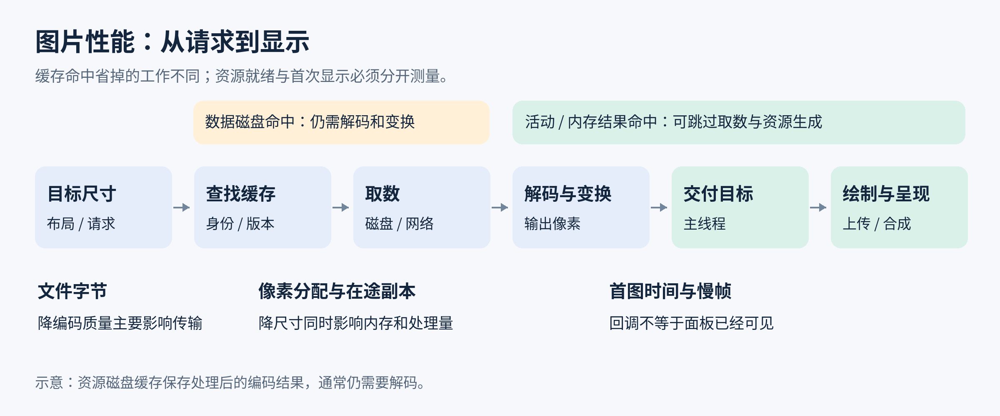

# 加载链路与加载库

**Q1: [learning] 图片从请求到可见，应该怎样划分性能链路？**

把目标尺寸、请求等待、取数、解码、变换、交付和显示分开观察。请求成功回调只说明资源可以交付，不说明屏幕已出现主图。

1. **请求启动：**Glide 4 的 load 设置来源，into 才绑定目标并启动执行。目标尺寸尚未确定时，请求可能等待布局，不能把这段等待归为网络慢。
2. **查找与生成：**活动资源或内存结果命中可以省去后续部分工作，磁盘命中仍可能读盘并解码。未命中才继续访问原始来源，再解码和变换。
3. **交付目标：**主线程接收结果，检查请求是否仍属于当前条目。主线程拥塞、目标复用或页面销毁，都可能使交付晚于资源就绪。
4. **进入画面：**目标更新后还要参与布局、绘制、纹理准备和系统显示。回调、应用提交帧、实际呈现分别是不同时间点。
5. **统一关联：**为每次请求记录脱敏内容标识、版本、目标身份、请求宽高、实际输出及缓存来源。相同 URL（Uniform Resource Locator）不表示相同结果，更不表示相同执行路径。

依据为 Glide 4《Targets》《Caching》《RequestListener》与 Android Developers《Slow rendering》。图为按公开机制整理的阶段示意，不表示所有实现都串行执行。

**Q2: [learning] Glide 怎样确定目标尺寸，override 又保证了什么？**

Glide 4 根据 Target 提供的像素尺寸执行采样和变换。override 覆盖的是请求尺寸，不保证返回 Bitmap 恰好具有相同宽高，也不会改变服务器文件。

1. **View 尺寸：**ViewTarget 优先检查有效布局参数，再检查当前 View 尺寸并扣除 padding，必要时等待布局。已能确定尺寸时无需等每次完整布局完成。
2. **无界与复用：**wrap_content 在缺少有效尺寸时可能回退到屏幕大小。列表复用的旧 View 尺寸也可能与新条目不符，需要稳定布局或等待本轮布局，而不是把旧宽高当成新目标。
3. **显式请求：**override 的单位是物理像素。指定 300 × 300 后，FitCenter 可能输出 300 × 225，CenterCrop 才可能生成 300 × 300。省略 override 时采用 Target 尺寸，不能笼统说省略就加载原图。
4. **原图请求：**SIZE_ORIGINAL、自定义 Target 没有合理尺寸等情况可能绕过正常缩小。只在确需原像素且有预算时使用，列表缩略图通常不应请求原图。
5. **诊断：**同时记录控件大小、请求尺寸、变换、实际 Bitmap 宽高和 config。预取与正式请求要使用一致的结果契约，否则源数据命中也可能再次解码。

依据为 Glide 4《Targets》《Transformations》《Debugging》。

**Q3: [learning] Glide 的缓存层分别省掉什么工作？**

Glide 4 先查活动资源和内存结果，再查处理结果磁盘缓存、原始数据磁盘缓存，最后访问原始来源。缓存越接近最终结果，通常能省掉越多重复处理，但复用范围也更窄。

1. **活动资源：**结果仍被目标持有时可以共享，避免为相同请求再生成一份。它们仍占内存，不能因为未进入内存缓存就排除预算。
2. **内存结果：**保存已解码、已变换的可用结果，通常无需再读盘和解码。BitmapPool 不属于这层命中，池提供的是可覆盖存储。
3. **资源磁盘缓存：**存处理后的编码结果，可减少重复变换，读取后通常仍要解码。缩略图文件不是随时可直接绘制的 GPU 纹理。
4. **数据磁盘缓存：**保留来源数据，便于生成不同尺寸或变换，但需要再次解码。不同目标可共享原始数据，不代表最终 Bitmap 共享。
5. **来源证据：**DataSource 可区分内存、资源磁盘、数据磁盘、本地和远端等类别，但不能单独细分活动资源与内存缓存，也不是每个阶段的耗时明细。

依据为 Glide 4《Caching》及 DataSource 接口。

**Q4: [learning] 缓存键怎样同时保证命中率与内容正确？**

缓存键应表达“哪份内容、为谁生成、生成什么结果”。缺字段会错误复用，多放无关随机字段又会破坏命中率。

1. **来源与版本：**稳定模型标识加可靠版本，可区分相同地址更新后的内容。版本应来自内容修订、摘要等可信信息，不能每次请求加当前时间来强制失效。
2. **处理结果：**尺寸、变换、结果类型和相关选项影响活动资源、内存或资源磁盘键。原始数据缓存不需要每一种目标尺寸都有一份副本，各层键不能当成完全相同。
3. **变换参数：**Glide 自定义 Transformation 的 equals、hashCode 和 updateDiskCacheKey 应描述一致参数。圆角半径、算法版本或颜色矩阵改变输出，就要改变对应键。
4. **变换次序：**先裁切后圆角与先圆角后裁切可能不同，次序也是结果语义。Glide 连续调用不同 transform 方法可能替换前一次设置，需要多步时使用明确的组合变换。
5. **尺寸收敛：**同类缩略图使用合理稳定的尺寸档位，避免几像素的无意义差异制造大量结果。但不能为提高命中率把所有图片固定为最大尺寸。

依据为 Glide 4《Caching》《Transformations》。

**Q5: [learning] 固定地址图片怎样处理更新、账号切换与失效？**

将内容版本和访问范围纳入稳定身份，并在身份变化时取消旧请求、清理旧目标。只清磁盘一次既不能保证后续新鲜，也不能阻止晚到结果覆盖新账号画面。

1. **内容更新：**优先采用版本化资源地址，或把可靠版本通过 signature 纳入 Glide 请求。更新后使用新键，旧条目按容量淘汰，避免每次更新遍历删除所有变体。
2. **账号隔离：**同一地址可能按请求头返回不同人的头像，应以不含凭据的账号范围标识区分。不能假定认证头自然进入图片库所有缓存层的身份。
3. **退出边界：**撤销旧请求与目标，按产品的数据保留要求清理账号缓存。仅删除文件但保留内存结果或已启动请求，仍可能再次显示旧图。
4. **竞争处理：**自定义异步回调核对当前内容版本和请求代次。取消请求不一定撤回已发出的所有底层工作，交付前仍要检查结果归属。
5. **验收：**用相同地址、两个不同内容版本及账号切换测试，覆盖内存命中、磁盘命中和网络晚到结果，而不是只在清空数据后验证。

依据为 Glide 4《Caching》《Targets》。账号分区与交付代次为基于缓存身份和目标所有权的工程推导。

**Q6: [learning] 怎样选择磁盘策略，而不是默认缓存所有结果？**

先判断最贵、最常重复的阶段，再决定保留原始数据还是处理结果。更大的缓存提高命中的同时，也增加磁盘占用、写入和维护成本。

1. **AUTOMATIC：**Glide 4 的默认策略，远端通常缓存数据、本地通常缓存处理结果。理由是远端重取代价较高，而本地原文件通常可低成本重读。
2. **DATA：**适合同一来源反复生成多种尺寸或裁切，减少重复取数。它不省每次结果缺失后的解码与变换。
3. **RESOURCE：**适合固定尺寸且变换较贵的重复显示，减少重复处理。大量尺寸和变换版本会膨胀缓存，原始数据的复用需另行考虑。
4. **ALL 与 NONE：**ALL 增加数据和结果的缓存机会，是否实际写入仍受来源与编码器影响。NONE 禁用 Glide 该磁盘层，不能证明网络客户端也不缓存。
5. **内存与离线选项：**skipMemoryCache(true) 跳过内存结果缓存的使用与保存，不会消除活动目标的像素。onlyRetrieveFromCache(true) 禁止回源，未命中即失败。两者省略时通常为 false，均不是统一省内存开关。
6. **实验选择：**统计各来源占比、磁盘字节和重复处理时间。若变换很便宜、来源只看一次，缓存所有衍生结果可能没有足够收益。

依据为 Glide 4《Caching》与 DiskCacheStrategy、BaseRequestOptions 接口。

**Q7: [learning] 图片库磁盘缓存为什么不能等同于 HTTP 缓存？**

HTTP（Hypertext Transfer Protocol）缓存围绕响应与协议头工作，图片库缓存围绕资源身份和处理结果工作。命中上层图片缓存时，网络层可能根本没有机会验证新鲜度。

1. **HTTP 语义：**Cache-Control、验证器和重新验证决定网络响应能否复用。no-cache 表示复用前需要验证，不等于禁止存储，no-store 才限制存储行为。
2. **图片缓存：**原始数据或变换结果可由图片库独立保存。如果其键没有版本变化，服务器响应头更新也不必然让已经缓存的 Bitmap 立即失效。
3. **Coil 3：**默认网络取数器的图片磁盘缓存策略不直接遵守 Cache-Control。需要该语义时，使用匹配版本的 coil-network-cache-control 组件并注册 CacheControlCacheStrategy，不能只添加依赖就假定生效。
4. **分层诊断：**先确认是内存结果、图片磁盘还是网络响应缓存命中，再看验证是否执行。网络层“没有新请求”可能正是上层直接返回。
5. **避免重复成本：**确有需要时可同时启用两层，但应核对是否重复保存相同大响应。缓存敏感性和失效策略需覆盖全部层，不能只设置某一个开关。

依据为 RFC 9111《HTTP Caching》与 Coil 3《Network Images》。

**Q8: [learning] 图片请求怎样绑定页面和列表目标，避免错图与泄漏？**

请求生命周期应与资源的实际消费者一致。页面销毁、条目复用和目标清理时，既要停止无用工作，也要解除资源引用。

1. **页面作用域：**Glide.with(Activity/Fragment) 可接入对应生命周期，application context 则不会自动表达当前页面何时结束。只有确实跨页面存在的任务才使用相应长作用域。
2. **列表重绑：**同一 ImageView 发起新 Glide 请求会替换旧请求，空模型或不再需要图片的条目也要清理旧状态。自定义加载器需要自己实现取消与身份核对，不能只保存 position。
3. **回收与分离：**onViewRecycled 可清理不再需要的目标，暂时 detach 后可能马上重新显示，不宜无条件清空全部缓存。是否暂停按实际可见性与业务判断。
4. **自定义 Target：**保存并清理 Target，在 onLoadCleared 解除对资源的引用。库已经收回的 Bitmap 不能继续绘制、缓存到业务单例或自行 recycle，否则可能被覆盖或回收。
5. **异步竞态：**响应携带条目身份和请求代次，交付时与当前绑定比较。稳定条目 key 管理列表身份，不能替代图片内容版本。

依据为 Glide 4《Targets》《Resource Reuse》。

**Q9: [learning] 本地相册列表怎样避免读取并解码每张原图？**

优先让媒体提供方或加载库按目标尺寸提供缩略图，只有详情与编辑场景才请求更高分辨率。本地文件没有网络等待，仍可能产生显著的读盘、解码和跨进程成本。

1. **平台入口：**Android 10 起 ContentResolver.loadThumbnail 接收内容 Uri 和目标像素 Size，由提供方生成适合请求的缩略图。调用可能阻塞，应放到受限工作线程，不能因为图片在本地就在主线程执行。
2. **参数语义：**Uri 必须是可访问的来源，Size 是期望缩略图尺寸，不保证任意提供方返回与其完全相同的宽高。CancellationSignal 用于取消不再需要的调用，传 null 则缺少这条取消控制，不会自动跟随列表条目退出。
3. **统一缓存：**加载库可能已具备媒体缩略图获取路径，先核对实际实现，避免同时再维护一套缓存和重复请求。内容修改时间、方向或版本变化应使结果身份更新。
4. **访问边界：**内容 Uri 不等同于文件路径，受权限、提供方能力和来源存续影响。云端媒体的提供方也可能需要远端取数，不能把所有相册入口都归类为零网络成本。
5. **回退与验收：**提供方不支持或返回质量不足时，按可控尺寸自行采样或请求更高档位。快速滚动时取消旧目标，比较实际读取字节、输出尺寸、首图时间与并发峰值。

依据为 Android《ContentResolver.loadThumbnail》《ContentProvider.openTypedAssetFile》与 Glide 4《Targets》。

**Q10: [learning] 预取怎样缩短等待，而不挤占首屏资源？**

预取只在未来会用到、且能提前完成的请求上有收益。以可见主图为最高业务优先级，用有限窗口控制无用下载、解码和驻留。

1. **对齐结果：**预取与正式显示采用相同模型、版本、目标尺寸和变换，否则可能只热了原始数据，仍需重新生成结果。
2. **估算窗口：**可用“滚动速度 × 加载延迟”估计需要提前多少屏，再按条目数和内存预算限制。例如一秒移动 20 项、加载约 0.2 秒，先评估约 4 项，而不是一次预取整个列表。
3. **响应方向：**滚动反向、页面退出或数据刷新时取消过时预取。快速滑动时降低无用解码，不能让旧方向任务长期占满线程。
4. **调并发：**观察网络、解码及主线程交付各自的排队。Glide priority 是库内调度偏好，不保证抢占已执行任务或决定网络服务端顺序。
5. **验证收益：**统计预取结果真正被使用的比例、占位时长、关键图可见时间、额外字节和峰值。命中率高但首屏更慢，说明预取争用超过收益。

依据为 Glide 4《RecyclerView integration》《Options》。窗口计算是用于调参的估算，不是通用固定值。

**Q11: [learning] 占位图、缩略图与主图怎样避免额外工作和视觉倒退？**

占位稳定布局，缩略图提供早期内容，主图满足最终质量。分别衡量它们的出现时间，不把缩略图出现当作主图加载完成。

1. **占位：**选小而便宜的资源，预留与主图相同的区域或比例。Glide 的占位资源在主线程路径加载，不宜用大图或复杂 Drawable 制造新的卡顿。
2. **缩略图：**Glide thumbnail 与主请求协调执行，主图完成后不会被迟到缩略图覆盖。独立小文件能减少早期字节，使用同一大来源仅降低解码尺寸，不保证减少下载。
3. **版本：**缩略图和主图应属于同一内容版本及裁切目标，避免先显示旧头像或裁切方向相反的主体。
4. **失败：**Glide 的 error 请求在主请求失败后触发，即使缩略图已成功也不等于主请求成功。要明确保留缩略图还是替换为错误图，并验证最终画面。
5. **过渡：**大量图片同时淡入会增加混合和短期共存。主图首次出现与完全不透明是两个终点，按产品目标分别记录。

依据为 Glide 4《Options》《Placeholders》《Transitions》。

**Q12: [learning] Coil 3 怎样配置共享加载器并避免重复资源？**

通常以应用级共享 ImageLoader 复用缓存与网络资源，在请求层绑定页面目标。为了每页“独立”而随意新建加载器，会切碎缓存并增加占用。

1. **实例职责：**每个 ImageLoader 管理自身的内存缓存、磁盘缓存及网络相关组件。共享实例提高跨页面复用，账号隔离或测试隔离才需要明确的独立资源边界。
2. **网络能力：**Coil 3 将网络支持拆为可选组件。按项目选择匹配的 OkHttp 或 Ktor 网络模块，不能只传入网络地址就假定核心包能取数。
3. **专用格式：**动画、SVG（Scalable Vector Graphics）等可能需要额外解码组件。先确认组件与实际文件匹配，避免把“不支持该输入”当成网络慢。
4. **缓存并发：**多个加载器不应各自创建磁盘缓存实例并争用同一目录。确需共享时遵守库的 DiskCache 生命周期约束，独立域则使用明确隔离的目录。
5. **诊断：**记录加载器实例、请求尺寸、结果来源和异常链。不同实例的冷缓存与共享实例的热缓存不能直接作性能结论。

依据为 Coil 3《Image Loaders》《Network Images》《GIFs》《SVGs》与 DiskCache 接口。

**Q13: [learning] 加载失败怎样有限回退，避免重试风暴？**

先分类失败，再为可恢复错误提供有限重试。取消、鉴权失败、坏图和不支持格式不应统一立即重发。

1. **瞬时网络问题：**有限次数重试并退避，遵循服务端节流信息。网络恢复后只重启仍可见、仍有效的请求，避免所有离屏条目同时重试。
2. **永久或条件性错误：**资源不存在先修模型或版本，权限失效先恢复授权，不支持格式切换已知可用变体。相同坏字节反复解码不会自愈。
3. **取消：**用户滑走、页面结束或新请求替换属于正常生命周期。不能把取消统计为服务失败，再由重试逻辑复活旧任务。
4. **部分数据：**ImageDecoder 默认对错误不完整数据报错，只有业务明确接受残缺图时才允许部分结果。部分图不能冒充完整成功写入通用缓存。
5. **成本证据：**记录异常阶段、重试次数、回退格式、实际字节及最终状态。有限回退也要在总等待和并发预算内，避免一张失败图片占用整个首屏窗口。

依据为 Glide 4《Debugging》、Android《ImageDecoder.OnPartialImageListener》及 HTTP 重试与缓存语义。

**Q14: [learning] 怎样定位图片加载慢发生在哪一段？**

沿同一请求建立时间线，先区分等待与执行，再验证单个假设。一个总耗时或 DataSource 标签不足以定位根因。

1. **尺寸未就绪：**请求已创建但尚未开始取数，检查布局约束、Target 回调与复用尺寸。网络日志里没有请求不等于网络故障。
2. **取数等待：**分开看任务排队、连接与响应、读盘。磁盘命中仍慢时，检查输入大小和后续解码，不能直接扩缓存。
3. **生成资源：**记录解码前后、变换前后与实际输出像素。先用相同来源的小尺寸输出作对照，确认是否为像素工作量。
4. **交付等待：**资源已就绪但目标迟迟未更新时，用线程时间线检查主线程排队和锁，而不是继续降低编码质量。
5. **显示延迟：**目标更新及时但画面晚，关联布局、绘制、纹理上传与显示帧。自定义追踪标记应包含请求身份，避免把另一张图的慢帧错配过来。

依据为 Glide 4《Debugging》《RequestListener》与 Android Developers《System tracing overview》《Slow rendering》。

**Q15: [learning] 怎样设计可复现的图片性能验收？**

固定输入和使用路径，分别测冷缓存、磁盘命中、内存命中，再同时检查等待、流畅度、资源与正确性。优化应证明预期阶段减少了工作，而非只看到一次总耗时下降。

1. **控制条件：**固定设备与系统、发布构建、图片集、控件尺寸、网络和滚动脚本。冷图片缓存不等于冷进程，重新启动进程也不保证磁盘缓存冷。
2. **时间指标：**统计关键图首次可辨认、主图首次出现与过渡结束的分布，报告中位数和高分位。失败、取消和仍未显示的请求单独计数，避免只统计成功样本。
3. **资源指标：**记录下载字节、实际输出像素、峰值内存、在途数量和缓存来源。只减少网络字节却增加低端设备解码时间时，按业务路径重新选择格式。
4. **帧指标：**用可重复滚动比较帧耗时分布，按真实刷新率判断预算。测量方法和工具开销保持一致，调试构建与发布构建不能混作一组。
5. **正确性：**覆盖条目重排、账号切换、方向标签、透明图、坏图、超大图和后台返回。优化后出现错图、模糊或旧数据，指标再好也不能通过。
6. **因果验证：**一次改变一个主要因素。若解码变快而可见时间不变，继续找主线程或显示瓶颈，并如实报告收益范围。

依据为 Android Developers《Macrobenchmark overview》《Slow rendering》与 Glide 4《Debugging》。指标组合为面向图片链路的实验设计。
