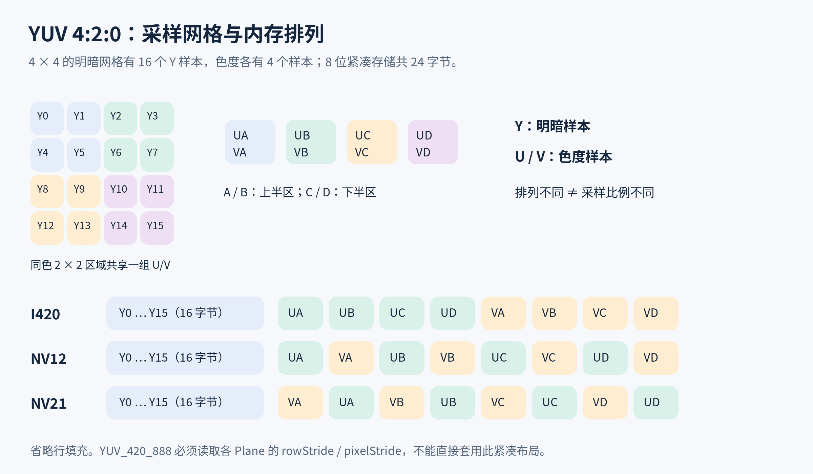

# YUV 图像处理与性能

**Q1: [learning] YUV 是图片格式吗，为什么适合相机与视频？**

YUV 泛指将明暗与色度分开的颜色表示，既不是 JPEG 这样的压缩文件格式，也不是唯一的内存布局。Android 数字图像中常说的 YUV 通常实际指 Y′CbCr，必须再确定采样方式、布局和色彩解释才能正确使用。

1. **分量含义：**Y′ 是由非线性 R′G′B′ 分量加权得到的明暗信号，Cb、Cr 描述蓝、红相对明暗的色差。口语里的 U、V 常对应 Cb、Cr，但不应把模拟 YUV 与数字 Y′CbCr 的系数混用。
2. **压缩空间：**人眼通常对色度细节较不敏感，减少色度样本可节省带宽，又保留较多轮廓信息。RGB（Red, Green, Blue）转换为完整分辨率色差分量，与丢弃色度样本是两件事，后者会损失信息。
3. **链路用途：**相机、视频编解码与部分图像算法可直接处理 YUV，避免每帧转换为 RGB。只需明暗的算法甚至可以直接读取 Y 平面，但不能将其无条件当作线性亮度或完整范围灰度。
4. **边界：**普通 Bitmap/Canvas 通常消费 RGB 类像素，算法、编码器或 Surface 可能接收其他格式。应先确认下游输入契约，再决定是否转换，而不是收到相机帧就立即转 Bitmap。

依据为 ITU-R BT.601、BT.709 的颜色表示定义、Android《ImageFormat》与 libyuv《formats.md》。

**Q2: [learning] YUV 4:4:4、4:2:2、4:2:0 怎样计算内存？**

采样比例描述色度相对明暗的空间分辨率，不描述字节排列。在 8 位、无对齐、宽高适配采样的条件下，4:4:4、4:2:2、4:2:0 分别约需每像素 3、2、1.5 字节。

1. **4:4:4：**每个像素位置都有一组 Y、U、V 样本，色度不做空间降采样，适合需要完整色度细节的处理。
2. **4:2:2：**色度水平方向减半、垂直方向不变。两个横向像素共享一组色度样本，总量为 WH + WH/2 + WH/2 = 2WH 字节。
3. **4:2:0：**色度水平和垂直方向都减半，2 × 2 明暗块对应一组色度样本，总量为 WH + WH/4 + WH/4 = 1.5WH 字节。末尾的 0 不表示没有 V 分量。
4. **数量级：**1920 × 1080 的紧凑 8 位 4:2:0 约 2.97 MiB，ARGB_8888 约 7.91 MiB。若每秒转换 30 帧，仅一次读取 YUV 加一次写入 ARGB 就约 326.3 MiB/s，未计其他读取、复制、缓存行为和算法输出。
5. **实际分配：**行对齐、平面偏移、奇数尺寸处理和容器位宽会改变真实容量。奇数尺寸的紧凑模型可按 WH + 2 × ceil(W/2) × ceil(H/2) 估算，但仍须确认接口是否允许该尺寸，不能用理论值代替 Plane 描述。

依据为 libyuv《formats.md》及 Android《ImageFormat》。带宽数值为单次读写模型的计算结果，不是设备性能测试。

**Q3: [learning] I420、YV12、NV12、NV21 的区别是什么？**

它们都可表示 8 位 4:2:0，区别主要是色度分量的存放顺序。相同采样比例不保证字节兼容，传错顺序通常会出现明显偏色。

1. **I420：**平面式布局，先 Y，再 U，再 V。每个色度平面宽高约为明暗平面的一半。
2. **YV12：**平面式布局，先 Y，再 V，再 U。Android ImageFormat.YV12 还规定特定的行对齐要求，不能只交换两个紧凑数组就假定满足全部契约。
3. **NV12：**半平面布局，先 Y，再交错的 UV 色度对。色度行包含交错样本，不能把第二平面的连续字节都当作 U。
4. **NV21：**半平面布局，先 Y，再交错的 VU。旧 Camera 预览默认常用 NV21，但 Camera2 的 YUV_420_888 不保证就是 NV21。
5. **移植边界：**libyuv 的 I/J/H 等前缀还表达色彩矩阵与范围约定。其他组件只说“类 I420 布局”时，不能自动推断其色彩范围，应独立传递元数据。

图中每格表示一个 8 位样本，省略行填充。A、B、C、D 对应四个 2 × 2 区域，不用于规定具体标准的色度采样位置。

依据为 libyuv《formats.md》与 Android《ImageFormat.NV21》《ImageFormat.YV12》。

**Q4: [learning] YUV_420_888 为什么不能直接拼成 NV21？**

YUV_420_888 是 Android 对 8 位 4:2:0 数据的灵活描述，通过三个 Plane 暴露分量与步长，不保证三块独立且紧凑的数组。必须按各平面的描述读取。

1. **平台保证：**planes[0] 为 Y，planes[1] 为 U，planes[2] 为 V。Y 的 pixelStride 为 1，U/V 的 rowStride 和 pixelStride 分别相等。
2. **平面式情况：**U/V 的 pixelStride 可以为 1，行尾仍可能有填充。把整个 buffer 直接拼接，会把填充也复制到有效图像中。
3. **半平面情况：**U/V 的 pixelStride 可以为 2，两个 ByteBuffer 可能是同一底层交错区域的不同视图。三个 Plane 不等于三份物理分配，不能简单累加其 capacity 推算底层占用。
4. **不能猜布局：**仅凭 pixelStride=2，不能断言先 U 还是先 V、是否存在别名关系、数据是否可连续读取。应按分量逐样本读取，或使用有明确前提检查的快路径。
5. **需要 NV21 时：**先按有效区域写紧凑 Y，再按 V、U 顺序交错写色度，遵守输出尺寸与裁切限制。该重排不做颜色矩阵转换，但仍有复制成本。

依据为 Android《ImageFormat.YUV_420_888》《Image.Plane》。

**Q5: [learning] rowStride、pixelStride 和 cropRect 怎样决定读取位置？**

rowStride 是相邻行起点间的字节距离，pixelStride 是同一行相邻分量样本的字节距离。读取必须从该平面的有效起点出发，加上行列偏移，并受 ByteBuffer.limit 限制。

1. **基本地址：**对已确认的平面基准，样本地址为 base + y × rowStride + x × pixelStride。base 是该视图的有效起点，不是所有平面共用的地址，也不能假定别人没有改过 buffer.position。
2. **裁切偏移：**cropRect 使用图像坐标。Y 平面按 left、top 偏移，4:2:0 色度索引需换算到半分辨率网格。简单重打包通常要求偶数裁切起点，任意奇数起点还要处理色度相位，不能只整除就宣称颜色完全等价。
3. **可算示例：**4 × 4 图像的 Y 行跨度为 6，读取 (2,1) 的字节偏移为 1 × 6 + 2 = 8。色度行跨度为 4、像素跨度为 2 时，对应色度坐标 (1,0)，偏移为 2，分别相对 U、V 的起点读取。
4. **最后一行：**Image.Plane 只保证映射到最后一行最后一个有效样本，末行填充可能不存在。4 × 4、Y 行跨度 6 时，最后有效字节偏移为 21，缓冲可能只有 22 字节，不能盲读 6 × 4 = 24 字节。
5. **安全访问：**使用独立 duplicate 视图可避免改变共享 position，但不会延长 Image 寿命。索引与容量计算先用足够宽的整数检查溢出，再访问内存。8 位样本作为无符号值使用，Java/Kotlin 的 Byte 转整型后要按 0xff 掩码处理。

依据为 Android《Image.Plane》《Image.getCropRect》与 Java ByteBuffer 契约。数值示例只演示寻址，不假定所有设备采用这些跨度。

**Q6: [learning] 为什么 YUV 转 RGB 后会偏色、发灰或黑位不对？**

内存布局、色彩矩阵、数值范围和输出通道顺序都必须匹配。布局正确只说明读到了样本，不说明这些样本被正确解释成颜色。

1. **色度顺序：**NV12 与 NV21 混用会交换 U/V，常产生严重色偏。先用固定色块验证分量与步长，再调整转换系数。
2. **矩阵：**BT.601、BT.709、BT.2020 的权重不同。尺寸或“来自相机”不能单独保证某一矩阵，使用来源契约和可获得的色彩元数据选择。
3. **范围：**常见 8 位有限范围的 Y 标称为 16～235，色度为 16～240、中心为 128。完整范围通常使用 0～255。把有限范围当完整范围会压缩对比度，把完整范围当有限范围可能裁掉暗部与高光。
4. **传递特性：**HDR（High Dynamic Range）还涉及非线性传递与色调映射，仅更换 YUV 矩阵不足以生成正确的普通屏幕 RGB 图。应保留或明确转换色彩标准、范围与传递信息。
5. **输出顺序：**libyuv 名称中的 ARGB 以寄存器通道含义命名，小端内存字节顺序可能为 B、G、R、A。不能直接把函数名当作 ByteBuffer 中的字节顺序，更不能与 Bitmap 的整数颜色表示混淆。
6. **验证：**用灰阶、纯红绿蓝、肤色及暗部样图，对照已知正确路径。整体偏色、灰黑位和周期条纹对应的假设不同，不应统一靠修改饱和度修复。

依据为 ITU-R BT.601、BT.709、Android《MediaFormat》的颜色键与 libyuv《formats.md》。

**Q7: [learning] YUV 转 Bitmap 怎样减少转换、复制与临时分配？**

首先确认是否真的需要 Bitmap。需要时直接进行一次目标尺寸的像素转换，避免经 JPEG 编码再解码的绕路。

1. **灰度算法：**如果下游接受 Y 平面及步长，直接传有效区域，省去色度读取和 RGB 扩展。下游只接受紧凑数据时再按行拷贝 Y，不能把带填充数据直接当紧凑矩阵。
2. **彩色算法：**优先选择能直接接收相机 Image 或 YUV 平面的接口，传递方向和色彩信息。接口内部仍可能转换，所以要看端到端耗时，不能只凭业务代码没有 copy 宣称零拷贝。
3. **必须转换：**使用支持实际 plane、stride 和色彩矩阵的转换实现，复用有界输出缓冲。可评估 libyuv 等经过验证的原生实现，其 SIMD（Single Instruction, Multiple Data）优化仍需目标架构支持与实测。
4. **避免绕路：**YUV → JPEG → Bitmap 多出有损编码、压缩字节缓冲与解码，既慢又可能损失质量。YuvImage.compressToJpeg 的常规路径只接受 NV21 或 YUY2，并要求 sRGB 色彩空间，不是任意 YUV_420_888 三平面的通用入口。
5. **缩小处理量：**在算法允许时先裁出区域或降低分辨率，再转换。要确保色度对齐、方向与下游模型尺寸一致，不能为省像素裁掉有效识别区域。
6. **计入副本：**一份 YUV 输入、一份 RGBA 输出和一个额外 IntArray 可能同时存在。复用减少分配频率，不会减少同时存活时的容量。

依据为 Android《YuvImage》、libyuv 转换接口与 Android Developers《Image analysis》。

**Q8: [learning] 相机帧怎样裁切、旋转并把检测框画回预览？**

先统一坐标系，再决定是否搬动像素。可通过元数据或矩阵表达的方向变化，不必每帧生成旋转后的 Bitmap。

1. **识别坐标：**传感器、Image 裁切区、算法输入、预览 View 可能有不同方向与比例。检测框属于哪一坐标系必须由算法接口明确说明。
2. **优先元数据：**CameraX 的 rotationDegrees 表达需要的旋转，下游若能接收该值，就不必自己旋转整帧。不要把方向元数据同时交给算法又事先旋转像素，造成双重旋转。
3. **必须搬像素：**Y 与 U/V 必须以各自采样尺寸一起旋转或镜像，90 度后宽高交换。只转 Y 会让明暗正确但颜色错位。
4. **裁切相位：**4:2:0 的色度样本覆盖多个明暗像素，裁切起点落在奇数位置时，简单复制色度可能改变采样相位。优先用支持该情况的实现，或选符合业务的偶数对齐区域。
5. **绘回预览：**将算法缩放、裁切、旋转与前置镜像组合成映射，检测框经该映射落到 View。Preview 的 Crop 留下的偏移也要纳入，不能只把框坐标乘宽高比例。
6. **验收：**覆盖横竖屏、前后摄像头、非居中裁切及边缘目标，分别检查像素方向和框位置。单一正中目标很容易掩盖映射错误。

依据为 Android Developers《Transform output》《Image analysis》及 Android《Image.getCropRect》。

**Q9: [learning] Image 和 ImageProxy 为什么必须及时关闭？**

它们持有生产者交付的图像缓冲，close 表示归还缓冲供后续帧复用。只丢掉 Java 引用或等待垃圾回收，无法可靠维持实时流水线。

1. **同步消费：**在处理完成或异常退出时归还，通常用 finally 保障。关闭后不能继续读取 Plane 的 ByteBuffer，duplicate 也不拥有独立像素。
2. **异步消费：**算法返回前仍在访问像素时不能提前 close，应在完成回调归还，或先复制必须的数据后立即归还原帧。前者占用相机槽位，后者增加复制与自己的缓存，两者都需有上限。
3. **CameraX：**关闭 ImageProxy，让 CameraX 完成内部管理，不直接关闭它包装的 android.media.Image。对不同包装对象重复释放会破坏所有权。
4. **ImageReader：**已获取且未关闭的图像数量达到 maxImages 后，再获取可能抛 IllegalStateException，生产链路也可能受阻。增大 maxImages 只能暂时掩盖泄漏，还会放大驻留。
5. **观察证据：**同时记录获取数、关闭数、当前持有数与帧时间戳。预览突然停住时，不应只怀疑相机驱动，先检查应用是否归还所有异常路径的帧。

依据为 Android《Image.close》《ImageReader》与 CameraX《ImageProxy.close》《Image analysis》。

**Q10: [learning] CameraX 背压怎样在低延迟与逐帧处理间取舍？**

实时识别通常重视最新画面，选择保留最新帧并允许丢弃过期帧。必须逐帧处理时可阻塞生产者，但前提是处理吞吐能够长期跟上输入。

1. **KEEP_ONLY_LATEST：**CameraX 的默认策略，分析未完成时以最新待处理图替换旧待处理图。setImageQueueDepth 在此策略下不生效，增加该值不会提升分析吞吐。
2. **BLOCK_PRODUCER：**保留队列并在积压达到限制时阻塞生产，可能连带影响同相机绑定的预览等用例。该模式默认队列深度为 6，显式设置更大只能吸收有限抖动，还会增加延迟和内存。
3. **吞吐判断：**30 帧/秒输入的帧间隔约 33.3 ms，算法每帧 50 ms 只能处理约 20 帧/秒。再深的有限队列也不能长期消化这个差值，应减分辨率、减少分析频率或允许丢帧。
4. **自建队列：**不要从 analyzer 收帧后再投入一个无限协程或线程池队列，破坏上游背压。整个链路在途数量都要有界，输出也不应按完成顺序显示已经过时的结果。
5. **Camera2：**实时处理可用 ImageReader.acquireLatestImage 丢掉旧帧，但需要至少两个可获取槽位余量，即 maxImages 减当前已持有数至少为 2，才能按预期丢旧保新。acquireNextImage 更适合按序消费，不解决吞吐不足。
6. **验收：**比较输入时间戳到结果显示的端到端延迟、丢帧数、持有帧数与预览流畅度。只看算法平均时间会忽略排队导致的陈旧画面。

依据为 CameraX《Image analysis》《ImageAnalysis》与 Android《ImageReader.acquireLatestImage》。

**Q11: [learning] CameraX 的 YUV、RGBA、NV21 输出怎样选择？**

直接选择下游能消费且转换最少的输出。输出格式改变的是分析路径契约，不代表相机传感器天然提供该字节布局。

1. **YUV_420_888：**通常作为分析默认输出，适合能按平面和步长读取的算法，避免主动扩展为四通道图。仍需处理 cropRect、方向和色彩约定。
2. **RGBA_8888：**适合必须接收四通道输入的消费方，CameraX 会承担相应格式转换。按 ImageAnalysis API 的字节契约读取，不能把网络文章中的 ARGB 整数顺序直接套入 ByteBuffer。转换成本也要计入相机到分析的耗时。
3. **NV21：**CameraX 1.5.0 起可通过 OUTPUT_IMAGE_FORMAT_NV21 请求。ImageProxy 仍报告 YUV_420_888，提供符合 NV21 排列约定的平面视图，不能仅凭 format 字段判定请求未生效。
4. **包装边界：**NV21 模式下，ImageProxy 与 getImage 得到的底层 android.media.Image 可能具有不同的数据、尺寸或其他属性。使用哪份数据就配套使用哪份描述，不能把一方的跨度用于另一方缓冲。
5. **版本边界：**旧 CameraX 不能假定有 NV21 输出能力。升级或手工重排前，比较组件兼容性、额外复制及下游输入要求，避免为了少写转换代码增加整条链路开销。

依据为 CameraX《ImageAnalysis》《ImageAnalysis.Builder》及 CameraX 1.5 发布说明。

**Q12: [learning] YUV 预览为什么优先走 Surface，“零拷贝”有什么边界？**

只需要显示或编码时，优先让生产者将缓冲交给能直接消费它的 Surface 路径，避免应用每帧读回 YUV、转换 Bitmap、再上传。共享缓冲减少的主要是应用显式搬运，不表示系统没有转换、同步或带宽成本。

1. **纯预览：**CameraX Preview 或 Camera2 输出到适合的 Surface，可以由图形链路处理缓冲。SurfaceTexture 可把流接入纹理消费，但仍需应用正确处理纹理变换矩阵和帧同步。
2. **分析与预览分工：**分析需要可读取的 YUV 帧时，使用独立分析输出，预览继续走显示输出。不要为了画面可见，把每个分析帧再转成 Bitmap 填给 ImageView。
3. **不可直接读取：**ImageFormat.PRIVATE 表示布局由实现决定，并不提供普通可读平面。不能用相同 Plane 代码读取它，也不能从“不需要 CPU 读取”推断它已经是某种固定 RGB 格式。
4. **混合处理成本：**GPU（Graphics Processing Unit）上转换或处理后再读回 CPU（Central Processing Unit），可能引入同步等待和额外复制。若最终算法仍在 CPU，搬到 GPU 不一定更快，应把上传、执行与读回一起计时。
5. **共享契约：**HardwareBuffer 等机制也需要匹配格式、用途、设备支持和同步生命周期。生产者还在写、消费者尚未结束就复用或释放，都会破坏正确性，不能只看是否避免了 byte[]。
6. **测量边界：**报告省掉的是哪次复制、转换或读回，并观察端到端延迟和帧缓冲驻留。无法观察内部实现时，只能说避免了应用显式复制，不能宣称物理零拷贝。

依据为 Android《SurfaceTexture》《ImageFormat.PRIVATE》《HardwareBuffer》与 CameraX Preview、ImageAnalysis 文档。

**Q13: [learning] 10 位 P010 为什么不能套用 8 位 YUV 的内存公式？**

P010 是 4:2:0 半平面格式，但每个 10 位有效样本放在 16 位容器中。Android 的 YCBCR_P010 从 API（Application Programming Interface）级别 31 起定义，是否可用于具体输入输出仍取决于设备能力。

1. **存储：**Y 平面后接交错 CbCr 平面，样本为小端 16 位值，低 6 位为零，10 位有效数据位于高位。不能只取每个样本的第一个字节当成灰度。
2. **容量：**忽略对齐且宽高为偶数时，共 1.5WH 个样本，每样本 2 字节，即约 3WH 字节。1920 × 1080 约 5.93 MiB，而不是按有效位数紧凑打包计算的 3.71 MiB。
3. **色彩：**10 位不自动等于 HDR，仍需颜色标准、范围和传递特性。转成 8 位输出时可能需要色调映射和量化处理，简单右移不保证显示正确。
4. **处理路径：**确认算法和转换库支持 P010，并按真实步长读取。不得把它传给只接受 8 位 I420/NV21 的函数，即使宽高完全相同。
5. **性能取舍：**只有业务确需该精度才保留更大的工作集，测量转换、驻留和输出质量。换成普通 RGBA 只改变格式，并不会自动保留扩展动态范围。

依据为 Android《ImageFormat.YCBCR_P010》《MediaFormat》与 libyuv《formats.md》。

**Q14: [learning] YUV 分析卡顿、绿屏或花屏怎样建立排查顺序？**

先验证输入契约和所有权，再优化转换速度。错误布局的“快速转换”只会更快生成坏图，平均耗时短也可能因排队而显示陈旧结果。

1. **先验布局：**记录格式、尺寸、cropRect、各 Plane 的 rowStride/pixelStride、有效 buffer 范围。周期性条纹先查行填充，色度错位先查采样索引，异常偏色先查 U/V 与输出通道顺序。
2. **再验颜色：**用已知灰阶和纯色样本判断矩阵、范围及位深。完整色彩问题与只读取 Y 的灰度问题分开定位，不用任意调饱和度掩盖契约错误。
3. **核对寿命：**检查异常和异步路径是否漏 close 或提前 close。缓冲已归还后继续读取，会把内容复用错误误判为相机随机花屏。
4. **测端到端：**按同一帧时间戳记录获取、开始处理、处理结束及结果显示，分开计算排队与执行。在统一时钟口径前，不跨设备或跨时钟源直接相减。
5. **单变量优化：**依次比较只读 Y、缩小分析分辨率、直接 YUV 输入、复用输出和减少在途帧。每步同时检查准确率、图像质量、丢帧、预览流畅度与峰值。
6. **验证样本：**覆盖平面与半平面、带行填充、末行无填充、裁切、90 度旋转、前置镜像及不同设备。模拟缓冲能验证寻址，真实相机还要验证生产者和生命周期。

依据为 Android《Image.Plane》《ImageReader》、CameraX《Image analysis》及 libyuv 格式契约。排查顺序为基于这些契约归纳的工程方法。
