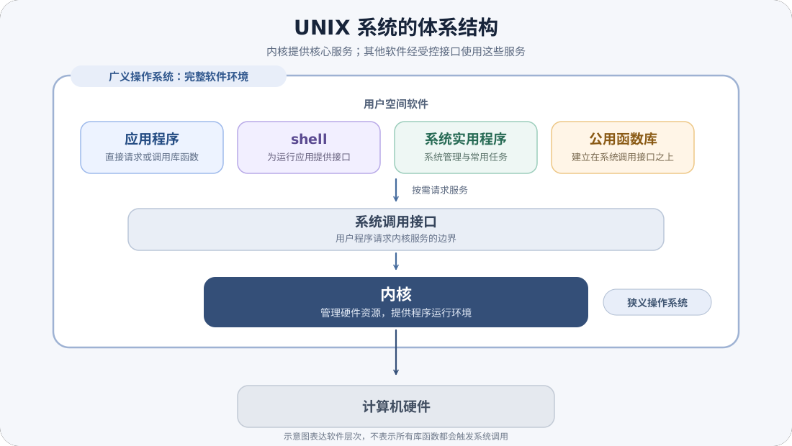

# 操作系统基础与运行机制

> 学习资料。问题覆盖操作系统职责、运行特征、处理器保护机制与内核组织；题序即文档结构。“第一类/第二类虚拟机监控程序”一题与 ../04-virtualization/01-虚拟化.md Q1 同题，2026-10-08 去重移除，以该册为准。

**Q1: [learning] 操作系统在硬件、应用程序和用户之间承担什么职责？**

操作系统管理处理器、内存、设备和文件等资源，并向应用程序与用户提供受控、可复用的接口。它让应用通过命令接口、图形界面或系统调用使用硬件，而不必直接管理每种设备的细节。

1. **资源管理**：分配与回收内存和设备，调度处理器，管理文件及其访问权限。
2. **接口服务**：命令行和图形界面面向用户。系统调用面向程序，是请求内核服务的受控入口。
3. **资源保护**：把共享资源操作集中到受控的内核路径，隔离应用之间以及应用与内核之间的访问。

操作系统也是硬件之上的抽象层，但不同系统提供的接口、资源模型和实现范围并不相同。

**Q2: [learning] 操作系统中的并发、并行、共享和异步分别表示什么关系？**

并发表示多个任务在一段时间内都能推进，并不要求同一时刻执行。并行表示多个任务在同一时刻执行。共享描述多个任务使用共同资源，异步描述发起方不必等待操作完成后才继续，而是在完成时通过回调、事件、队列或查询结果衔接后续工作。异步本身不意味着并行，也不保证完成顺序。

1. **单核处理器**：多个可运行任务通过切换形成并发，不能在同一时刻执行多条任务指令。
2. **多核处理器**：任务既可以并发，也可以在不同核心上并行。
3. **互斥共享**：同一时刻只允许一个任务访问资源，例如需要独占的设备。
4. **并发共享**：多个任务在同一时间段使用资源，底层可能由分时交替完成，例如多个进程读取同一文件。共享若包含写入，还需同步、互斥或定义一致性规则。

并发与共享要求系统处理同步和互斥。异步操作何时完成取决于调度、设备及事件进度，调用方应按接口契约处理完成、失败和取消，而不能假定固定时序。

**Q3: [learning] 用户态和内核态如何限制程序执行特权操作？**

处理器通过执行状态和特权级限制可执行的指令：普通应用运行在用户态，不能直接执行特权指令或任意访问受保护资源。内核在内核态执行资源管理与硬件操作。系统调用通过受控入口请求服务，异常由当前执行引起，外部中断由设备等外部事件引起，三者都可能使处理器转到内核处理路径。内核保存必要的执行现场并按来源处理，完成后再返回原执行上下文或调度其他任务。

1. **用户态**：应用可执行普通指令，但访问受保护资源时必须请求内核服务。
2. **内核态**：内核可执行特权指令，并按权限检查完成设备、内存和进程管理操作。
3. **系统调用**：应用通过指定入口请求服务。处理器切换到内核态，内核检查参数并执行操作。
4. **异常与中断**：异常由当前指令执行引起，例如非法访问。中断通常由外部事件引起，例如设备完成 I/O。处理器依据异常或中断类型转到对应处理逻辑。

应用不能通过普通函数调用绕过系统调用边界直接执行内核代码。具体指令和特权级规则由处理器架构定义。

**Q4: [learning] 系统调用与语言库函数有什么区别？**

系统调用是程序请求内核服务的接口。库函数是编程语言或运行库提供的函数，其中有些会进一步调用系统调用，有些完全在用户态完成。库函数可以封装系统调用的参数、缓冲、错误处理和平台差异，但两者不是同一层接口。一次库函数调用可能触发零次、一次或多次系统调用。

以文件读取为例，库函数先校验或整理参数，再通过系统调用陷入内核。内核验证描述符与权限、执行或排队 I/O，并把结果或错误码返回用户态，库函数再转换为运行库约定的返回值与错误状态。文件读写、进程控制和内存映射通常需要系统调用。字符串处理等库函数可完全在用户态完成。即使源码里函数名相同，不同运行库也可能采用不同封装，因此判断是否进入内核应看实现和调用边界。

**Q5: [learning] 大内核、微内核、分层内核和模块化内核分别在什么方面取舍？**

这些结构主要在内核态代码范围、模块边界、通信成本和可维护性之间取舍。大内核把较多服务放在内核态，调用路径短。微内核把更多服务移到用户态，缩小内核核心，但服务通信需要额外切换。

1. **大内核**：进程、内存和设备等服务多在内核态协作，通常减少跨边界通信。内核代码体量和模块耦合会增加维护难度。
2. **微内核**：内核只保留较小的核心服务，其他服务通过受控通信运行。隔离边界更清楚，但消息传递和状态切换可能增加成本。
3. **分层结构**：模块按层提供接口，便于逐层验证与替换。层次边界和跨层访问会影响设计与性能。
4. **模块化结构**：以内核模块扩展功能，模块接口清晰时有利于独立维护和动态扩展。模块依赖仍需治理，模块化本身不等于隔离。

具体操作系统可以组合这些结构特征。不能只凭“大内核”或“微内核”标签推断整个系统的性能或安全性。

**Q6: [learning] 中断和陷阱（trap）分别是什么？它们与系统调用是什么关系？**

中断与陷阱都是“控制权从当前执行流转到内核处理程序”的机制，差别在来源：中断由外设或时钟等异步事件触发，与当前指令无关。陷阱（trap）由当前指令同步产生——系统调用、缺页异常、除零都属于陷阱。系统调用的实现机制正是陷阱：用户态把调用号与参数放入约定寄存器后执行专用指令（x86 的 `syscall`、ARM 的 `svc`），CPU 切到内核态并跳入系统调用入口表。

1. **异步与同步**：中断随时可能到达，处理前要保存被打断的上下文并在完成后返回原点。陷阱发生在当前指令边界，返回后重执行或继续下一条。
2. **处理流程**：硬件保存关键状态并切换到内核栈 → 按向量表找到处理程序 → 内核处理（中断下半部可能延后）→ 恢复上下文返回。
3. **边界**：中断上下文不代表任何进程，不能睡眠等待——这条规则沿用到 Linux 驱动开发。“中断快于陷阱”不成立，两者都要付出上下文保存与缓存污染的代价。

**Q7: [learning] 存储层次结构为什么有效？“局部性原理”在其中的作用是什么？**

存储层次按“寄存器 → 高速缓存（L1/L2/L3）→ 主存 → 磁盘”排列，越往上越快、越贵、越小。它能以接近上层的价格获得接近上层的性能，依据是程序的局部性原理：时间局部性（刚被访问的数据很可能再次被访问）与空间局部性（被访问数据附近的数据很可能被相继访问）。

1. **机制**：层次间以块为单位搬运——刚访问的块被调入上层，命中时直接服务。不命中才向下逐层查找，并把数据按块提升上来。
2. **有效性条件**：局部性越强命中率越高。顺序访问数组与循环访问热数据是两种局部性的典型来源，指针追逐与随机大范围访问会击穿层次。
3. **工程延伸**：这一模型解释了缓存行对齐、预取、批量 I/O 等优化的收益来源。它不是缓存一致性协议——多核间的一致性由额外的协议维护，属于另一层机制。

**Q8: [learning] UNIX 的体系结构中，内核、系统调用接口和用户空间软件分别处于什么位置？**

UNIX 的狭义操作系统指管理硬件资源并为程序提供运行环境的**内核**。应用程序通过系统调用接口请求内核服务，而 shell、公用函数库和系统实用程序属于用户空间软件。按广义用法，“操作系统”还可指由内核及周边软件构成的完整软件环境，因此讨论时要先确认这个词指内核还是整套系统。

各层的职责和边界如下：

1. **内核**：位于体系结构的核心，控制计算机硬件资源，并提供进程、内存、文件和设备等受控服务。
2. **系统调用接口**：应用请求内核服务的边界。应用可以直接发起系统调用，也可以使用建立在该接口之上的公用函数库；一次库函数调用不一定会进入内核。
3. **用户空间软件**：包括应用程序、shell、系统实用程序和公用函数库。shell 是一种为运行其他应用程序提供接口的特殊应用程序，不属于内核。
4. **硬件**：由内核管理和控制，不属于软件意义上的操作系统组成部分。

广义用法把这些用户空间软件与内核一并视为操作系统环境。日常语境则常用“操作系统”指内核，或指包含系统软件的整套环境。Linux 的命名也体现这种区别：Linux 是内核。使用 Linux 内核的 GNU（GNU's Not Unix）系统常称为 GNU/Linux，日常表达中又常简称 Linux。GNU 项目在《Linux and GNU》中也按 GNU 系统加 Linux 内核描述这一组合。讨论体系结构或定位系统边界时，应说明所采用的范围。

**Q9: [learning] Shell 是什么？**

Shell 是运行在用户空间的命令语言解释器，也是用户调用系统实用程序的接口。它读取终端输入或脚本内容，解释命令并执行。它不是内核，也不是终端或终端模拟器：终端提供输入输出通道，shell 负责解释命令。

Shell 的职责和实现边界可以按以下顺序理解：

1. **交互输入**：交互式 shell 从终端读取用户键入的命令，通常还会显示提示符。
2. **脚本输入**：非交互式 shell 从文件或字符串读取命令。条件、循环、变量、管道和重定向等语言结构使脚本可以组合命令完成自动化任务。
3. **命令执行**：shell 解析命令并展开变量等表达式，然后处理内建命令，或查找并启动外部程序。shell 设置管道和重定向，安排命令之间的输入输出。文件、进程和设备等操作由 shell 或外部程序通过系统调用请求内核。
4. **登录 shell**：用户账户信息可以指定登录时运行的 shell。Linux 的 `passwd(5)` 文档规定，本地账户文件 `/etc/passwd` 以冒号分隔的第七个字段表示该程序。可移植操作系统接口（POSIX, Portable Operating System Interface）标准的 2024 版（POSIX.1-2024）中的 `struct passwd` 也用 `pw_shell` 表示它。账户信息也可能由其他账户服务提供，所以不能假定所有 UNIX 系统都直接从这个文件读取。
5. **实现与可移植性**：常见实现包括 Bourne shell、Korn shell、C shell、Bash（Bourne-Again SHell）和 tcsh。POSIX.1-2024 规定了可移植的 shell 命令语言及常用工具。不同 shell 仍可提供各自扩展，因此脚本要么明确选择解释器，要么限制在 POSIX 规定的语法和行为内。POSIX 标准不能推出某个系统或发行版的默认登录 shell。

因此，排查命令或脚本差异时，应同时确认运行的是交互式还是非交互式 shell、实际启动了哪个解释器，以及脚本是否依赖该实现的扩展。
