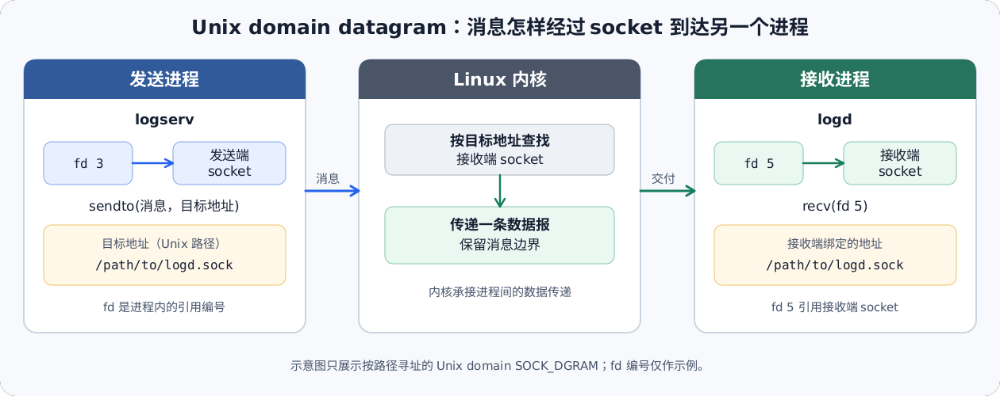

# 进程间通信基础

> 学习资料。本文介绍进程间通信的基本抽象，当前收录 Linux socket 与 Unix domain socket。Q 序列即文档结构。

**Q1: [learning] Linux 中的 socket 是什么？**

Linux 中的 socket 是内核创建并管理的通信端点对象，代表一个进程可用于收发数据的一端。进程通过系统调用操作这个端点，内核按创建时选择的通信域、类型和协议处理数据。`socket()` 返回的文件描述符（fd，file descriptor）只是当前进程引用该内核对象的句柄。它既不是 socket 对象本身，也不是供其他进程直接使用的通信地址。

先看同一台机器上两个进程使用 Unix domain 数据报 socket 的简化伪代码。它省略了 Linux `sockaddr_un` 结构、地址长度、缓冲区长度和错误处理，展示的是操作关系，不是可直接编译的 C 代码。

```text
接收进程：
    rx_fd = socket(AF_UNIX, SOCK_DGRAM, 0)
    bind(rx_fd, "/path/to/logd.sock")
    message = recvfrom(rx_fd)

发送进程：
    tx_fd = socket(AF_UNIX, SOCK_DGRAM, 0)
    sendto(tx_fd, "hello", "/path/to/logd.sock")
```

`rx_fd` 是 `receive file descriptor` 的示意变量名，表示接收端文件描述符。它保存 `socket()` 返回的整数，用来让接收进程后续通过 `bind()` 和 `recvfrom()` 操作刚创建的 socket。`rx` 只是变量名约定，不是 Linux 的特殊名称。发送进程中的 `tx_fd`（`transmit file descriptor`）同理，用来操作发送端 socket；它和 `rx_fd` 属于不同进程各自的文件描述符表，即使数值碰巧相同，也不表示它们引用同一个 socket。

接收端和发送端分别运行在两个独立进程中，代码不是在同一个线程里从上到下连续执行。接收进程先绑定地址，然后停在 `recvfrom()` 等待。发送进程可以并行运行并向该地址发送消息。示例假定接收端已成功绑定，省略了系统调用失败时的处理。

按两端的操作流程看这段代码：

1. **创建端点**：接收进程调用 `socket()`，请求内核创建一个本地通信端点，并拿到 `rx_fd`。`AF_UNIX` 选择本机进程通信域，`SOCK_DGRAM` 选择保留消息边界的数据报语义，`0` 表示采用这个通信域和类型的默认协议。
2. **绑定接收地址**：`bind()` 把路径名关联到接收端 socket。这个名字让发送方能够找到接收端。它不是 socket 对象本身，也不是保存消息内容的普通文件。
3. **发送数据报**：发送进程创建自己的 socket，因此得到自己的 `tx_fd`。`sendto()` 把一条消息和目标路径交给内核。
4. **内核转交消息**：内核按目标地址找到绑定到该路径的接收端 socket，并将数据报排入接收端。`recvfrom()` 通过 `rx_fd` 取出一条消息。调用方也可以请求发送方地址。



图中的 `fd 3` 和 `fd 5` 是两个进程各自的文件描述符示例。`/path/to/logd.sock` 是 Unix domain 的路径地址示例，不代表所有 socket 都使用文件系统路径。

要理解“内核提供通信端点”，需要把 socket 对象、文件描述符和地址分开看：

1. **socket 对象**：调用 `socket()` 后，内核创建一个通信对象，并根据通信域、类型和协议为它建立相应状态。应用不能直接访问内核对象的内部数据，只能通过系统调用请求内核执行发送、接收、绑定地址等操作。
2. **文件描述符**：`socket()` 把一个进程内的整数编号返回给调用方，后续系统调用通过该编号找到对应的内核 socket。编号只在进程的文件描述符表中有意义。两个进程都拿到 fd 3，不代表它们指向同一个 socket。`dup()` 或 `fork()` 等操作也可能让多个 fd 引用同一个底层对象。
3. **通信地址**：地址是给 socket 绑定或供发送方查找目标的名称，不是 socket 对象本身。Unix domain socket 可以使用文件系统路径作为地址。`bind()` 把地址关联到本地 socket，`sendto()` 可以用目标地址指定接收端。路径名用于定位端点，消息由内核转交，并不是把数据写进这个路径对应的普通文件。

`socket()` 的通信域（domain，也称 address family）决定 socket 属于哪一类通信协议族，并决定地址的表示方式及相应的协议实现。它不单独决定消息是否保留边界或是否可靠：

1. **`AF_UNIX`**：用于同一台机器上的本地进程通信。地址可以是文件系统路径。Linux 还支持不依赖文件系统路径的抽象地址。
2. **`AF_INET`**：用于 IPv4 网络协议族，地址通常由 IPv4 地址和端口组成。具体使用 TCP 还是 UDP，还要结合 socket 类型和协议选择判断。
3. **域与地址的区别**：`AF_UNIX` 是通信域，`/path/to/logd.sock` 是该域中的一个路径地址。前者选择通信机制和地址格式，后者定位某个 socket。并非所有域都使用文件系统路径。

`SOCK_DGRAM` 是面向数据报的 socket 类型。每次发送形成一条独立消息，接收端读取时仍能区分消息边界。数据报允许的最大长度由通信域和协议决定。这与 `SOCK_STREAM` 的连续字节流不同，后者不会保留应用每次发送时的消息边界。

数据报的其他语义需要结合通信域和协议判断：

1. **无连接语义**：发送方通常可在每次发送时指定目标地址。对数据报 socket 调用 `connect()` 只会设置默认发送目标并限制接收来源，不会像 TCP（Transmission Control Protocol，传输控制协议）那样完成连接握手。
2. **可靠性不由类型单独保证**：`AF_INET` 配合 `SOCK_DGRAM` 通常使用 UDP（User Datagram Protocol，用户数据报协议），协议不保证数据报一定送达或按发送顺序到达。Linux 的 `AF_UNIX` 数据报 socket 则保留消息边界。Linux `unix(7)` 文档说明其数据报可靠且不会重排。这不等于接收进程已经处理了消息，也不能推导到所有通信域。
3. **接收缓冲区边界**：一次接收对应一条数据报。若接收缓冲区小于消息，Linux 会截断超出部分。使用 `recvmsg()` 时，接收标志中的 `MSG_TRUNC` 可表明消息尾部已被丢弃。接收方要按协议允许的长度准备缓冲区，或检查截断状态，不能把截断后的内容当成完整消息。

判断一段 socket 代码的通信行为时，分别查看通信域、类型和协议：域回答“使用哪类地址与协议族”，类型回答“数据如何分段和交付”，协议回答“采用该域中的哪种具体协议”。Linux `socket(2)`、`bind(2)`、`connect(2)`、`recv(2)`、`unix(7)` 与 `udp(7)` 文档分别描述这些接口和 Linux 的具体语义。
