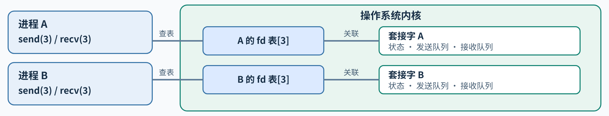
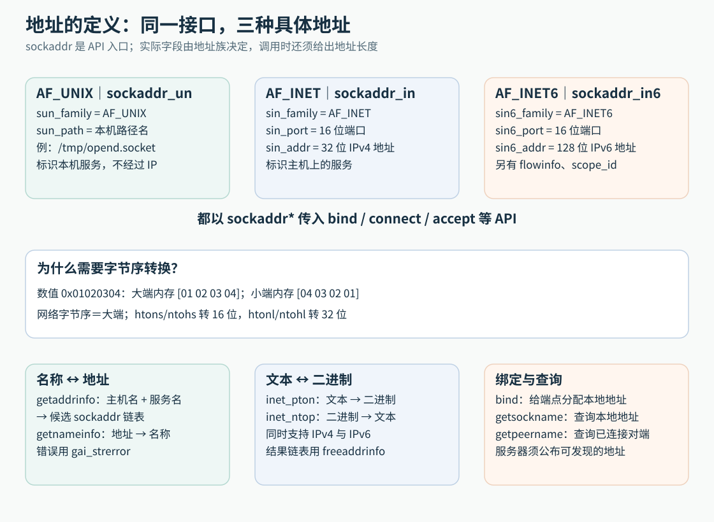
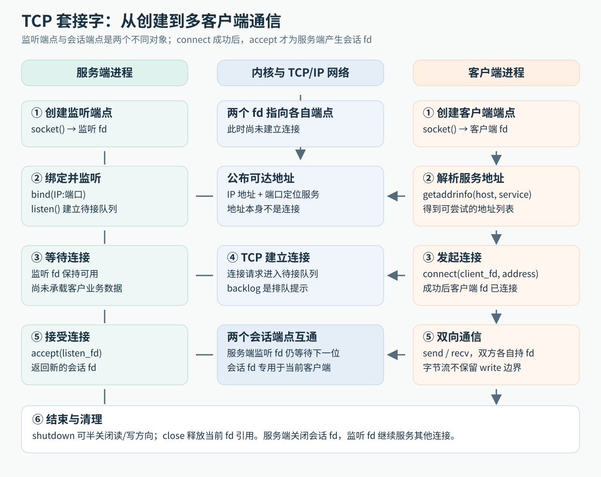

# 套接字接口、寻址与数据传输

> 范围：POSIX/Linux 套接字的创建、寻址、连接、数据传输与选项。接口行为以 POSIX 定义和 Linux man-pages 的对应手册为依据。通用 TCP/IP 协议原理归网络知识库。

**Q1: [learning] 套接字是什么？套接字描述符是什么？**

1. **套接字：**内核维护的通信端点，是通信一方用来收发数据的对象。内核保存它的状态和收发队列。
2. **套接字描述符：**进程用来访问该端点的文件描述符（fd，file descriptor），本质是一个整数编号。进程把它传给 send、recv 等调用。fd 不是套接字本身，编号只在本进程内有意义。



图中两行是独立示例，不表示两个套接字已连通。连线只表示访问关系，省略中间的打开文件表项。

**Q2: [learning] 套接字和描述符由谁维护，数量怎样确定？**

内核维护套接字对象和各进程的 fd 表。套接字数量随调用动态变化，受 fd 上限、系统文件表和内存等资源限制。

**Q3: [learning] socket 函数的声明、参数和返回值怎样读？**

```c
#include <sys/socket.h>
int socket(int domain, int type, int protocol);
```

socket() 接收三个参数，依次是通信域、套接字类型和具体协议。它们共同决定要创建哪种通信端点。调用成功返回 fd；失败返回 -1 并设置 errno。下面按参数顺序说明各自的作用。

1. **domain（通信域）：选择在哪类通信体系中通信。**常量前缀 AF 是 Address Family（地址族）的缩写。domain 选择通信所用的地址族，并决定后续地址格式。常见值有：
    1. `AF_UNIX`：本机进程间通信，地址通常是本地路径，不使用 IP 地址和网络端口。
    2. `AF_INET`：IPv4 通信，后续地址通常用 `sockaddr_in` 表示。
    3. `AF_INET6`：IPv6 通信，后续地址通常用 `sockaddr_in6` 表示。

2. **type（套接字类型）：选择数据如何交付给应用。**
    1. `SOCK_STREAM`：把数据当作连续字节流。假设发送方先后发送“ABC”和“DEF”，接收方可能一次读到“ABCDEF”，也可能分几次读到；收发调用的边界不会保留。因此应用协议要规定如何识别一条完整消息，例如用长度字段或分隔符。TCP 常使用这种类型；`AF_UNIX` 也可提供相同的流式收发方式，用于本机进程通信。
    2. `SOCK_DGRAM`：把数据当作一条条独立报文。每次发送形成一条数据报，接收方按报文读取，边界会保留。IPv4/IPv6 常用 UDP 承载这类报文；UDP 报文可能丢失或乱序。`SOCK_DGRAM` 是数据交付类型，UDP 是具体协议，不能画等号；其他通信域的数据报有各自的交付保证。

   所以，`SOCK_STREAM` 收发的是连续字节，消息边界由应用定义；`SOCK_DGRAM` 收发的是有边界的报文。类型描述交付方式，不单独指定具体协议。

3. **protocol（具体协议）：在 domain 和 type 允许的范围内选择协议。**传 `0` 表示让系统为该组合选择默认协议，不是“没有协议”。例如 IPv4 的 `SOCK_STREAM` 通常默认 TCP，IPv4 的 `SOCK_DGRAM` 通常默认 UDP；需要明确指定时可传 `IPPROTO_TCP` 或 `IPPROTO_UDP`。protocol 也不是端口号。

看三个组合的差别：

1. `socket(AF_UNIX, SOCK_STREAM, 0)`：本机地址体系 + 字节流语义 + 该组合的默认协议。
2. `socket(AF_INET, SOCK_STREAM, 0)`：IPv4 地址体系 + 字节流语义 + 通常为 TCP。
3. `socket(AF_INET, SOCK_DGRAM, 0)`：IPv4 地址体系 + 数据报语义 + 通常为 UDP。

调用成功只创建本地套接字并返回 fd；还没有指定本地地址、连接对端或开始收发。后续是否需要 bind、connect 或 listen，由通信角色和类型决定。

**Q4: [learning] socket() 创建了什么？domain、type、protocol 三个参数分别决定什么？**

socket() 请求内核创建端点，并返回访问它的 fd；调用本身不绑定地址，也不建立连接。

- **domain** 选地址族，**type** 选数据语义，**protocol** 选具体协议，0 表示默认值。
- 组合必须受系统支持。例如 AF_INET + SOCK_STREAM 通常对应 TCP，AF_INET + SOCK_DGRAM 通常对应 UDP。
- 创建后按角色继续调用 bind、connect、listen，或直接使用数据报套接字。

**Q5: [learning] SOCK_STREAM、SOCK_DGRAM、SOCK_SEQPACKET、SOCK_RAW 与 SOCK_RDM 的语义分别是什么？**

类型描述数据交付方式；具体可靠性还取决于域和协议。

1. **SOCK_STREAM：**有序双向字节流，不保留发送调用边界；常用于 TCP。
2. **SOCK_DGRAM：**保留报文边界；IPv4/IPv6 常对应 UDP，UDP 不保证交付和顺序。Unix domain 数据报语义可能不同。
3. **SOCK_SEQPACKET：**面向连接、可靠有序且保留记录边界；支持范围依系统和域而定。
4. **SOCK_RAW：**访问较低层协议数据；Linux 通常要求 CAP_NET_RAW。
5. **SOCK_RDM：**可靠但不保证顺序的数据报类型，支持并不普遍。

**Q6: [learning] IPPROTO_IP、IPPROTO_IPV6、IPPROTO_TCP、IPPROTO_UDP、IPPROTO_ICMP 与 IPPROTO_RAW 分别标识什么？**

IPPROTO 常量标识协议或协议选项层级，不是套接字类型或端口号。

- **IPPROTO_IP / IPPROTO_IPV6：**IPv4 / IPv6 层。
- **IPPROTO_TCP / IPPROTO_UDP：**TCP / UDP，可用于显式选协议或设置对应层选项。
- **IPPROTO_ICMP：**IPv4 ICMP 协议。
- **IPPROTO_RAW：**Linux 原始 IP 套接字相关特殊值，构包方式和权限依接口而定。

socket() 的 protocol 参数传 0 表示使用该域与类型的默认协议。

**Q7: [learning] 套接字描述符与普通文件描述符有哪些共同点和不同点？**

套接字 fd 由进程 fd 表管理，可用 close、dup、fork 和 poll；已连接流套接字也可用 read/write。它没有普通文件的偏移量，不能 lseek。

- 多个 fd 可引用同一套接字；关闭一个引用不一定销毁对象。
- 需要地址、消息标志或辅助数据时，用 send/recv 家族。
- fd 的存在不意味着 mmap、文件锁等普通文件语义适用。

**Q8: [learning] close() 与 shutdown() 怎样影响共享引用和双向连接？**

**close()** 关闭当前 fd 引用；**shutdown()** 关闭套接字的收发方向，即使还有 dup/fork 产生的其他 fd。

- **SHUT_RD：**停止接收。
- **SHUT_WR：**停止发送；TCP 对端读完已发送数据后会观察到写方向结束，本端仍可接收，适合“发完请求再读响应”。
- **SHUT_RDWR：**同时停止收发，但仍需 close(fd)。

EOF 时机还受排队数据、协议状态和其他引用影响。

**Q9: [learning] 主机字节序、网络字节序与大小端分别是什么意思？**

字节序规定多字节整数在内存中的字节排列。网络字节序是大端，主机字节序由机器决定。

以 `0x01020304` 为例：大端按 `01 02 03 04` 存放，小端按 `04 03 02 01` 存放。跨机器传输时按协议转换，不能直接发送本机内存表示。

**Q10: [learning] htons、htonl、ntohs 和 ntohl 各转换什么？为什么不能手写固定交换顺序？**

接口在主机字节序与网络大端序之间转换，按平台决定是否交换字节：

- `htons` / `htonl`：16 / 32 位主机序转网络序。
- `ntohs` / `ntohl`：16 / 32 位网络序转主机序。

端口常用 htons；读取后用 ntohs。不要对地址字节数组、文本 IP 或已是网络序的字段重复转换，也不要手写固定字节反转。

**Q11: [learning] 为什么套接字 API 使用 sockaddr 指针与地址长度，而不只传一个 IP 字符串？**

各通信域的地址结构不同。通用接口用 sockaddr 指针加长度承载地址；IP 字符串本身不包含完整地址信息，如端口、IPv6 scope ID 或 Unix 路径。

- 输入时传具体结构及其实际长度，地址族须与套接字兼容。
- 输出时长度参数先给缓冲区容量，返回后表示实际地址长度；注意检查截断。
- 使用 sockaddr_in、sockaddr_in6、sockaddr_un 的对应长度，不假定结构布局跨平台一致。



**Q12: [learning] sockaddr_in 的 family、port、address 分别是什么格式？**

sockaddr_in 表示 IPv4 端点：

- `sin_family` 填 AF_INET。
- `sin_port` 是 16 位网络序端口，数字端口用 htons 转换。
- `sin_addr` 保存 32 位 IPv4 地址；用 inet_pton 或 getaddrinfo 填充。
- 构造时先清零结构，再设置成员，避免传入未初始化内容。

端口需结合本地地址和协议理解，不能单独唯一标识进程。

**Q13: [learning] sockaddr_in6 比 IPv4 地址结构多了什么，scope ID 何时不可省略？**

sockaddr_in6 表示 IPv6 端点，含地址族、端口、128 位地址及 IPv6 专有字段。

- `sin6_family` 为 AF_INET6；`sin6_port` 使用网络字节序；`sin6_addr` 用 inet_pton 等接口填充。
- `sin6_scope_id` 指定链路本地等作用域地址使用的接口，否则目的范围可能不明确。
- 普通应用通常不需自行设置 `sin6_flowinfo`。

文本地址的压缩写法不能直接复制进二进制字段。

**Q14: [learning] inet_pton 与 inet_ntop 分别转换什么，和旧 IPv4 专用转换接口有什么差别？**

`inet_pton` 将 IPv4/IPv6 文本转为二进制地址；`inet_ntop` 做反向转换。调用时明确传 AF_INET 或 AF_INET6。

- inet_pton 返回 1 表示成功、0 表示格式无效、-1 表示调用错误。
- inet_ntop 需要足够大的输出缓冲区，可用 INET_ADDRSTRLEN 或 INET6_ADDRSTRLEN。
- 旧接口 inet_addr/inet_ntoa 仅支持 IPv4，且错误处理或存储行为不理想；新代码优先用上述接口。

它们不做 DNS 查询；主机名解析用 getaddrinfo。

**Q15: [learning] gethostent、getnetent、getprotoent 和 getservent 查询的分别是什么？为什么新代码不应把它们作为统一寻址入口？**

这些传统 netdb 接口查询不同数据库对象：

- **gethostent：**主机名与地址记录。
- **getnetent：**网络名称与网络编号。
- **getprotoent：**协议名称与协议编号，如 TCP。
- **getservent：**服务名、传输协议与端口；同名服务可有 TCP/UDP 不同记录。

数据库来源由系统配置决定。新应用通常用 getaddrinfo 将主机名和服务名解析为可直接尝试的地址，并用 freeaddrinfo 释放结果。

**Q16: [learning] gethostbyname、gethostbyaddr、getservbyname 和 getservbyport 与 getaddrinfo 的关系是什么？**

旧接口分别查主机或服务数据库；getaddrinfo/getnameinfo 提供更适合 IPv4/IPv6 的统一地址转换。

- `gethostbyname` 按主机名查记录；`gethostbyaddr` 按地址做反向查询。
- `getservbyname` 按服务名和协议查端口；`getservbyport` 按端口和协议查登记服务名。
- 数据库结果不证明主机在线、端口可达或身份可信。新代码优先使用 getaddrinfo/getnameinfo。

**Q17: [learning] hostent、netent、protoent 和 servent 结构里的名称、别名、编号分别指什么？**

四种传统结构对应不同对象，名称、别名与编号不可混用：

- **hostent：**主机名、别名和一个或多个二进制地址。
- **netent：**网络名、别名及网络编号，不是主机完整地址。
- **protoent：**协议名、别名及协议编号，不是端口。
- **servent：**服务名、别名、网络序端口及传输协议名。

这些记录不能证明服务在线或身份可信。

**Q18: [learning] gethostent 等逐条查询接口为什么还有 set*ent 与 end*ent 配套函数？**

传统 `get*ent` 接口按数据库顺序逐条枚举；对应的 `set*ent` 重置遍历，`end*ent` 结束遍历并清理资源。

调用顺序通常是 set*ent → 重复 get*ent 直到无记录 → end*ent。返回结构可能由库管理，不能假定指针长期有效。多线程及 IPv4/IPv6 通用程序优先使用 getaddrinfo/getnameinfo。

**Q19: [learning] getaddrinfo 如何把主机名与服务名解析为可用的套接字地址？**

getaddrinfo 将主机名 node 和服务名 service 解析为 addrinfo 链表；每项含地址族、类型、协议和 sockaddr，可用于 socket 后的 bind 或 connect。

1. 用 hints 限制 ai_family、ai_socktype、ai_protocol、ai_flags；结果可能有多个候选。
2. 逐项用该项参数创建套接字并尝试操作，失败则 close 后继续。
3. 返回值是 EAI 错误码，不按 -1/errno 处理；用 gai_strerror 解释。
4. 用 freeaddrinfo 释放结果。

解析成功只表示得到候选地址，不代表服务可连接。

**Q20: [learning] getaddrinfo 的 AI_PASSIVE、AI_CANONNAME、AI_NUMERICHOST、AI_NUMERICSERV、AI_ADDRCONFIG 和 AI_V4MAPPED 各改变什么？**

这些标志放在 hints.ai_flags，约束 getaddrinfo 的解析：

- **AI_PASSIVE：**用于 bind；node 为 NULL 时通常生成通配地址。不设置时 NULL 通常生成环回地址。
- **AI_CANONNAME：**请求规范主机名，不代表身份已验证。
- **AI_NUMERICHOST / AI_NUMERICSERV：**要求主机 / 服务为数字形式，跳过名称查询。
- **AI_ADDRCONFIG：**按本机已配置地址族筛选，结果受接口配置影响。
- **AI_V4MAPPED：**在适用条件下用 IPv4 映射地址满足 IPv6 结果请求。

支持细节依系统与 libc；这些标志不保证远端可达。

**Q21: [learning] getnameinfo 如何把套接字地址转换成主机名和服务名，为什么日志常用数字形式？**

getnameinfo 将 sockaddr 转成主机名和服务名，可能触发反向 DNS 或服务数据库查询。

- 提供主机与服务各自的输出缓冲区及长度。
- `NI_NUMERICHOST`、`NI_NUMERICSERV` 强制输出数字地址和端口，避免名称查询。
- 返回 EAI 状态码，不应只检查 errno。

日志通常记录数字地址和端口：查询更直接，且反向解析名称不是身份认证依据。

**Q22: [learning] bind 将什么关联到套接字，为什么服务端常调用它？**

bind 将本地地址关联到已创建的套接字。服务器通常先 bind 再 listen；客户端未显式绑定时，系统通常在 connect 或首次发送时选择本地地址和临时端口。

调用需提供兼容的 fd、sockaddr 地址及该结构的实际长度。成功只表示本地地址绑定完成，不代表已监听或网络可达。地址被占用、不属于本机或权限不足时可能失败。

**Q23: [learning] 通配 IP 地址、环回地址、端口 0 和固定端口分别意味着什么？**

bind 地址决定监听范围；端口 0 与固定端口决定端口由谁选择。

- **通配地址：**监听适用的本地接口；是否能从外部访问仍受路由、防火墙和双栈配置影响。
- **环回地址：**仅供本机访问，适合本地服务。
- **端口 0：**请求系统分配端口；成功后用 getsockname 查询实际值。
- **固定端口：**提供稳定入口，但要处理占用与权限限制。

**Q24: [learning] getsockname 与 getpeername 各查询哪一端地址？**

`getsockname` 查询本地地址；`getpeername` 查询已关联的对端地址。调用方提供 sockaddr 缓冲区和容量，返回长度需按地址族解释。

常用于查询自动分配的本地端口、端口 0 绑定结果，或已连接套接字的对端。地址只反映协议栈端点，不等同于用户身份。

**Q25: [learning] 面向连接的客户端调用 connect 时发生什么，成功返回能证明什么？**

connect 为流套接字发起到指定 sockaddr 的连接。TCP connect 成功表示传输连接建立，可开始收发；不代表应用握手、鉴权或业务处理成功。

失败可能来自地址/路由不可达、连接被拒或超时。Linux 上失败后的套接字可能不适合重用，通常关闭 fd 并新建套接字重试。

**Q26: [learning] connect 遇到瞬时失败时怎样重试，为什么不能对所有错误无限重连？**

只对可能恢复的连接错误重试，并设置次数、总时限和退避。

1. 按 errno 区分拒绝、超时、网络不可达和参数错误。
2. 失败 fd 关闭后新建套接字，再尝试下一地址或稍后重试。
3. 达到时限就报告失败；连接成功后仍需验证应用协议和业务响应。

**Q27: [learning] 非阻塞 connect 返回 EINPROGRESS 后如何判断连接最终是否建立？**

非阻塞流套接字的 connect 返回 EINPROGRESS 表示连接仍在进行。

1. 等待 poll/select 等通知 fd 可写，并设置连接超时。
2. 可写只表示连接过程已有结果；用 getsockopt(SOL_SOCKET, SO_ERROR) 裁决。
3. SO_ERROR 为 0 才表示成功；非 0 是失败。超时取消时关闭 fd。

**Q28: [learning] 对数据报套接字调用 connect 是否建立了 TCP 式连接？**

对常见 UDP 套接字调用 connect 不会握手或建立 TCP 式连接；它在本地设置默认目的地址，并过滤接收来源。

- 未关联时用 sendto 为每个报文指定目的；关联后可用 send/recv。
- 成功不证明对端服务存在，错误可能在收发时才出现。
- UDP 的丢失、重复、乱序和认证仍由应用按需处理。

**Q29: [learning] listen 将套接字变成什么状态，backlog 控制的是什么？**

listen 将已绑定的流套接字设为被动监听端点，供 accept 取出连接；通常顺序是 socket → bind → listen。

backlog 是等待应用 accept 的连接队列请求值，不是服务端并发连接总数。内核可调整上限；Linux TCP 还区分已完成和未完成握手队列。队列满时客户端表现依实现与配置而定。

**Q30: [learning] accept 返回的 fd 与监听 fd 有什么区别，客户端地址从哪里取得？**

accept 从监听队列取出连接并返回新的已连接 fd；监听 fd 继续接收其他客户端。

- 用连接 fd 与该客户端收发，完成后关闭它。
- 可通过 accept 的 sockaddr 参数取得客户端地址；不需要时可传 NULL，也可之后调用 getpeername。
- 每条连接需维护独立状态；地址不等于业务身份。

**Q31: [learning] 阻塞与非阻塞 accept 在没有待处理连接时分别怎样表现？**

阻塞 accept 在无连接时等待；非阻塞 accept 返回 -1 且 errno 为 EAGAIN/EWOULDBLOCK，表示当前无连接可取。

- 事件循环收到监听 fd 可读后可循环 accept，直到 EAGAIN。
- 就绪通知与 accept 之间有竞态，因此事件循环通常将监听 fd 设为非阻塞。
- Linux 的 accept4 可为新 fd 设置 SOCK_NONBLOCK 或 SOCK_CLOEXEC；它不是通用 POSIX 接口。

**Q32: [learning] 什么时候选字节流，什么时候选数据报？**

按业务需要选择数据语义：

- **SOCK_STREAM：**有序字节流，适合连续传输；应用必须自行定义消息边界。TCP 提供传输层重传与排序，不负责业务确认。
- **SOCK_DGRAM：**保留独立报文，适合有界消息；若用 UDP，应用需接受或处理丢失、重复和乱序。
- **SOCK_SEQPACKET：**需要连接、顺序和消息边界时可考虑，但先确认目标系统支持。

不能简单等同“连接可靠、无连接不可靠”；具体语义取决于协议和域。

**Q33: [learning] 已连接套接字为什么既能用 read/write，也能用 send/recv？**

套接字 fd 可用于 read/write；send/recv 额外提供 flags，地址和辅助数据则由其他接口承载。

- **read/write：**基本收发，不带套接字专用 flags。
- **send/recv：**可用 MSG_DONTWAIT、MSG_PEEK 等单次标志。
- **sendto/recvfrom：**传递数据报目的或来源地址。
- **sendmsg/recvmsg：**支持分散缓冲区、地址和控制消息。

无论使用哪组接口，都要处理短读短写与协议消息边界。

**Q34: [learning] send 返回成功的字节数能证明什么，为什么流套接字还要处理短写？**

send 返回本次交给本地套接字层的字节数，不证明对端已读取或处理。流套接字可能短写，应用需从返回偏移继续发送。

- 非阻塞发送缓冲不足时处理 EAGAIN/EWOULDBLOCK，等待可写后续传。
- 对端关闭读方向时可能触发 SIGPIPE 并返回 EPIPE；Linux 可用 MSG_NOSIGNAL 抑制该信号，但仍要处理错误。
- 业务确认需由应用协议单独实现。

**Q35: [learning] sendto 比 send 多了什么，什么时候需要显式目的地址？**

sendto 比 send 多了目的 sockaddr 和长度，常用于未 connect 的数据报套接字，让每次发送选择目的地。

已关联对端时通常用 send；不能用 sendto 随意改写流连接对端。数据报一次发送是一条报文，过大可能报 EMSGSIZE，不保证自动拆成多条业务消息。

**Q36: [learning] msghdr 与 iovec 各组织哪部分数据，sendmsg 能额外发送什么？**

sendmsg 用 msghdr 描述发送内容，iovec 数组可将正文分成多个内存片段，避免应用先拼成连续缓冲区。

- `msg_name`：可选目的地址；`msg_iov`：正文片段；`msg_control`：辅助控制消息，如 Unix domain fd 传递。
- sendmsg 的 flags 参数控制本次调用；它与 msghdr 的字段不同。

分散发送不改变 TCP 字节流语义，对端仍可能分多次读取。

**Q37: [learning] recv 默认等到什么程度才返回，MSG_PEEK、MSG_DONTWAIT 与 MSG_WAITALL 分别改变什么？**

recv 通常有数据可读就返回实际长度，不保证填满缓冲区。

- **MSG_PEEK：**查看队列数据但不移除；后续状态可能变化。
- **MSG_DONTWAIT：**本次调用非阻塞；无数据时返回 EAGAIN/EWOULDBLOCK。
- **MSG_WAITALL：**流套接字尽量等满请求长度，但信号、错误或关闭仍可导致短返回。

数据报缓冲区太小可能截断报文，不能再用下一次 recv 补读其余部分。

**Q38: [learning] recv 返回 0、EAGAIN 和正数分别意味着什么？**

返回值按类型解释：

- **正数：**实际收到的字节数，可能只是业务消息的一部分。
- **TCP 流返回 0：**请求长度非零且队列读完时，通常表示对端有序关闭写方向。
- **数据报返回 0：**可能是一条合法的零长度报文。
- **-1：**检查 errno；EAGAIN、EINTR 和连接错误处理不同。

**Q39: [learning] recvfrom 返回发送方地址时，地址缓冲区和长度参数怎样配合？**

recvfrom 可同时接收数据和发送方地址。调用前将 addrlen 设为地址缓冲区容量，返回后它表示地址长度。

- 返回值是正文长度，不是以 NUL 结尾的字符串长度；零长度报文合法。
- 不需来源地址时，addr 和 addrlen 可按接口契约传 NULL。
- 来源 IP/端口不等于身份，可能受 NAT 或代理影响。

**Q40: [learning] recvmsg 怎样同时取得正文、来源地址和辅助数据？**

recvmsg 将正文、来源地址和辅助数据分别写入 msghdr 指定的 iovec、msg_name 和 msg_control 缓冲区。

接收前设置各缓冲区容量；接收后按返回正文长度及更新后的长度字段解析。检查 `msg_flags` 中的 **MSG_TRUNC**（正文截断）与 **MSG_CTRUNC**（辅助数据截断），尤其是接收 fd 或凭据时。调用 flags 与返回的 msg_flags 不同。

**Q41: [learning] recvmsg 的 MSG_EOR、MSG_TRUNC 与 MSG_CTRUNC 各报告哪一类接收结果？**

这三个标志位于接收后的 `msghdr.msg_flags`：

- **MSG_EOR：**支持记录语义的协议中表示记录结束；TCP 不保留一次 send 的边界。
- **MSG_TRUNC：**数据报正文被截断，不应当作完整请求处理。
- **MSG_CTRUNC：**辅助控制数据被截断；接收 fd 或凭据时必须检查。

它们描述接收状态，不等于返回字节数。

**Q42: [learning] 为什么一次 write 不对应一次 read，流式协议要怎样划定业务消息边界？**

SOCK_STREAM 只保证字节顺序，不保留 send/write 边界；一次发送可被多次读取，多次发送也可一次读到。应用必须定义成帧规则：

- **固定长度：**累积到规定长度。
- **长度前缀：**先读长度再读正文，并限制最大值。
- **分隔符：**读到约定分隔符；正文含分隔符时需转义。
- **关闭界定：**约定半关闭/关闭表示结束，适合一次性内容。

TCP 不定义业务消息边界。

**Q43: [learning] 数据报接收缓冲区不足时会发生什么，为什么不能按字节流方式补读剩余部分？**

数据报接收缓冲区不足时，超出部分通常丢弃或报告截断；下一次接收的是下一条报文，不是剩余字节。

- 限制应用报文大小，并检查平台支持的 MSG_TRUNC 等截断信息。
- 大数据应由应用分块并管理序号、重组和超时，或改用流式传输。
- 可发送大小还受协议、路径 MTU 和系统实现影响。

**Q44: [learning] setsockopt 与 getsockopt 的 level、option、value、length 各承担什么角色？**

setsockopt/getsockopt 按 **level**（选项层）、**optname**（选项名）、**optval**（值缓冲区）和 **optlen**（字节长度）设置或查询端点行为。

- SOL_SOCKET 是通用层；IPPROTO_TCP 等是协议层。
- optval 类型依选项而定，不要假定全是 int。
- 设置时 optlen 是输入长度；查询时先给容量，返回实际长度。

影响 bind/listen/connect 的选项通常要在相应调用前设置；选项可用性依系统而异。

**Q45: [learning] SO_REUSEADDR 解决什么问题，为什么它不等于允许任意两个服务同时绑定同一端口？**

SO_REUSEADDR 放宽部分本地地址重用限制，常用于 TCP 服务重启；规则依系统、协议、地址和连接状态而异。

- 通常在 bind 前设置。
- 它不允许任意两个进程无条件绑定同一地址和端口。
- Linux 的 SO_REUSEPORT 是另一选项，用于特定的多监听场景并有自身规则。

遇到 EADDRINUSE，先检查绑定地址、端口和现有进程，再选择选项。

**Q46: [learning] SO_TYPE、SO_ERROR 与 SO_KEEPALIVE 分别查询或改变什么？**

- **SO_TYPE：**查询套接字类型，如 SOCK_STREAM；不表示连接状态或实际协议名。
- **SO_ERROR：**读取并清除挂起错误；非阻塞 connect 就绪后用它判断最终结果，0 表示成功。
- **SO_KEEPALIVE：**启用支持协议的内核保活探测；用于发现长时间失效连接，不等于业务响应确认。

选项支持和保活参数依系统及协议。

**Q47: [learning] SO_RCVBUF、SO_SNDBUF、SO_RCVLOWAT 与 SO_SNDLOWAT 分别控制哪一层缓冲和阈值？**

缓冲区选项控制内核排队能力，低水位控制就绪阈值；它们不定义业务消息大小或链路带宽。

- **SO_RCVBUF / SO_SNDBUF：**接收 / 发送缓冲容量，受系统上限和实现影响；增大不保证对端处理更快。
- **SO_RCVLOWAT：**接收低水位，影响读取和就绪判断，支持细节依系统版本。
- **SO_SNDLOWAT：**发送低水位；Linux 不允许通过 setsockopt 修改。

调优前先区分应用成帧、内核排队与网络瓶颈。

**Q48: [learning] SO_RCVTIMEO、SO_SNDTIMEO 和 SO_LINGER 分别限制什么等待？**

**SO_RCVTIMEO** 和 **SO_SNDTIMEO** 限制阻塞收发调用等待；**SO_LINGER** 影响关闭时未完成发送的处理。

- 收发超时后可能返回 EAGAIN/EWOULDBLOCK；若已有部分数据，仍可能返回其长度。
- SO_LINGER 的启用状态和秒数影响 close/shutdown 等待行为，异常关闭语义依协议与平台。
- 这些选项不构成端到端业务截止时间；应用需自行限制解析、重试和收发总时长。

**Q49: [learning] SO_BROADCAST、SO_DONTROUTE、SO_DEBUG 与 SO_OOBINLINE 分别适用于什么场景？**

这些 SOL_SOCKET 选项用途不同：

- **SO_BROADCAST：**允许适用的数据报套接字发送广播，不保证网络转发。
- **SO_DONTROUTE：**要求适用发送直达目标而不经网关，不替代路由或隔离策略。
- **SO_DEBUG：**请求内核协议调试信息，支持及权限依系统而定。
- **SO_OOBINLINE：**让 TCP 紧急数据出现在普通接收流中，不提供业务优先级。

**Q50: [learning] TCP 的带外数据和紧急标记是什么，为什么不宜把它当成通用高优先级业务通道？**

TCP urgent 机制用紧急指针标记字节流中的位置，不是独立的高优先级通道。

- **MSG_OOB：**发送或接收协议支持的紧急数据；系统间处理细节可能不同。
- **SO_OOBINLINE：**把紧急数据留在普通接收流；`sockatmark` 可检查是否到达标记位置。
- **SIGURG：**提示紧急状态变化，不替代实际读取或业务确认。

需要高优先级命令时，应在应用协议中定义队列、调度与确认。

**Q51: [learning] O_NONBLOCK、MSG_DONTWAIT、poll/select 和信号驱动 I/O 分别解决什么问题？**

这些机制分别控制调用等待、就绪等待和事件通知：

- **O_NONBLOCK：**设置 fd 对应打开文件描述的非阻塞状态；暂不能完成时返回 EAGAIN/EWOULDBLOCK。共享该对象的 fd 也受影响。
- **MSG_DONTWAIT：**Linux 单次收发的非阻塞标志，不改变 fd 持久状态。
- **poll/select：**等待 fd 可读/可写等；就绪后操作仍可能返回 EAGAIN，事件循环常配合非阻塞 fd。
- **信号驱动 I/O：**用 SIGIO 等通知状态变化，应用仍需执行收发。

**Q52: [learning] F_SETOWN、F_GETOWN、O_ASYNC、SIGIO 和 SIGURG 在信号驱动套接字 I/O 中如何分工？**

信号驱动 I/O 是“内核通知、本机进程再处理”，不是内核替应用完成读写。

- **F_SETOWN / F_GETOWN：**设置 / 查询接收信号的本机进程或进程组。
- **O_ASYNC：**启用 I/O 状态变化通知。
- **SIGIO：**提示普通 I/O 事件；**SIGURG** 提示紧急数据相关状态。

信号可能合并，处理函数受异步信号安全限制；收到信号后仍要检查并读取套接字。

**Q53: [learning] 一个 TCP 服务器从启动到处理多个客户端，套接字调用顺序与职责边界是什么？**

TCP 服务器典型顺序：`socket → bind → listen → accept → 收发 → close`。

1. 解析绑定地址，创建套接字；必要选项在 bind 前设置，再 bind、listen。
2. accept 每次返回一个连接 fd；监听 fd 保持工作以接受其他客户端。
3. 在连接 fd 上按应用协议成帧、处理短读短写，并区分传输成功与业务成功。
4. 用线程、进程或事件循环并发处理；管理超时、fd 资源和关闭路径。



fork/exec/dup2 是可选的连接处理方式，不是服务器必需结构。

**Q54: [learning] 无连接数据报服务器的接收与回复为什么必须保存每条请求的发送方地址？**

无连接数据报服务器通常先 socket、bind，再循环 recvfrom 获取报文及发送方地址，并用 sendto 回复该地址。

- 每条请求都要把地址与请求 ID 一起保存；并发处理时不能用“最近一次来源地址”回复。
- 来源地址不等于业务身份。发送成功也不保证对端收到。
- 需要可靠性时由应用协议处理超时、去重、重传与校验。零长度报文合法，不代表连接关闭。
