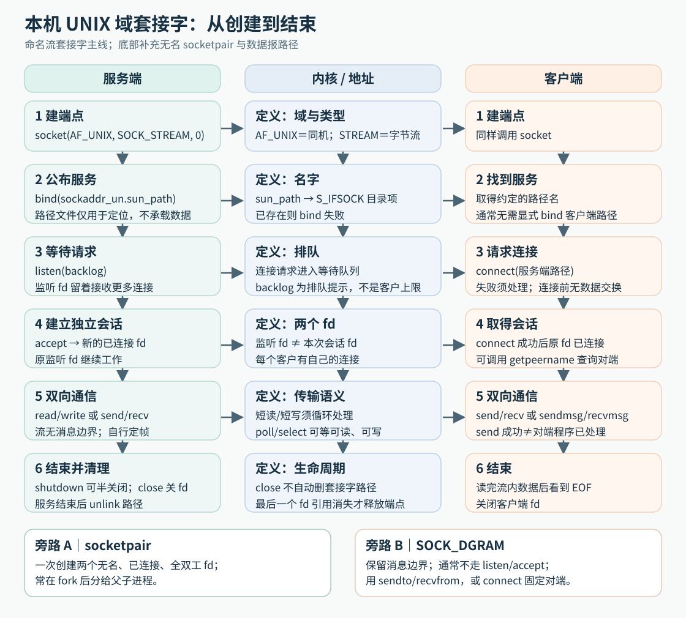
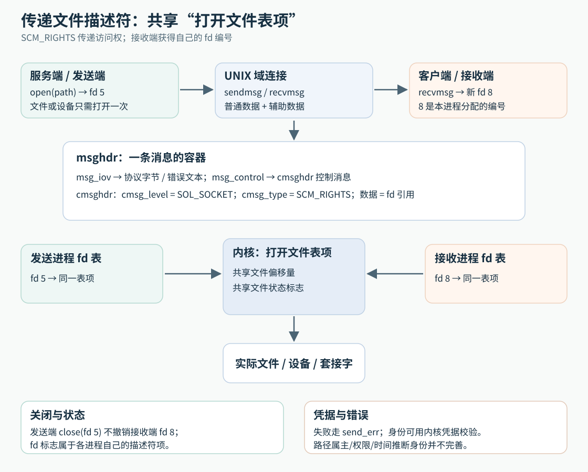

# Unix domain 套接字与描述符传递

> 范围：Unix domain 套接字的本机寻址、描述符与凭据传递、多客户端服务模型。平台行为以 Linux man-pages 的 unix、socketpair、sendmsg、recvmsg、cmsg、open、dup 与 credentials 手册为依据。

**Q1: [learning] Unix domain 套接字是什么，与经环回地址通信的 TCP 套接字有什么不同？**

Unix domain 套接字是同一台机器上的进程间通信端点，使用 AF_UNIX 或 AF_LOCAL 域。它沿用 socket、bind、connect、send、recv 等接口，但不通过 IP 地址和端口寻址，也不需要把本机数据按 TCP/IP 网络路径发送。

1. **地址：**可用文件系统路径或 Linux 抽象命名空间，也可创建无名的已连接套接字对。
2. **传输类型：**Linux 支持 SOCK_STREAM、SOCK_DGRAM 和 SOCK_SEQPACKET。流、数据报和顺序分组的消息边界仍按各自类型判断。
3. **额外能力：**可通过辅助数据传递打开文件描述符和经过内核检查的进程凭据，普通 TCP 套接字不提供同一套本机对象传递语义。
4. **边界：**它不能直接连接另一台机器。性能可能受复制次数、消息大小和实现影响，不能笼统声称一定比环回 TCP 快。

**Q2: [learning] Unix domain 的 SOCK_STREAM、SOCK_DGRAM 与 SOCK_SEQPACKET 怎样区分？**

三种类型主要按连接方式与消息边界区分，不应因为都在本机就假定表现完全一样。

1. **SOCK_STREAM：**面向连接、按序交付字节，不保留每次 write 的边界。需要应用协议自己定义消息长度。
2. **SOCK_DGRAM：**每次发送是一条独立消息，接收保留边界。Linux unix(7) 明确说明其本地数据报可靠且不会重排，但这不是 UDP 的语义，也不代表接收进程已经处理消息。
3. **SOCK_SEQPACKET：**面向连接、按序且保留消息边界。需要同时获得连接状态和记录边界时，可先检查目标内核及系统接口是否支持。

**Q3: [learning] socketpair() 创建的两个端点是什么，为什么适合父子进程通信？**

socketpair 一次创建两个已相互连接且无名的套接字，把两个 fd 写入调用者提供的数组。常见组合是 AF_UNIX、SOCK_STREAM、协议参数 0。每一端都可收发，因此能建立全双工的本机通道。

接口声明及调用结果如下，声明不是完整程序：

```c
#include <sys/socket.h>
int socketpair(int domain, int type, int protocol, int sv[2]);
```

domain 通常为 AF_UNIX，type 选择流或数据报等交付方式，protocol 为 0 选择默认协议。sv 是接收两个 fd 的输出数组，成功返回 0，失败返回 -1 并设置 errno。不能把返回值 0 当成新 fd，两个 fd 实际在 sv[0] 和 sv[1] 中。

1. **创建时：**调用者拿到两个独立 fd。没有服务器路径、bind、listen 或 accept 步骤。
2. **fork 后：**父子进程继承两个 fd，各自关闭不使用的一端，就能通过保留的一端通信。
3. **生命周期：**例如父进程保留 sv[0]，子进程保留 sv[1]，父进程应关闭 sv[1]，子进程应关闭 sv[0]。若父进程还持有 sv[1]，即使子进程关闭它，父进程读 sv[0] 也不能据此期待立即 EOF，因为对端仍有自己的引用。

socketpair 适合已有继承关系或能够直接交付 fd 的进程。彼此无关的进程通常需要有名的服务地址或其他 fd 交付途径。

**Q4: [learning] socketpair 与 pipe 都能连接父子进程，为什么两者不能完全互换？**

pipe 通常提供单向字节通道。socketpair 的两个端点都可双向通信，并可在 Unix domain 上使用套接字消息及辅助数据能力。因此是否只需传字节、是否要全双工以及是否要传 fd，决定了选择。

1. **单向数据流：**pipe 结构简单，适合一个写端到一个读端。
2. **双向对话：**socketpair 不需两条 pipe 就能让两端互发请求与响应。
3. **传递内核对象引用：**需要 SCM_RIGHTS 传文件描述符时，Unix domain 套接字提供对应辅助数据机制，普通 pipe 的字节流不提供此能力。

把数字 fd 写进 pipe 只发送一个整数，不会在另一进程的 fd 表里创建指向同一对象的引用。

**Q5: [learning] socketpair 怎样让 poll 间接等待 XSI 消息队列？**

XSI（X/Open System Interfaces）消息队列使用队列标识符，不能直接放进 poll 的 fd 字段。教材让线程阻塞等待队列，再把消息写到 socketpair，将队列事件转成套接字可读事件。

1. **初始化：**为每个消息队列创建一个 Unix 域数据报 socketpair 和一个接收线程。主循环登记每对端点的一端，线程持有另一端。
2. **接收线程：**在 msgrcv 中等待，收到消息后把正文写进自己的套接字端点。线程与主循环在同一进程中共享 fd 表，不应像 fork 后那样随意关闭“另一个线程要用”的 fd。
3. **主循环：**poll 得到某端点可读后，从该端点读取消息，并据登记关系判断消息队列来源。
4. **选择数据报：**一条队列消息对应一条 socket 报文，接收边界得以保留。若改用普通管道或流端点，就需加入长度头并保存不完整帧，不能假定一次 read 对应一次队列消息。
5. **代价：**增加每队列线程和经套接字的额外数据复制。若只通过套接字发送通知、正文放在线程共享队列中，可减少正文中转，但必须自行实现同步、所有权和队列容量控制，这属于对示例的改造。
6. **阻塞与丢弃：**套接字队列满可能令转发线程阻塞，主循环处理速度因而影响队列接收。教材 msgrcv 使用 MSG_NOERROR，过长消息可被截断，不能把本地数据报可靠性扩大成整条桥接链绝不丢内容。

桥接让主循环统一等待 fd，没有改变 XSI 队列本身的接口。教材的关键点在于转换等待方式，而不是宣称所有 IPC 对象都原生支持 poll。

**Q6: [learning] sockaddr_un 中 sun_family 与 sun_path 各表示什么？**

sockaddr_un 是 Unix domain 套接字使用的地址结构。sun_family 标记 AF_UNIX，sun_path 保存路径名地址或 Linux 抽象地址的字节。它们共同构成可传给 bind、connect 等接口的本地地址。

1. **路径名地址：**sun_path 保存以 NUL 结尾的文件系统路径，路径字节数不得超过目标系统字段容量。结构前部字段布局也可能不同。《Advanced Programming in the UNIX Environment》（APUE）所比较的 FreeBSD 与 macOS 结构在 sun_family 前含 sun_len，而 Linux 与 Solaris 示例没有该字段。
2. **抽象地址：**Linux 中 sun_path 的首字节为 NUL，后续名称由传入的 addrlen 界定。它不是 C 字符串，也不对应文件系统路径。
3. **无名套接字：**未 bind 的流端点或 socketpair 端点可能没有可读取的路径名，不能假定 sun_path 总有内容。

sun_path 长度在不同系统上可能不同。避免把 Linux 的固定容量写成跨 POSIX 平台保证。

**Q7: [learning] 计算 Unix domain 地址长度时，为什么要用 offsetof 而不是盲传路径字符串长度？**

系统调用的 addrlen 描述整个 sockaddr_un 地址结构中实际参与寻址的字节，不只是 sun_path 里的字符数。offsetof(struct sockaddr_un, sun_path) 给出路径字段起始偏移，能适应结构前部在不同系统上的布局差异。

1. **路径名地址：**长度通常至少包含字段偏移、路径字节及终止 NUL。Linux unix(7) 给出 `offsetof(struct sockaddr_un, sun_path) + strlen(sun_path) + 1` 的计算方式。
2. **抽象地址：**首个 NUL 是命名空间标记，其后的名称按精确字节长度计算，可包含 NUL。不能用 strlen 决定长度。
3. **输出地址：**getsockname、getpeername 或 accept 返回的地址长度须先与提供的容量比较。输出被截断时，sun_path 不保证有字符串终止符。

offsetof 来自 stddef.h，返回指定成员的字节偏移。应使用标准宏，不能照抄教材用于解释原理的空指针取成员表达式作为通用实现。教材部分例子未计入终止 NUL，Linux 路径名用法按上述包含 NUL 的长度处理。

sizeof(sockaddr_un) 可在一些路径名调用中使用，但精确长度更能表达地址实际内容。字段容量和调用契约仍以目标平台手册为准。

**Q8: [learning] Unix domain 路径名地址与 Linux 抽象地址在可见性、权限和清理上有什么区别？**

两者都能命名本机端点，但名字存在的位置不同，安全边界也不同。

1. **路径名地址：**bind 在文件系统中创建套接字类型的目录项。路径所在目录的权限影响创建与访问。关闭 fd 不自动删除路径名，服务应在合适时机 unlink 自己创建的条目。
2. **抽象地址：**Linux 专有命名空间，不创建路径文件。文件 mode、umask 和 chmod 不控制它的访问。所有引用关闭后，抽象名字随端点消失。
3. **可移植性：**路径名地址更便于跨 Unix 系统设计。抽象命名空间是 Linux 扩展，不能作为 POSIX 通用接口要求。

无论使用哪种地址，都不能单靠“别人不知道名字”作为访问控制。敏感服务应核验对端身份与实际授权。

**Q9: [learning] 路径名 Unix socket 文件是否保存消息内容，进程退出后为什么可能留下失效路径？**

路径名套接字在文件系统中的条目只用于命名内核通信端点，不保存发送的消息正文，不能像普通文件那样 open 并读取消息。消息经内核套接字队列在进程间交付。

1. **服务运行时：**bind 创建名称，客户端用该名称 connect 或 sendto 找到端点。
2. **服务退出后：**fd 关闭可释放内核端点，但路径目录项可能仍存在。下一次 bind 同一路径会遇到 EADDRINUSE。
3. **清理时：**服务只能安全清理确认属于自己的路径。简单“先 unlink 再 bind”若目录可被其他进程写入，可能删除别人的端点或遇到替换竞态。

先 stat 确认类型再 unlink 仍有两个问题：stat 会跟随符号链接，观察的可能是链接目标，和 unlink 删除的目录项不是同一对象。即使改用 lstat，检查后目录项仍可能被替换，且确认为 socket 也不能证明它已经失效。应使用受控目录与服务实例协调，确认是自己可清理的残留名称后再处理。

**Q10: [learning] 文件系统权限与 Unix socket 对端身份验证是什么关系？**

路径目录与套接字文件权限可限制谁能创建或连接，但它们不完整证明“当前连接者是谁”。Linux 会在连接路径名流套接字或向路径名数据报套接字发送时检查写权限。创建路径还需要所在目录的写与搜索权限。POSIX 不保证所有系统都以相同方式使用 socket 文件权限。

1. **目录权限：**控制谁能搜索目录或创建、替换路径条目，是防止服务地址被抢占的第一层边界。
2. **套接字 mode：**在 Linux 上可约束谁能连接或发送，但不能把跨系统一致性当作前提。
3. **对端凭据：**需要按 UID/GID 授权时，应使用目标平台提供的内核凭据机制，如 Linux 的 SO_PEERCRED 或 SCM_CREDENTIALS。

读到一个客户端自称的 PID、UID，或 stat 到一个客户端路径的 owner，都不能独立完成安全认证。路径可能被替换，身份也可能与持有路径者不同。

**Q11: [learning] 无继承关系的两个本机进程怎样建立 Unix domain 流连接？**

服务器创建 AF_UNIX 流套接字，bind 到受控路径并 listen。客户端创建自己的 AF_UNIX 流套接字，connect 到服务器路径。服务器 accept 后得到只用于该客户端的新 fd，监听 fd 继续等待其他客户端。

1. **服务器地址：**必须在客户端可访问的目录中创建，并处理残留路径与启动竞态。
2. **客户端地址：**流客户端通常不必自行 bind 路径。服务端可在 accept 后通过内核凭据机制取得连接者身份，不应为识别客户端而强制每个客户端制造可被伪造或竞态替换的路径。
3. **消息协议：**连接建立后仍要定义请求长度、响应状态、超时与关闭方式，因为 SOCK_STREAM 不保留调用边界。

本地连接避免网络寻址，但不自动解决并发、鉴权和协议成帧。



**Q12: [learning] 教材的 serv_listen、cli_conn 和 serv_accept 怎样配合？**

它们是教材包装标准套接字调用的辅助函数，不是系统调用。服务端先公布路径，客户端连接该路径，服务端再取得这个客户端专用的连接 fd。

```c
int serv_listen(const char *name);
int cli_conn(const char *name);
int serv_accept(int listenfd, uid_t *uidptr);
```

按连接建立顺序理解：

1. **serv_listen：**检查 name 是否放得进 sun_path，创建 AF_UNIX 流套接字，准备路径地址，再 bind、listen。成功返回监听 fd，负返回值区分失败步骤，errno 保留底层原因。教材先 unlink 旧路径的做法需要额外的路径所有权保护。
2. **cli_conn：**创建客户端端点，绑定由进程 ID 构造的客户端路径并设置权限，再 connect 到服务器 name，成功返回连接 fd。普通 Unix 域流客户端通常不用自行 bind，这里绑定是为了配合教材的路径身份检查。
3. **serv_accept：**用 listenfd 调用 accept，得到新的连接 fd 和客户端地址，再检查客户端路径。若检查通过且 uidptr 非空，把路径所有者写入该输出参数。成功返回连接 fd，失败关闭本次连接并返回负值。
4. **相同与不同的地址：**cli_conn 接收的 name 必须指向服务器公开路径，客户端另行绑定的路径属于客户端自己，两者不能混用。
5. **独用连接：**多个客户连接同一服务地址，服务端仍为每次 accept 得到不同 fd。后续通过连接 fd 区分会话，不是靠不同客户端必须占用不同服务器路径。

示例的声明只说明辅助接口。它们的具体负返回值来自教材实现，不能套用为 POSIX 错误码。

**Q13: [learning] 教材为什么检查客户端 socket 路径，却仍不能可靠认证连接者？**

教材试图用路径的元数据推断客户端有效用户 ID，但路径和连接是两个不同对象。即使检查时路径看起来合理，也不能直接证明它属于当前持有连接的进程。

1. **取得路径：**serv_accept 根据 accept 返回的地址长度提取路径，另行补终止 NUL。不能假定返回的 sun_path 总是完整 C 字符串。
2. **检查内容：**示例检查文件类型是否为 socket、权限是否仅允许所有者读写执行，以及访问、修改和状态变更时间是否足够新，然后读取 st_uid。
3. **推断缺口：**PID 会复用，路径可能被替换或被另一个进程持有，检查和后续使用之间也有时间窗口。时间较新与权限为 0700 不会把路径自动绑定到当前连接身份。
4. **现代 Linux 做法：**在支持的已连接 Unix 域套接字上查询 SO_PEERCRED，或按消息接收内核检查的凭据，再执行授权。内核凭据解决身份来源问题，不替应用决定这个用户能做什么。

教材展示的是历史示例的验证思路，不能把其中“这是当前系统最佳方案”的判断推广到今天的平台。

**Q14: [learning] 把一个打开的 fd 发给另一进程，为什么不能只发送它的整数值？**

fd 整数只在发送进程自己的描述符表中有意义。另一进程的同号 fd 可能引用完全不同的对象，甚至尚未打开。真正的描述符传递要求内核在接收进程的描述符表中建立新的引用。

1. **发送方：**持有某个打开文件描述对应的 fd，可通过 Unix domain 套接字的 SCM_RIGHTS 辅助数据请求内核传递引用。
2. **接收方：**recvmsg 后获得本进程可用的新 fd 编号。编号通常与发送方不同，但指向同一打开文件描述。
3. **引用生命周期：**发送方之后关闭自己的 fd，不会自动使接收方的引用失效。传送途中内核也会维护相应引用，发送方关闭不会使已经成功交付到传输机制的引用立即失效。只有最后引用释放后，底层打开对象才按其规则清理。

因此“传 fd”是传内核对象引用的能力交付，不是拷贝一个整数或重新按路径 open 文件。

**Q15: [learning] SCM_RIGHTS 传递后的两个 fd 共享什么，不共享什么？**

SCM_RIGHTS 的效果近似于把同一打开文件描述复制进另一个进程的 fd 表。两个进程的 fd 编号和描述符级标志各自独立，但共享打开文件描述关联的状态。

1. **共享：**若传的是普通文件，文件偏移及文件状态标志如 O_NONBLOCK 属于打开文件描述，可能被两端共同观察或修改。传 socket 时，两端引用同一个套接字端点状态。
2. **独立：**fd 数字由接收进程分配。FD_CLOEXEC 是描述符级标志，不因两个 fd 指向同一打开文件描述就自动同步。
3. **权限含义：**接收方可使用已经打开的能力，即使它自己不能重新按路径打开该文件。服务器传递前必须验证请求并限制交付对象。

例如双方引用同一普通文件的打开文件描述，子进程 lseek 到偏移 100 后，在已同步且没有其他读写的条件下，父进程查询当前位置也会得到 100。父进程随后读取 20 字节，又会共同推进偏移。若各自重新 open 同一路径，通常有各自的偏移，不能用“都访问同一文件”推断是否共享。

**Q16: [learning] cmsghdr 的 cmsg_len、cmsg_level、cmsg_type 和数据区各表示什么？**

cmsghdr 是 sendmsg/recvmsg 控制消息的头部。一条控制消息由头部和随后数据组成，可表达文件描述符、凭据等不属于普通正文的内容。

1. **cmsg_len：**该条控制消息的实际长度，包含头部及数据，不等同于整个控制缓冲区的分配容量。
2. **cmsg_level：**指明控制消息所属协议层。Unix domain 的 SCM_RIGHTS 和 SCM_CREDENTIALS 使用 SOL_SOCKET。
3. **cmsg_type：**在对应层内指定消息类型。SCM（Socket-level Control Message）表示套接字级控制消息。SCM_RIGHTS 表示传打开文件描述的引用，SCM_CREDENTIALS 表示传内核检查的进程凭据。
4. **数据区：**按类型解释。SCM_RIGHTS 的数据是 fd 整数数组，接收后的整数属于接收进程自己的 fd 表。

控制区可能包含多条消息，还要满足内存对齐要求，因此不能把 msg_control 当成单个固定结构直接强制转换后使用。

**Q17: [learning] CMSG_SPACE、CMSG_LEN、CMSG_DATA、CMSG_FIRSTHDR 与 CMSG_NXTHDR 怎样配合？**

这些宏帮助调用者按平台要求的对齐方式分配、填写和遍历辅助数据。手动假定头部紧贴下一个头部，可能在不同 ABI 上解析错位。

1. **CMSG_SPACE：**计算一条控制消息连同头部、数据及对齐填充所需的缓冲区容量。分配 msg_control 时使用。
2. **CMSG_LEN：**计算这条消息应写入 cmsg_len 的实际长度，不把尾部为下一条消息准备的填充误算进本条内容。
3. **CMSG_DATA：**取得某个 cmsghdr 后的数据区指针。对需要对齐的数据类型，可用 memcpy 与合适的本地对象交换，不假定返回指针满足任意类型对齐。
4. **CMSG_FIRSTHDR：**从 msghdr 控制区取得第一条消息，容量不足时返回 NULL。
5. **CMSG_NXTHDR：**从当前消息移动到下一条合法消息，到末尾或空间不足时返回 NULL。

发送前要清零控制缓冲区并写对 level、type、长度。接收后遍历每条消息时仍要检查类型、长度和 MSG_CTRUNC，不能只看第一条。

**Q18: [learning] SCM_RIGHTS 发送一个 fd 时，各层缓冲区怎样填写？**

发送端需要普通正文和辅助数据两部分。正文负责协议状态，辅助数据描述待交付的内核引用，二者通过同一次 sendmsg 关联。

按一个 fd 的构造过程理解：

1. **正文 iovec：**准备至少一个普通数据字节，例如协议状态，将 iov_base 指向它，iov_len 设为正文长度。Linux Unix 域流套接字传控制消息时要求伴随普通数据，不能只留空正文。
2. **控制缓冲区：**用 CMSG_SPACE(sizeof(int)) 确定容量，并提供满足 cmsghdr 对齐要求的存储。先清零，再将 msg_control 指向它，msg_controllen 设为容量。
3. **控制头：**CMSG_FIRSTHDR 取得第一条消息，cmsg_level 设为 SOL_SOCKET，cmsg_type 设为 SCM_RIGHTS，cmsg_len 设为 CMSG_LEN(sizeof(int))。省略这些字段，内核就无法按传 fd 的控制消息解释载荷。
4. **载荷：**通过 memcpy 将有效 fd 的 int 值写入 CMSG_DATA 指向的数据区。这里填写的是发送进程的 fd，内核接收后为对端建立新 fd，不能预先假定对端编号。
5. **调用：**msg_iov 指向正文数组，msg_iovlen 为元素数。已连接端点无需目的地址，msg_name 与 msg_namelen 置为 NULL 和 0。调用 sendmsg 时另传 flags，普通发送可传 0。
6. **完成：**检查正文发送进度及错误，依据协议决定是否关闭发送方引用。发送成功不等于业务方已认可对象用途，也不是自动撤销发送方引用。

发送两个 fd 时，载荷改为两个 int，两个长度宏的参数都相应改为 2 * sizeof(int)。头部长度与存储容量仍使用不同宏，不能把数据长度直接写成整个控制区长度。



**Q19: [learning] 接收一个或多个文件描述符时怎样解析控制消息？**

接收端要按控制消息的类型与长度取出 fd，并明确每一个已接收 fd 的关闭责任。不能看到 msg_controllen 非零就把第一段数据强转成一个 int。

1. **准备容量：**为预期最大 fd 数分配控制缓冲区，容量用 CMSG_SPACE 计算。每次 recvmsg 前重新填写 msg_control、msg_controllen 和正文 iovec。
2. **检查结果：**先判断 recvmsg 返回值，再检查 MSG_CTRUNC。正文完整而控制数据被截断时，请求仍不完整，不能继续按成功处理。
3. **遍历：**使用 CMSG_FIRSTHDR 和 CMSG_NXTHDR 逐条查找，确认 cmsg_level 为 SOL_SOCKET、cmsg_type 为 SCM_RIGHTS，并验证 cmsg_len 至少包含头部。
4. **解释载荷：**用实际有效长度计算 int 数组的元素数，检查是否符合协议数量。通过 memcpy 将载荷复制到正确对齐的 int 存储，避免假定 CMSG_DATA 的返回地址适合任意强制转换。
5. **多个 fd：**在一条 SCM_RIGHTS 消息的数据区放 int 数组即可表达多个引用。不要把教材习题中的多种可能编码当成所有平台都支持，Linux unix(7) 要求一次发送中每种控制消息类型仅出现一项。
6. **失败清理：**格式错误、数量不符或业务拒绝时，关闭本次已取得的所有 fd。Linux 会关闭因控制区不足或描述符限额而未能交付的多余引用，但已交付部分仍由接收进程负责。

Linux 的 MSG_CMSG_CLOEXEC 可在接收 fd 时设置 FD_CLOEXEC，避免泄漏给之后 exec 的程序。否则要按平台能力设置，并考虑多线程中的竞态。

**Q20: [learning] Unix domain 的 SO_PEERCRED、SCM_CREDENTIALS 与 SCM_CREDS 有什么平台差异？**

连接级查询与消息级辅助数据可以在不同时间点取得对端凭据，但各 Unix 系统提供的接口和凭据结构不同。内核返回的凭据是授权输入，应用仍须按自己的 UID/GID 策略检查。

1. **SO_PEERCRED：**对适用的已连接 Unix domain 套接字，通过 getsockopt 查询对端凭据。Linux 返回的是连接建立或 socketpair 创建等特定时点的凭据快照。
2. **SO_PASSCRED：**在接收端启用后，使后续消息可以带 SCM_CREDENTIALS 控制消息，适合按消息观察发送方。
3. **SCM_CREDENTIALS：**Linux 控制消息里的 ucred 含 pid、uid、gid。发送方显式提供时须初始化结构，内核会校验调用者是否有权声明这些值。启用 SO_PASSCRED 而发送方未显式提供时，Linux 可生成包含发送者 PID、真实 UID 与真实 GID 的默认凭据。
4. **SCM_CREDS：**《Advanced Programming in the UNIX Environment》（APUE）对 FreeBSD 8.0 的示例使用此类型和 cmsgcred，字段包括 PID、真实/有效 UID、真实 GID 与组列表。Linux 3.2.0 的示例使用 SCM_CREDENTIALS 和 ucred。书中还指出 macOS 10.6.8 不支持该凭据传送方式，Solaris 10 不通过 Unix domain socket 提供它。这些是书中版本的历史对照，不是当前系统支持矩阵。部署时必须查目标系统的对应手册。

SO_PASSCRED 是接收选项，默认未启用。仅分配控制缓冲区不能自动要求接收凭据。教材把 credentials 译作“证书”，这里指内核提供或检查的进程身份信息，不是公钥证书。

不能把对端路径名的 owner 或应用自己在正文填写的 UID 当成等价机制。若进程能切换身份，还要区分连接时快照与每条消息的发送时身份。

**Q21: [learning] send_fd、send_err 和 recv_fd 为什么还要约定正文协议？**

SCM_RIGHTS 只交付打开对象引用，不表达成功、失败或错误说明。教材通过普通正文字节约定状态，再把成功响应与辅助数据中的 fd 关联。

```c
int send_fd(int channel, int fd_to_send);
int send_err(int channel, int status, const char *errmsg);
int recv_fd(int channel, ssize_t (*userfunc)(int, const void *, size_t));
```

按响应类型解释：

1. **成功响应：**send_fd 的 channel 是通信套接字，fd_to_send 是待交付对象。正文是两个零字节，第一个是分隔符，第二个表示成功，同时用 SCM_RIGHTS 携带 fd。fd 为 0 也可能合法，不能以大于 0 判断成功。
2. **失败响应：**send_err 先发 errmsg，再发零分隔字节和非零状态字节，不附 fd。调用方传入的 status 为 -1 至 -255，线上用其绝对值表示。这个状态域是教材协议约定，不等于自动完整传输 errno。
3. **接收响应：**recv_fd 读取普通数据，分隔符前的错误文本交给 userfunc。回调常为 write，参数分别为 STDERR_FILENO、文本地址与字节数，不要求接收缓冲区本来就是结尾为 NUL 的字符串。
4. **返回结果：**状态为 0 时返回接收端自己的新 fd，非零时返回相应负状态。辅助发送函数成功返回 0、失败返回 -1，和 recv_fd 成功返回 fd 的契约不同。
5. **流式解析：**两个状态字节也可能分次读到。接收器必须保留“等待分隔符”“等待状态”等进度，并关联已收到的控制消息。教材检查两个结尾字节位于同一次读取尾部的写法不能直接当作任意分段条件下的通用解析器。

发送遇到部分进度时，也不能无条件重发同一 SCM_RIGHTS，否则可能重复交付引用。协议实现应记录正文进度与控制消息是否已经交付。

**Q22: [learning] open 服务为什么返回描述符，而不转发整个文件内容？**

服务负责打开对象并交付引用，客户端拿到本进程 fd 后直接执行后续 I/O。服务因此可以封装打开过程，而无须持续中转文件内容。

1. **职责分离：**服务器处理路径解析、打开标志和访问策略。客户端只需要一个可用描述符，不必重复这些打开细节。
2. **交互量：**请求传文件名和模式，响应传状态及 fd。真正的文件读写由客户端通过收到的引用完成，避免为全部内容再设计一次服务转发协议。
3. **对象范围：**原则适用于可交付的打开对象，不只普通文件。但后续能调用什么 I/O 仍取决于该对象，收到 fd 不意味着一定能 lseek。
4. **独立服务的价值：**服务实现可以作为独立程序更新并复用，也可在明确授权下拥有不同于客户端的权限。普通库函数运行在调用进程内，不能仅靠链接库获得独立进程的权限边界。
5. **代价：**引入进程通信、错误协议和资源生命周期。权限不同的服务必须先决定哪些请求获准，不能只因技术上能 open 就交付 fd。

**Q23: [learning] 第一版 csopen 怎样启动 opend 并取得文件描述符？**

第一版 csopen 在首次调用时创建全双工通道并启动子进程 opend，之后复用该通道发送打开请求。它是每个客户端配一个服务子进程，不是每次打开文件都 fork 一次。

1. **创建通道：**fd_pipe 用 socketpair 创建两个相连流端点，然后 fork。父子各关闭不用的一端，否则多余引用可能让对端无法及时看到 EOF。
2. **子进程接线：**子进程用 dup2 把自己持有的一端接到标准输入和标准输出，再 exec opend。标准输入读取请求，标准输出用于 send_fd/send_err 回应，两者指向同一个全双工端点。
3. **父进程保留：**父进程将自己的端点存为静态状态，后续 csopen 直接使用。通信失败后需显式关闭并重置状态，否则静态 fd 并不会自动变成可用新连接。
4. **发送请求：**writev 将操作名及空格、路径、空格及十进制模式和结尾 NUL 三段组合成正文。多段 iovec 避免先拼接字符串，但不保证一次 writev 全部写完。
5. **接收结果：**父进程调用 recv_fd，成功取得新 fd 后直接 read 文件，并最终 close。服务子进程自己的原始 fd 可在交付后关闭。

exec 保留的是未设置 FD_CLOEXEC 的描述符。dup2 到标准描述符时应处理源与目标相同的情形，不能随后无条件关闭恰好仍要保留的 fd。

**Q24: [learning] open 请求中的路径、模式和结尾 NUL 各有什么作用？**

教材请求形式为 `open <pathname> <openmode>\0`，它是一段应用协议文本，不是对 open 系统调用参数的内存拷贝。

1. **open：**操作名，服务器用它确认请求类型。这里的文本不是让 shell 执行的命令。
2. **pathname：**待打开对象路径，由服务进程解释。相对路径基于服务的工作目录，客户端与守护进程工作目录不同可能得到不同对象，因此不能默认含义相同。
3. **openmode：**传给 open 的标志按十进制编码成文本。服务器必须检查整数转换是否完整、是否溢出及哪些标志被允许，不能把 atoi 返回 0 当作有效输入的充分证明。
4. **结尾 NUL：**表示这条请求结束，发送长度必须包括它。它是字节值 0，不是文本中的反斜线和数字 0，也不是关闭连接。
5. **格式限制：**教材按空白拆参数，因此包含空格的路径不能原样表达。要支持任意合法路径，需要长度字段或明确的转义规则。
6. **打开标志边界：**示例调用 open(pathname, oflag)，没有提供创建时所需的 mode 参数。不能允许客户端任意传入 O_CREAT 等需要额外参数的模式而继续使用该调用形式。

协议中的“打开模式”与创建文件的权限 mode 不是同一概念，后者必须在支持创建操作时另行定义。

**Q25: [learning] opend 怎样从请求文本走到 send_fd？**

教材把读取、切分参数、验证参数和打开文件分成不同函数。理解这条调用链，才能判断哪个位置应检查协议完整性，哪个位置应执行权限策略。

1. **main：**从通信端点读取请求。示例将当前读取长度直接传给 handle_request，通用实现应先累计到完整帧，再进入后续步骤。
2. **handle_request：**检查请求格式，调用 buf_args 解析。若格式错误，经 send_err 回传说明，不能继续使用上一次请求遗留的路径或标志。
3. **buf_args：**用 strtok 把可修改缓冲区按空白拆成 argv 风格数组，末尾添加 NULL，再调用 cli_args 回调。strtok 会改写原缓冲区，数组中的指针仍指向它。
4. **cli_args：**检查参数个数和操作名，将路径与标志交给请求处理逻辑。教材用全局变量保存它们，适用于串行即时处理，但若改为异步处理，就要把数据复制或转移到独立请求对象。
5. **open：**先完成授权与参数校验，再打开对象。失败时保存 errno 并生成错误响应，成功后通过 send_fd 交付引用。
6. **收尾：**关闭服务器自己的新 fd，客户端仍可通过收到的引用访问对象。解析失败、发送失败和客户端断开也都必须释放本次请求资源。

buf_args 的 argv 数组在函数返回后失效，而它指向的字符受原请求缓冲区生命周期约束。扩大参数数组只能解除数量限制，不能修复这些生命周期或协议问题。

**Q26: [learning] 为什么 opend 不能把一次 read 当成一条请求？**

Unix 域 SOCK_STREAM 和 TCP 一样不保留 write 边界。即使通信仅发生在本机且请求很短，也可能出现一条请求分多次读取，或一次读取带回多条请求。

1. **半条请求：**第一次读到 `open /tmp/a`，第二次才读到模式和 NUL。第一段末尾不是 NUL 并不证明客户端协议错误，可能只是尚未收齐。
2. **多条请求：**一次读到两个 NUL 结束的请求，必须逐条解析，不能只检查最后一个字节为 NUL 就把整个缓冲区当成一条。
3. **持久状态：**每个连接分别保存已收字节、当前帧长度和未处理尾部。读到完整请求后取出一条，剩余部分留给下一条。
4. **资源限制：**在见到分隔符前也要检查最大允许长度和等待期限，防止无结尾输入持续占用内存。
5. **连接结束：**EOF 到来时若还有不完整请求，应按协议报告截断或放弃，不能把尾部自动当成完整请求。

send_fd/recv_fd 的响应同样需要解析进度。使用较大缓冲区、writev 或本机通道都不能免除成帧。

**Q27: [learning] 第二版 open 服务如何让无关客户端共享一个 opend？**

第二版把 opend 改为常驻服务，公开一个 Unix 域监听路径。每个客户端连接它，服务端为各连接维护状态，从而省去每个客户端启动服务子进程的步骤。

1. **客户端：**csopen 首次用 cli_conn 建连，将连接 fd 保存下来，后续继续发送同一种 open 请求并调用 recv_fd。改变的是连接来源，文件描述符响应协议不变。
2. **服务器启动：**处理启动选项，选择前台或守护方式，再用 serv_listen 建立公开入口。这个路径是服务发现入口，不承载文件内容。
3. **新连接：**监听 fd 可读时 accept，登记新连接 fd 和客户身份，加入 select 或 poll 的监视集合。
4. **已有连接：**读取并累计请求，完成授权后执行 open，再把 fd 返回给该连接。不同客户必须有独立的解析进度和响应状态。
5. **成本变化：**一个进程集中管理多个客户，减少进程创建成本，但一次慢 open 或阻塞发送仍可能拖住整个循环。I/O 多路复用不自动使业务处理非阻塞。

客户端断线后应移除监视并释放状态。服务端 fd 数、缓冲内存和打开文件数量仍需受资源上限控制。

**Q28: [learning] client 数组与 pollfd 数组为什么不能随意共用下标？**

client 数组保存业务连接状态，pollfd 数组保存等待事件。只有明确维护同一排列不变量时，两者的同一下标才代表同一个客户端。

1. **教材的 client：**每项保存 fd 和 UID，fd 为 -1 表示空槽。client_add 优先复用空槽，满后扩容，返回新客户在 client 中的下标。client_del 按 fd 找到并清空对应项。
2. **教材的 pollfd：**首项保存监听 fd，客户项放在有效区间。删除客户时用末项填补空位，并缩短有效长度，避免等待大量空槽。
3. **失配例子：**A、B 原在下标 1、2，A 断开后 pollfd 把 B 移到 1，但 client 的 B 仍在 2。此时按 pollfd[1].fd 收请求、按 client[1].uid 取身份，会组合出不属于同一连接的数据。
4. **修正不变量：**可以按 fd 查找客户状态、保存显式映射，或把事件项与业务状态统一移动。不能只让两个数组分别“看起来紧凑”。
5. **扩容注意：**realloc 可能搬迁存储，保存的元素指针会失效。需要可恢复错误处理时，用临时指针承接 realloc，成功后再替换原指针，并初始化新增槽位。

上述失配可由教材图 17-27 的空槽复用规则与图 17-30 的末项搬移规则推演出来。UID 不能仅按事件数组当前位置取用。

**Q29: [learning] select 版服务循环怎样维护集合与扫描范围？**

select 将输入集合改写为当前就绪集合，所以服务器要保存长期集合，每轮复制后再等待。最大 fd 和客户端数组最大下标描述不同范围，不能互换。

```c
#include <sys/select.h>
int select(int nfds, fd_set *readfds, fd_set *writefds,
            fd_set *exceptfds, struct timeval *timeout);
```

按一轮循环理解：

1. **长期登记：**allset 保存监听 fd 和所有客户 fd，FD_SET 加入，FD_CLR 移除。每轮把它复制给临时 readfds，不能把上轮返回集合直接作为下轮完整输入。
2. **参数范围：**nfds 是当前监视的最大 fd 加 1。客户数组的最大使用下标只限制应用遍历客户表，不是 select 的 nfds。
3. **等待选择：**readfds 请求可读，writefds 请求可写，exceptfds 请求协议异常条件，不关心的集合传 NULL。timeout 为 NULL 表示无限等待，零时间值用于立即查询，非零值限制本次等待。
4. **分派：**监听 fd 就绪时接入并登记新客户，连接 fd 就绪时读取数据或处理 EOF、错误。返回值是就绪位总数，返回 0 表示等待超时，返回 -1 时检查 errno。
5. **移除：**客户关闭后同步清除集合位、关闭 fd 和释放业务状态。必要时重新计算最大 fd 与最大下标，减少无效扫描。
6. **容量：**传统 fd_set 受 FD_SETSIZE 限制。即使客户只有几个，如果 fd 编号过大，也不能直接执行 FD_SET。

Linux select 可能修改 timeout，因此重复调用要重设等待时间。等待和实际 I/O 之间状态可能变化，事件循环通常仍配合非阻塞描述符。

**Q30: [learning] poll 版服务循环怎样登记事件并删除客户？**

poll 通过数组逐项指定 fd 和期望事件，用 revents 返回实际事件。数组长度是待检查元素数，不是最大 fd 加 1。

```c
#include <poll.h>
int poll(struct pollfd *fds, nfds_t nfds, int timeout);
```

1. **登记字段：**每项的 fd 为端点编号，events 指定 POLLIN、POLLOUT 等目标事件，revents 由本次调用返回。负 fd 项被忽略，不能把未初始化的值当作空槽。
2. **调用参数：**fds 指向数组，nfds 是参与等待的元素数量，timeout 单位为毫秒。0 表示立即查询，负值表示无限等待。返回正数表示有事件的元素数，0 表示超时，-1 表示错误。
3. **接入新客户：**监听项出现 POLLIN 后尝试 accept，给新连接建立业务状态并加入数组。扩容后须使用新数组地址。
4. **处理已有客户：**按位检查 revents。POLLIN 可与 POLLHUP 同时出现，POLLERR、POLLNVAL 即使未列在 events 中也应处理，不能只写单一相等比较。
5. **删除与搬移：**若用末项填补空位，当前下标还需重新检查，避免跳过搬入项。业务状态映射必须同时保持正确，不能让 UID 或解析缓冲跟错连接。

poll 避免了 fd_set 的固定编号限制，但仍要扫描数组。只有存在待发数据时才关注 POLLOUT，否则可写连接可能使循环持续立即返回。

**Q31: [learning] EOF 或 POLLHUP 能否证明客户端进程已经退出？**

不能。它们描述通信端点的状态，不直接描述整个进程的生死。服务应依据流结束、队列数据和协议决定收尾，而不是把事件翻译成“客户已退出”。

1. **流 EOF：**在正常开放读方向且接收长度大于 0 的条件下，表示对端发送方向已结束且数据读完。客户端可以仅 shutdown 写方向，继续等待服务器响应，进程仍存活。
2. **引用影响：**客户端退出通常会关闭其 fd，但其他进程或重复描述符若仍持有端点，服务端不一定马上看到 EOF。进程退出与最后引用释放不是同一事件。
3. **POLLHUP：**表示挂起条件，接收队列中仍可能有数据。若还需处理最后请求，应先按协议读取剩余数据，不能看到 HUP 就一律丢弃。
4. **教材策略：**示例优先关闭挂起连接，是其服务处理策略。对于采用半关闭表示请求结束的协议，服务仍需保留发送方向交付响应。
5. **收尾状态：**记录已读 EOF、是否存在完整请求、是否还有待发响应，再决定关闭。把这些状态压缩成一个“进程死亡”布尔值会丢失必要信息。

**Q32: [learning] 知道客户端 UID 后，open 服务为什么还需要授权？**

凭据只回答请求来自谁，不回答允许打开哪些对象。open 实际使用服务进程的权限，若服务权限更高且无授权检查，就可能替客户端绕过原有访问限制。

1. **绑定身份：**从可靠的对端凭据取得用户 ID，并将它关联到正确连接，不能直接信任请求正文自报的 UID。
2. **检查操作：**判断该身份是否获准使用目标路径与打开标志。读取、写入、截断和创建的影响不同，不能只检查路径字符串合法。
3. **定位对象：**相对路径、符号链接和路径替换可能改变最终打开对象。检查必须与实际打开的对象一致，不能认为一次 stat 后路径就不再变化。
4. **交付能力：**SCM_RIGHTS 交付后，客户端可使用已打开的访问能力，即使它原本不能按路径重新 open。服务关闭自己的引用不等于撤销客户端能力。
5. **教材边界：**第二版 handle_request 收到 UID 并用于日志，但示例直接 open，没有因此自动按客户端身份访问。记录 UID 不能替代授权实现。

**Q33: [learning] getopt 怎样解释 opend 的启动参数？**

getopt 解析启动进程的 argc/argv，不解析 socket 上传来的 open 请求。opend 用它决定是否以前台调试方式运行。

```c
#include <unistd.h>
int getopt(int argc, char *const argv[], const char *optstring);
extern char *optarg;
extern int optind, opterr, optopt;
```

1. **optstring：**例如字符串 iu:z 表示 i、z 不带参数，u 必须有参数。冒号跟在它修饰的选项字符后，不能理解成所有选项都带参数。opend 只使用 d，表示 -d 无额外参数。
2. **返回值：**每次返回一个选项字符，循环直到返回 -1。遇到未知选项通常返回问号。optstring 首字符为冒号时，缺少必需参数可单独返回冒号。
3. **optarg：**指向当前带参数选项的参数文本，例如 -u 后的用户名。值的有效性及多个选项是否冲突仍由应用检查。
4. **optind：**指向下一个待处理 argv 元素，初始化为 1。一次调用不保证恰好加 1，因为一个元素可能含多个短选项，也可能还要消费参数。
5. **opterr 与 optopt：**opterr 默认非零，允许库输出诊断。opend 设为 0 以自行处理。optopt 保存出错选项字符的整数值，不是字符串指针。
6. **结束标记：**单独的 -- 结束选项解释，后面的 -bar 可作为普通文件名。扫描结束后可从 optind 继续处理非选项参数。
7. **服务行为：**opend 看到 -d 后设置调试和标准错误日志开关，跳过守护化。未传 -d 时走守护进程方式，这由 opend 代码决定，不是 getopt 的默认功能。

GNU libc 还支持重排非选项参数等扩展，跨平台程序应核对目标 libc 的扫描规则。依据：getopt(3) 与教材图 17-28。
